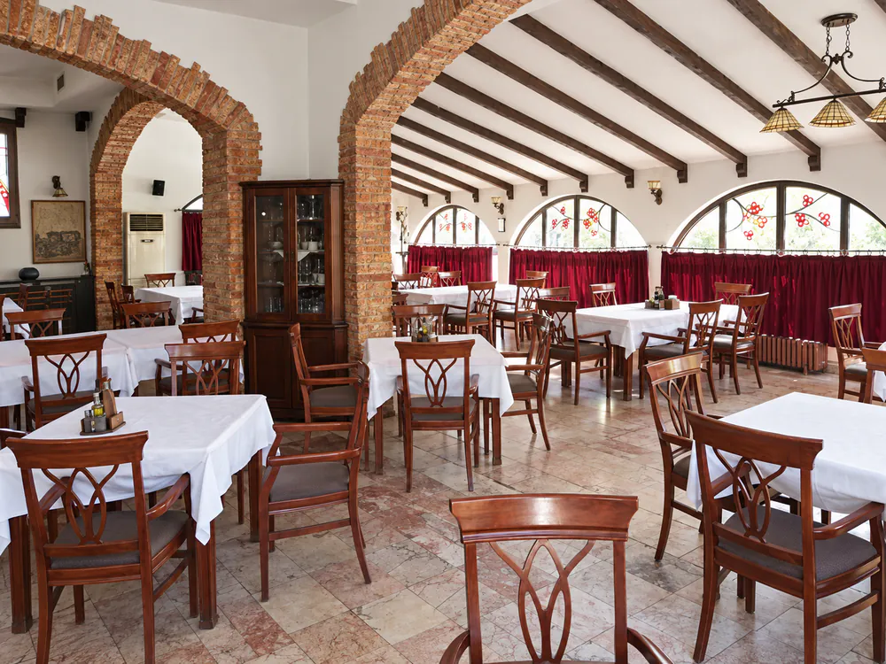

# Hotel Oaza Multi-page Site Implementation Plan

> **For agentic workers:** REQUIRED SUB-SKILL: Use superpowers:subagent-driven-development (recommended) or superpowers:executing-plans to implement this plan task-by-task. Steps use checkbox (`- [ ]`) syntax for tracking.

**Goal:** Turn today's one-page Hotel Oaza site into a bilingual multi-page Eleventy site (Macedonian at `/`, English under `/en/`) that keeps the current look and adds weddings and conferences landing pages, Viber and WhatsApp, the policy pages a card-payment site needs, and a PHP enquiry endpoint for MKhost. cPay gets reserved placeholders only.

**Architecture:** Eleventy 3 builds each Nunjucks page template twice, once per language. A one-off parse5 converter moves today's markup into includes: it swaps every `data-i18n` text for a `` shortcode and writes the text to per-language JSON dictionaries. `sections.css` is split into one file per section and bundled back into a single hashed `site.css`. A plain-PHP endpoint validates enquiries with the same rules as the browser and mails them through PHPMailer. Playwright pixel comparisons prove the look did not change.

**Tech Stack:** Node 22, Eleventy 3.1, Nunjucks, parse5 8, `node:test`, PHP 8 with PHPMailer 6, and Playwright 1.59 in the user's toolkit at `K:\ClaudeProjects\playwright-toolkit`.

**Spec:** `docs/superpowers/specs/2026-11-06-site-structure-design.md`

---

## Ground rules for whoever executes this

- **Paths.** The project root is `C:\Users\Mandzukov\Documents\CodexProjects\opus 5.5 design za hotelo`; in Git Bash that is `"/c/Users/Mandzukov/Documents/CodexProjects/opus 5.5 design za hotelo"`. Commands are for Git Bash, run from the project root, unless a step says otherwise.
- **Git:**
  - Run git only inside the project folder.
  - **Never push.** A push updates the friend's live preview at https://stefce221.github.io/hotel-oaza-site/, and once this work removes the root `index.html`, that preview breaks until the owner switches GitHub Pages to "GitHub Actions" (Task 29).
  - Commit locally at the end of each task with the message given. Stage only the files the task names, never `git add -A`. `Hotel-Oaza-website.zip` in the root belongs to the owner and stays untracked.
  - Every commit message ends with `Co-Authored-By: Claude Opus 5.5 <noreply@anthropic.com>`, passed as a second `-m`.
- **Content rules:**
  - Never add room service, or the old landlines 32 390 899 and 32 394 899.
  - Use only facts already on today's site. Anything only the hotel can confirm is written as a hotel marker, `[[HOTEL: …]]`.
- **Keeping the look:**
  - New CSS goes only in `src/assets/css/additions/`.
  - The split section files in `src/assets/css/sections/` are never edited; `npm run check` hashes them against the original.
  - `src/assets/css/base.css` is edited exactly once, for the menu breakpoint in Task 12.
- **Secrets.** SMTP credentials live only in `/home/oazahote/private/config.php` on the server. The repository holds `deploy/private/config.example.php` with empty values.
- **Out of scope** (each gets its own spec or decision later): cPay payments themselves, the effects decision, new photography, and the launch. Do not point domains or upload anything.

## Where this plan deviates from the spec's file tree, and why

1. **Dictionaries** live in `src/i18n/{mk,en}/*.json` (one file per feature) and `src/i18n/runtime/*.json`, not in `src/_data/mk.json` and `en.json`. Each task adds its own file, and the loader refuses a key defined twice. The build config reads them; they are not global template data.
2. **Page titles and descriptions** are dictionary keys (`page.<key>.title`, `page.<key>.description`), so both languages are checked together. `src/_data/pages.json` holds only URLs and menus.
3. **No `rooms.json`.** The converted rooms include already carries the four room types, and nothing else needs them.
4. **Policy texts** are per-language includes (`src/_includes/legal/<page>.<lang>.njk`), because long legal prose does not fit key-by-key dictionaries. The build fails if either language's file is missing.
5. **Visual parity** uses Playwright `toHaveScreenshot` in the toolkit, because it runs three times (old site, replica, final). The images go in the spec's git-ignored `_backup/baseline/`.
6. **Browser test names.** Browser tests are named `*.check.ts` and run with their own config. The toolkit's plain `npm test` therefore never starts the hotel servers.
7. **One extra hotel marker.** Beyond the spec's list, the build asks for MBS's registered address. Privacy and Card payments must name the operator's address, which may differ from the hotel's.
8. **Live-only files.** `api/`, `cpay/` and `.htaccess` are copied only by the live build, so the public GitHub Pages preview never serves PHP source.
9. **Phone-bar icons** use `currentColor`, like today's Call and Book icons. That keeps them monochrome and on-brand. Ink-coloured icons would disappear on the bar's dark background.

## File map

**Build and config (Node, unit-tested)**

| File | Responsibility |
|---|---|
| `package.json` | Scripts `start`, `build`, `build:preview`, `check`, `test` |
| `eleventy.config.js` | Shortcodes, filters, passthrough copies, marker transform, build-info file |
| `config/i18n.js` | Load dictionaries, translate, escape attributes, runtime script, guest options |
| `config/pages.js` | Page URLs per language, contact URL with prefill query |
| `config/contact.js` | Phone, Viber and WhatsApp links from `site.json` |
| `config/assets.js` | CSS bundle order, content hashes for asset URLs |
| `config/lists.js` | `inOrder()` for halls |
| `config/markers.js` | Find and highlight `[[HOTEL: …]]` markers |
| `scripts/lib/convert-i18n.mjs` + `scripts/convert-index.mjs` | One-off conversion of `index.html` |
| `scripts/lib/css-split.mjs`, `scripts/split-css.mjs`, `scripts/check-css-split.mjs` | Split `sections.css`; prove the join is byte-identical |
| `scripts/i18n-drop.mjs` | Remove retired keys from the converted dictionaries |
| `scripts/lib/site-checks.mjs` + `scripts/check-site.mjs` | `npm run check` |
| `scripts/check-markers.mjs` | Fails the live build while markers remain |
| `test/*.test.mjs` | `node:test` unit and HTTP tests |

**Templates and content (`src/`)**

| File | Responsibility |
|---|---|
| `_data/site.json`, `pages.json`, `languages.json`, `halls.json`, `ogImages.json`, `build.js` | Contact facts, URLs and menus, languages, halls, share images, build env |
| `i18n/en/*.json`, `i18n/mk/*.json`, `i18n/runtime/*.json` | All page text; script strings |
| `_includes/layouts/base.njk` | Head, header, main, footer, phone bar, scripts |
| `_includes/sections/*.njk` | Today's sections (converted) |
| `_includes/partials/*.njk` | Header parts, footer parts, phone bar, enquiry form and section, contact details, teasers, halls, FAQ, CTAs, legal page |
| `_includes/legal/*.{mk,en}.njk` | Terms, Privacy, Card payments text |
| `pages/*.njk` | One template per page key, built for mk and en; `404.njk` |
| `robots.txt.njk`, `sitemap.xml.njk` | Generated files |
| `assets/css/{tokens,base,fx}.css`, `sections/NN-*.css`, `additions/*.css`, `site.11ty.js` | Styles and the bundle |
| `assets/js/main.js`, `fx.js`, `enquiry-rules.js`, `enquiry.js` | Interactions |
| `api/enquiry.php`, `api/lib/*.php`, `api/vendor/phpmailer/*` | Enquiry endpoint |
| `cpay/ok.php`, `cpay/fail.php`, `cpay/lib/placeholder.php` | Reserved cPay addresses |
| `.htaccess`, `api/.htaccess`, `cpay/.htaccess` | Apache rules (live build only) |

**Other**

| File | Responsibility |
|---|---|
| `test/php/run.php`, `test/php/*.test.php` | Plain-PHP unit tests (run by `test/php.test.mjs`) |
| `test/fixtures/enquiry-cases.json` | Enquiry cases the browser rules and the PHP rules must both pass |
| `test/helpers/php.mjs` | Starts PHP's built-in server for the HTTP tests |
| `deploy/private/config.example.php` | Server config template, empty values |
| `.github/workflows/pages.yml` | Preview build to GitHub Pages |
| `README.md`, `docs/owner-checklist.md` | How to work on the site; what the hotel must supply |
| Toolkit `tests/hotel-oaza/playwright.config.ts`, `parity.check.ts`, `site.check.ts` | Pixel parity and browser checks |

---

# Phase A — Foundation and a 1:1 replica

### Task 1: Capture today's site as the visual baseline

**Files:**
- Create: `_backup/old-site/` (git-ignored copy of today's site)
- Create: `K:\ClaudeProjects\playwright-toolkit\tests\hotel-oaza\playwright.config.ts`
- Create: `K:\ClaudeProjects\playwright-toolkit\tests\hotel-oaza\parity.check.ts`

- [ ] **Step 1: Copy today's site out of git**

```bash
mkdir -p _backup/old-site && git archive ba6ab83 index.html assets images | tar -x -C _backup/old-site
ls _backup/old-site
```

Expected: `assets  images  index.html`

- [ ] **Step 2: Write the toolkit config for the hotel checks**

Create `K:\ClaudeProjects\playwright-toolkit\tests\hotel-oaza\playwright.config.ts`:

```ts
import { defineConfig } from "@playwright/test";
import path from "node:path";

/**
 * Hotel Oaza checks. Run from the toolkit folder:
 *   npx playwright test --config=tests/hotel-oaza/playwright.config.ts [parity|site]
 * OAZA_PHASE=old|replica|final picks the parity phase (default final).
 * "old" serves the saved one-page site on 5511; the other phases use the Eleventy dev server on 5510.
 */
export const PROJECT = "C:/Users/Mandzukov/Documents/CodexProjects/opus 5.5 design za hotelo";
const phase = process.env.OAZA_PHASE ?? "final";

const oldSite = {
  command: `python -m http.server 5511 --bind 127.0.0.1 --directory "${PROJECT}/_backup/old-site"`,
  url: "http://127.0.0.1:5511/",
  reuseExistingServer: true,
};
const newSite = {
  command: "npm start",
  cwd: PROJECT,
  url: "http://127.0.0.1:5510/",
  reuseExistingServer: true,
  timeout: 120_000,
};

export default defineConfig({
  testDir: __dirname,
  testMatch: /.*\.check\.ts$/,
  outputDir: path.join(__dirname, "../../test-results/hotel-oaza"),
  snapshotPathTemplate: `${PROJECT}/_backup/baseline/{projectName}/{arg}{ext}`,
  fullyParallel: false,
  workers: 1,
  reporter: [["list"]],
  expect: { toHaveScreenshot: { maxDiffPixelRatio: 0.001, animations: "disabled" } },
  use: { reducedMotion: "reduce", deviceScaleFactor: 1 },
  projects: [
    { name: "phone", use: { viewport: { width: 390, height: 844 } } },
    { name: "desktop", use: { viewport: { width: 1440, height: 900 } } },
  ],
  webServer: phase === "old" ? oldSite : newSite,
});
```

- [ ] **Step 3: Write the parity check**

Create `K:\ClaudeProjects\playwright-toolkit\tests\hotel-oaza\parity.check.ts`:

```ts
import { test, expect, type Page } from "@playwright/test";

/** Pixel parity between today's one-page site and the Eleventy build. See playwright.config.ts for phases. */
const phase = process.env.OAZA_PHASE ?? "final";
const OLD = "http://127.0.0.1:5511/";
const NEW = "http://127.0.0.1:5510";

type Lang = "mk" | "en";
type Target = { name: string; selector: string; final?: Record<Lang, string> };

/** `final` = where the block lives in the multi-page site; blocks without it change on purpose (teasers, links, form, footer). */
const TARGETS: Target[] = [
  { name: "hero", selector: "#top", final: { mk: "/", en: "/en/" } },
  { name: "intro", selector: "#about", final: { mk: "/", en: "/en/" } },
  { name: "rooms-body", selector: "#rooms .rooms__body", final: { mk: "/sobi/", en: "/en/rooms/" } },
  { name: "amenities", selector: "#rooms .amenities", final: { mk: "/sobi/", en: "/en/rooms/" } },
  { name: "dining", selector: "#dining .dining__grid", final: { mk: "/restoran/", en: "/en/restaurant/" } },
  { name: "event-cards", selector: "#events .events__cards" },
  { name: "halls", selector: "#events .halls__list" },
  { name: "aqua", selector: "#aquabella .aqua__grid" },
  { name: "stip-top", selector: "#stip .location__top", final: { mk: "/shtip/", en: "/en/stip/" } },
  { name: "landmarks", selector: "#stip .landmarks", final: { mk: "/shtip/", en: "/en/stip/" } },
  { name: "stip-bottom", selector: "#stip .location__bottom", final: { mk: "/shtip/", en: "/en/stip/" } },
  { name: "contact", selector: "#contact .contact__grid" },
  { name: "footer", selector: ".site-footer" },
];

async function open(page: Page, lang: Lang, target: Target) {
  if (phase === "old") {
    await page.addInitScript((l) => window.localStorage.setItem("oaza-lang", l), lang);
    await page.goto(`${OLD}?fx=off`);
  } else {
    const path = phase === "final" ? target.final![lang] : lang === "mk" ? "/" : "/en/";
    await page.goto(`${NEW}${path}?fx=off`);
  }
  await page.addStyleTag({ content: "#header, .action-bar, .fx-panel { visibility: hidden !important; }" });
  await page.evaluate(async () => {
    document.querySelectorAll<HTMLImageElement>('img[loading="lazy"]').forEach((img) => (img.loading = "eager"));
    await Promise.all(
      Array.from(document.images).map((img) =>
        img.complete
          ? null
          : new Promise((done) => {
              img.addEventListener("load", done);
              img.addEventListener("error", done);
            }),
      ),
    );
    await document.fonts.ready;
  });
}

for (const lang of ["mk", "en"] as const) {
  for (const target of TARGETS) {
    test(`${target.name} ${lang}`, async ({ page }) => {
      test.skip(phase === "final" && !target.final, "changed on purpose in the multi-page site");
      await open(page, lang, target);
      await expect(page.locator(target.selector).first()).toHaveScreenshot(`${target.name}-${lang}.png`);
    });
  }
}
```

- [ ] **Step 4: Capture the baseline from the old site**

```bash
cd /k/ClaudeProjects/playwright-toolkit && OAZA_PHASE=old npx playwright test --config=tests/hotel-oaza/playwright.config.ts parity --update-snapshots=all
```

Expected: `52 passed` (13 blocks × 2 languages × 2 viewports).

- [ ] **Step 5: Prove the capture is stable**

```bash
cd /k/ClaudeProjects/playwright-toolkit && OAZA_PHASE=old npx playwright test --config=tests/hotel-oaza/playwright.config.ts parity
ls "/c/Users/Mandzukov/Documents/CodexProjects/opus 5.5 design za hotelo/_backup/baseline/desktop" | wc -l
```

Expected: `52 passed`, then `26`. If a block fails here, the page is not settling before its screenshot. Fix `open()` before going on, because every later comparison depends on it.

- [ ] **Step 6: No commit**

Nothing in the repository changed: `_backup/` is git-ignored and the toolkit is a separate folder.

---

### Task 2: Scaffold the Eleventy project and move the assets

**Files:**
- Create: `package.json`, `eleventy.config.js`, `src/_data/languages.json`
- Modify: `.gitignore`
- Move: `assets/` → `src/assets/`, `images/` → `src/images/`

- [ ] **Step 1: Create `package.json`**

```json
{
  "name": "hotel-oaza-site",
  "version": "1.0.0",
  "private": true,
  "type": "module",
  "description": "Hotel Oaza website: Eleventy, Macedonian at / and English under /en/",
  "engines": {
    "node": ">=22"
  },
  "scripts": {
    "start": "eleventy --serve --port=5510",
    "build": "cross-env OAZA_ENV=live eleventy",
    "build:preview": "cross-env OAZA_ENV=preview PATH_PREFIX=/hotel-oaza-site/ eleventy",
    "test": "node --test \"test/**/*.test.mjs\""
  }
}
```

- [ ] **Step 2: Install the build tools**

```bash
npm i -D @11ty/eleventy@^3.1.8 parse5@^8.1.0 cross-env@^7.0.3
```

Expected: `added … packages`; `package.json` now has a `devDependencies` block and `package-lock.json` exists.

- [ ] **Step 3: Move the assets under `src/`**

```bash
mkdir -p src && git mv assets src/assets && git mv images src/images
```

- [ ] **Step 4: Ignore build output**

Append to `.gitignore`:

```
node_modules/
_site/
```

- [ ] **Step 5: Create the minimal config and the language list**

Create `eleventy.config.js`:

```js
/* Hotel Oaza — Eleventy config (grows in Task 8). */
export default function (eleventyConfig) {
  eleventyConfig.addPassthroughCopy({
    "src/images": "images",
    "src/assets/img": "assets/img",
    "src/assets/js": "assets/js",
  });

  return {
    dir: { input: "src", output: "_site", includes: "_includes", data: "_data" },
    pathPrefix: process.env.PATH_PREFIX || "/",
    templateFormats: ["njk", "11ty.js"],
    htmlTemplateEngine: "njk",
  };
}
```

Create `src/_data/languages.json`:

```json
["mk", "en"]
```

- [ ] **Step 6: Build once**

```bash
npx eleventy
ls _site
```

Expected: a line like `[11ty] Copied … Wrote 0 files`, then `assets  images`.

- [ ] **Step 7: Commit**

```bash
git add package.json package-lock.json eleventy.config.js src/_data/languages.json .gitignore src/assets src/images
git commit -m "chore: scaffold Eleventy and move assets under src/" -m "Co-Authored-By: Claude Opus 5.5 <noreply@anthropic.com>"
```

---

### Task 3: Translation helpers (`config/i18n.js`)

**Files:**
- Create: `config/i18n.js`
- Test: `test/i18n.test.mjs`

- [ ] **Step 1: Write the failing tests**

Create `test/i18n.test.mjs`:

```js
import { test } from "node:test";
import assert from "node:assert/strict";
import { mkdirSync, mkdtempSync, writeFileSync } from "node:fs";
import { tmpdir } from "node:os";
import path from "node:path";
import vm from "node:vm";
import {
  createTranslator,
  escapeAttr,
  guestOptionsHtml,
  langFromUrl,
  loadDictionaries,
  loadRuntime,
  missingKeys,
  runtimeScript,
} from "../config/i18n.js";

function fixture(files) {
  const dir = mkdtempSync(path.join(tmpdir(), "oaza-i18n-"));
  for (const [rel, data] of Object.entries(files)) {
    const file = path.join(dir, rel);
    mkdirSync(path.dirname(file), { recursive: true });
    writeFileSync(file, JSON.stringify(data));
  }
  return dir;
}

test("loadDictionaries merges every file of a language", () => {
  const dir = fixture({ "mk/a.json": { x: "Х" }, "mk/b.json": { y: "У" }, "en/a.json": { x: "X", y: "Y" } });
  assert.deepEqual(loadDictionaries(dir), { mk: { x: "Х", y: "У" }, en: { x: "X", y: "Y" } });
});

test("loadDictionaries refuses a key defined twice", () => {
  const dir = fixture({ "mk/a.json": { x: "1" }, "mk/b.json": { x: "2" }, "en/a.json": {} });
  assert.throws(() => loadDictionaries(dir), /Duplicate key "x" in mk\/b\.json/);
});

test("loadRuntime merges runtime files per language", () => {
  const dir = fixture({
    "runtime/a.json": { en: { a: "A" }, mk: { a: "А" } },
    "runtime/b.json": { en: { b: "B" }, mk: { b: "Б" } },
  });
  assert.deepEqual(loadRuntime(dir), { en: { a: "A", b: "B" }, mk: { a: "А", b: "Б" } });
});

test("the translator returns text and fails loudly on a missing key", () => {
  const t = createTranslator({ mk: { hi: "Здраво" }, en: { hi: "Hello" } });
  assert.equal(t("mk", "hi"), "Здраво");
  assert.equal(t("en", "hi"), "Hello");
  assert.throws(() => t("en", "bye"), /Missing en text for "bye"/);
  assert.throws(() => t("de", "hi"), /Unknown language "de"/);
});

test("missingKeys lists keys that exist in only one language", () => {
  assert.deepEqual(missingKeys({ mk: { a: "1", b: "2" }, en: { a: "1", c: "3" } }), ["en: b", "mk: c"]);
  assert.deepEqual(missingKeys({ mk: { a: "1" }, en: { a: "1" } }), []);
});

test("langFromUrl reads the language from the page URL", () => {
  assert.equal(langFromUrl("/en/"), "en");
  assert.equal(langFromUrl("/en/rooms/"), "en");
  assert.equal(langFromUrl("/"), "mk");
  assert.equal(langFromUrl("/sobi/"), "mk");
  assert.equal(langFromUrl("/404.html"), "mk");
  assert.equal(langFromUrl(false), "mk");
});

test("escapeAttr escapes quotes and brackets but keeps existing entities", () => {
  assert.equal(
    escapeAttr('Say "hi" <b> & go &amp; &#8212; &mdash;'),
    "Say &quot;hi&quot; &lt;b&gt; &amp; go &amp; &#8212; &mdash;",
  );
});

test("runtimeScript defines window.oazaI18n with lang, t() and onChange()", () => {
  const sandbox = { window: {} };
  vm.runInNewContext(runtimeScript({ "nights.many": "{n} nights" }, "en"), sandbox);
  const i18n = sandbox.window.oazaI18n;
  assert.equal(i18n.lang, "en");
  assert.equal(i18n.t("nights.many", { n: 3 }), "3 nights");
  assert.equal(i18n.t("unknown.key"), "unknown.key");
  assert.equal(typeof i18n.onChange, "function");
});

test("runtimeScript cannot close its own script tag", () => {
  assert.doesNotMatch(runtimeScript({ x: "</script><b>" }, "en"), /<\/script>/);
});

test("guestOptionsHtml labels one guest, many guests and 10+", () => {
  const html = guestOptionsHtml({ "guest.one": "{n} guest", "guest.many": "{n} guests", "guest.more": "{n} guests" }, "2");
  assert.match(html, /<option value="1">1 guest<\/option>/);
  assert.match(html, /<option value="2" selected>2 guests<\/option>/);
  assert.match(html, /<option value="10\+">10\+ guests<\/option>/);
  assert.equal(html.match(/<option/g).length, 10);
});
```

- [ ] **Step 2: Run the tests to see them fail**

Run: `npm test`
Expected: FAIL with `Cannot find module` … `config/i18n.js`.

- [ ] **Step 3: Implement `config/i18n.js`**

```js
/* Hotel Oaza — page text: dictionaries per language, the translator, and helpers used by shortcodes. */
import { existsSync, readdirSync, readFileSync } from "node:fs";
import path from "node:path";

export const LANGS = ["mk", "en"];
export const GUEST_VALUES = ["1", "2", "3", "4", "5", "6", "7", "8", "9", "10+"];

function jsonFiles(dir) {
  return existsSync(dir) ? readdirSync(dir).filter((f) => f.endsWith(".json")).sort() : [];
}

function readJson(file) {
  return JSON.parse(readFileSync(file, "utf8"));
}

/** Merge `into` with `entries`, refusing a key that is already there. */
function mergeInto(into, entries, where) {
  for (const [key, value] of Object.entries(entries)) {
    if (key in into) throw new Error(`Duplicate key "${key}" in ${where}`);
    into[key] = value;
  }
}

/**
 * Read src/i18n/<lang>/*.json into one table per language.
 * @param {string} dir
 * @returns {Record<string, Record<string, string>>}
 */
export function loadDictionaries(dir) {
  const dicts = {};
  for (const lang of LANGS) {
    const table = {};
    for (const file of jsonFiles(path.join(dir, lang))) {
      mergeInto(table, readJson(path.join(dir, lang, file)), `${lang}/${file}`);
    }
    dicts[lang] = table;
  }
  return dicts;
}

/**
 * Read src/i18n/runtime/*.json (each `{ en: {...}, mk: {...} }`) into one table per language.
 * @param {string} dir
 * @returns {Record<string, Record<string, string>>}
 */
export function loadRuntime(dir) {
  const runtime = Object.fromEntries(LANGS.map((lang) => [lang, {}]));
  for (const file of jsonFiles(path.join(dir, "runtime"))) {
    const data = readJson(path.join(dir, "runtime", file));
    for (const lang of LANGS) mergeInto(runtime[lang], data[lang] ?? {}, `runtime/${file} (${lang})`);
  }
  return runtime;
}

/**
 * @param {Record<string, Record<string, string>>} dicts
 * @returns {(lang: string, key: string) => string}
 */
export function createTranslator(dicts) {
  return function t(lang, key) {
    const table = dicts[lang];
    if (!table) throw new Error(`Unknown language "${lang}"`);
    const value = table[key];
    if (typeof value !== "string") throw new Error(`Missing ${lang} text for "${key}"`);
    return value;
  };
}

/** Keys present in one language but not the other, as "<lang that lacks it>: <key>". */
export function missingKeys(dicts) {
  const out = [];
  for (const lang of LANGS) {
    for (const other of LANGS) {
      if (other === lang) continue;
      for (const key of Object.keys(dicts[lang])) if (!(key in dicts[other])) out.push(`${other}: ${key}`);
    }
  }
  return out;
}

/** English pages live under /en/; everything else (including /404.html) is Macedonian. */
export function langFromUrl(url) {
  return typeof url === "string" && url.startsWith("/en/") ? "en" : "mk";
}

const ENTITY = /^&(?:[a-zA-Z][a-zA-Z0-9]*|#\d+|#x[0-9a-fA-F]+);/;

/** Escape text for a double-quoted attribute; entities already in the text (from today's markup) are kept. */
export function escapeAttr(value) {
  let out = "";
  for (let i = 0; i < value.length; i += 1) {
    const ch = value[i];
    if (ch === "&") out += ENTITY.test(value.slice(i)) ? "&" : "&amp;";
    else if (ch === '"') out += "&quot;";
    else if (ch === "<") out += "&lt;";
    else if (ch === ">") out += "&gt;";
    else out += ch;
  }
  return out;
}

/** Inline script that gives main.js and fx.js today's window.oazaI18n API (lang, t, onChange) for one language. */
export function runtimeScript(strings, lang) {
  const json = JSON.stringify(strings).replace(/</g, "\\u003c");
  return (
    "window.oazaI18n=(function(s){return{lang:" +
    JSON.stringify(lang) +
    ',t:function(k,v){var r=s[k]||k;if(v){Object.keys(v).forEach(function(n){r=r.split("{"+n+"}").join(v[n]);});}return r;},' +
    "onChange:function(){}};})(" +
    json +
    ");"
  );
}

/** The 1…10+ guest options, labelled with the runtime guest.one / guest.many / guest.more strings. */
export function guestOptionsHtml(strings, selected) {
  return GUEST_VALUES.map((value) => {
    const key = value.includes("+") ? "guest.more" : value === "1" ? "guest.one" : "guest.many";
    const label = strings[key].split("{n}").join(value);
    return `<option value="${value}"${value === selected ? " selected" : ""}>${label}</option>`;
  }).join("");
}
```

- [ ] **Step 4: Run the tests to see them pass**

Run: `npm test`
Expected: PASS, `# pass 10`, `# fail 0`.

- [ ] **Step 5: Commit**

```bash
git add config/i18n.js test/i18n.test.mjs
git commit -m "feat: translation helpers for the bilingual build" -m "Co-Authored-By: Claude Opus 5.5 <noreply@anthropic.com>"
```

---

### Task 4: Page addresses and contact facts

**Files:**
- Create: `src/_data/pages.json`, `src/_data/site.json`, `config/pages.js`, `config/contact.js`
- Test: `test/pages.test.mjs`, `test/contact.test.mjs`

- [ ] **Step 1: Create the data files**

Create `src/_data/pages.json`:

```json
{
  "urls": {
    "home": { "mk": "/", "en": "/en/" },
    "rooms": { "mk": "/sobi/", "en": "/en/rooms/" },
    "weddings": { "mk": "/svadbi/", "en": "/en/weddings/" },
    "conferences": { "mk": "/seminari/", "en": "/en/conferences/" },
    "restaurant": { "mk": "/restoran/", "en": "/en/restaurant/" },
    "aquabella": { "mk": "/aquabella/", "en": "/en/aquabella/" },
    "stip": { "mk": "/shtip/", "en": "/en/stip/" },
    "contact": { "mk": "/kontakt/", "en": "/en/contact/" },
    "terms": { "mk": "/uslovi/", "en": "/en/terms/" },
    "privacy": { "mk": "/privatnost/", "en": "/en/privacy/" },
    "payments": { "mk": "/plakjanje/", "en": "/en/payments/" }
  },
  "nav": ["rooms", "weddings", "conferences", "restaurant", "aquabella", "stip", "contact"],
  "explore": ["rooms", "weddings", "conferences", "restaurant", "aquabella", "stip"],
  "legal": ["terms", "privacy", "payments"]
}
```

Create `src/_data/site.json`:

```json
{
  "url": "https://www.oazahotel.com.mk",
  "phone": { "e164": "+38970310300", "display": "+389 70 310 300", "local": "070 310 300" },
  "email": "info@oazahotel.com.mk",
  "address": { "street": "Tošo Arsov 32", "postcode": "2000", "city": "Štip", "country": "MK" },
  "operator": {
    "mk": "МБС Угостителство и трговија ДООЕЛ Штип · ЕДБ 4029018520675",
    "en": "MBS Ugostitelstvo i trgovija DOOEL Štip · Tax no. 4029018520675"
  },
  "whatsapp": {
    "groups": { "weddings": "weddings", "conferences": "conferences", "home": "stay", "rooms": "stay" },
    "messages": {
      "weddings": {
        "mk": "Здраво, ве контактирам за свадба или прослава.",
        "en": "Hello, I'm getting in touch about a wedding or celebration."
      },
      "conferences": {
        "mk": "Здраво, ве контактирам за семинар или конференција.",
        "en": "Hello, I'm getting in touch about a seminar or conference."
      },
      "stay": {
        "mk": "Здраво, би сакал/а да резервирам соба.",
        "en": "Hello, I'd like to book a room."
      },
      "default": {
        "mk": "Здраво, имам прашање за Хотел Оаза.",
        "en": "Hello, I have a question for Hotel Oaza."
      }
    }
  }
}
```

- [ ] **Step 2: Write the failing tests**

Create `test/pages.test.mjs`:

```js
import { test } from "node:test";
import assert from "node:assert/strict";
import { contactUrl, otherLang, pageKeys, pageUrl } from "../config/pages.js";

test("pageUrl gives each page's address per language", () => {
  assert.equal(pageUrl("home", "mk"), "/");
  assert.equal(pageUrl("home", "en"), "/en/");
  assert.equal(pageUrl("weddings", "mk"), "/svadbi/");
  assert.equal(pageUrl("conferences", "en"), "/en/conferences/");
  assert.equal(pageUrl("payments", "mk"), "/plakjanje/");
});

test("pageUrl refuses unknown pages and languages", () => {
  assert.throws(() => pageUrl("spa", "mk"), /Unknown page "spa"/);
  assert.throws(() => pageUrl("home", "de"), /No de URL for page "home"/);
});

test("all 11 pages have an MK address and an EN one under /en/", () => {
  assert.equal(pageKeys().length, 11);
  for (const key of pageKeys()) {
    assert.ok(pageUrl(key, "en").startsWith("/en/"), key);
    assert.ok(!pageUrl(key, "mk").startsWith("/en/"), key);
  }
});

test("otherLang swaps mk and en", () => {
  assert.equal(otherLang("mk"), "en");
  assert.equal(otherLang("en"), "mk");
});

test("contactUrl adds only the values it is given", () => {
  assert.equal(contactUrl("mk"), "/kontakt/");
  assert.equal(contactUrl("en", { type: "stay" }), "/en/contact/?type=stay");
  assert.equal(contactUrl("mk", { type: "stay", room: "twin" }), "/kontakt/?type=stay&room=twin");
  assert.equal(contactUrl("mk", { type: "stay", room: undefined }), "/kontakt/?type=stay");
});
```

Create `test/contact.test.mjs`:

```js
import { test } from "node:test";
import assert from "node:assert/strict";
import { loadSite, telHref, viberHref, whatsappHref } from "../config/contact.js";

const site = loadSite();
const wa = (text) => `https://wa.me/38970310300?text=${encodeURIComponent(text)}`;

test("call and Viber links use +389 70 310 300", () => {
  assert.equal(telHref(site), "tel:+38970310300");
  assert.equal(viberHref(site), "viber://chat?number=%2B38970310300");
});

test("the WhatsApp message follows the page", () => {
  assert.equal(whatsappHref(site, "weddings", "mk"), wa("Здраво, ве контактирам за свадба или прослава."));
  assert.equal(whatsappHref(site, "conferences", "en"), wa("Hello, I'm getting in touch about a seminar or conference."));
  assert.equal(whatsappHref(site, "rooms", "mk"), wa("Здраво, би сакал/а да резервирам соба."));
  assert.equal(whatsappHref(site, "home", "en"), wa("Hello, I'd like to book a room."));
  assert.equal(whatsappHref(site, "stip", "en"), wa("Hello, I have a question for Hotel Oaza."));
  assert.equal(whatsappHref(site, "404", "mk"), wa("Здраво, имам прашање за Хотел Оаза."));
});

test("the operator lines carry the company and its tax number", () => {
  assert.match(site.operator.mk, /ЕДБ 4029018520675/);
  assert.match(site.operator.en, /Tax no\. 4029018520675/);
});
```

- [ ] **Step 3: Run the tests to see them fail**

Run: `npm test`
Expected: FAIL with `Cannot find module` for `config/pages.js` and `config/contact.js`.

- [ ] **Step 4: Implement both modules**

Create `config/pages.js`:

```js
/* Hotel Oaza — page addresses per language, from src/_data/pages.json (also global data `pages`). */
import { readFileSync } from "node:fs";

const PAGES = JSON.parse(readFileSync(new URL("../src/_data/pages.json", import.meta.url), "utf8"));

/** @returns {string[]} every page key, in pages.json order */
export function pageKeys() {
  return Object.keys(PAGES.urls);
}

/**
 * @param {string} key page key, e.g. "rooms"
 * @param {"mk"|"en"} lang
 * @returns {string} root-relative URL without the path prefix
 */
export function pageUrl(key, lang) {
  const urls = PAGES.urls[key];
  if (!urls) throw new Error(`Unknown page "${key}"`);
  if (!urls[lang]) throw new Error(`No ${lang} URL for page "${key}"`);
  return urls[lang];
}

export function otherLang(lang) {
  return lang === "mk" ? "en" : "mk";
}

/**
 * Contact page URL with a prefill query (type, room, arrival, …); empty values are left out.
 * @param {"mk"|"en"} lang
 * @param {Record<string, string|undefined>} [params]
 */
export function contactUrl(lang, params = {}) {
  const query = new URLSearchParams(Object.entries(params).filter(([, value]) => value)).toString();
  return pageUrl("contact", lang) + (query ? `?${query}` : "");
}
```

Create `config/contact.js`:

```js
/* Hotel Oaza — phone, Viber and WhatsApp links from src/_data/site.json (also global data `site`). */
import { readFileSync } from "node:fs";

export function loadSite(file = new URL("../src/_data/site.json", import.meta.url)) {
  return JSON.parse(readFileSync(file, "utf8"));
}

export function telHref(site) {
  return `tel:${site.phone.e164}`;
}

/** Opens a Viber chat; Viber has no reliable direct-call link. */
export function viberHref(site) {
  return `viber://chat?number=${encodeURIComponent(site.phone.e164)}`;
}

/** wa.me chat with the ready message for this page: weddings, conferences, stay (home, rooms) or default. */
export function whatsappHref(site, pageKey, lang) {
  const group = site.whatsapp.groups[pageKey] ?? "default";
  const text = site.whatsapp.messages[group]?.[lang];
  if (!text) throw new Error(`No ${lang} WhatsApp message for "${group}"`);
  return `https://wa.me/${site.phone.e164.slice(1)}?text=${encodeURIComponent(text)}`;
}
```

- [ ] **Step 5: Run the tests to see them pass**

Run: `npm test`
Expected: PASS, `# fail 0`.

- [ ] **Step 6: Commit**

```bash
git add src/_data/pages.json src/_data/site.json config/pages.js config/contact.js test/pages.test.mjs test/contact.test.mjs
git commit -m "feat: page addresses and contact links for both languages" -m "Co-Authored-By: Claude Opus 5.5 <noreply@anthropic.com>"
```

---

### Task 5: The converter library

The converter is a one-off. It reads today's `index.html` and:
- replaces every `data-i18n` element's content with ``, or `` inside SVG, where text must be escaped;
- replaces every `data-i18n-attr` attribute with `attr=""`;
- replaces the guest `<select data-guests>` options with ``;
- cuts the page into include files.

All edits are planned on the original offsets and applied per region, so untouched markup is copied byte for byte.

**Files:**
- Create: `scripts/lib/convert-i18n.mjs`
- Test: `test/convert-i18n.test.mjs`

- [ ] **Step 1: Write the failing tests**

Create `test/convert-i18n.test.mjs`:

```js
import { test } from "node:test";
import assert from "node:assert/strict";
import {
  applyEdits,
  assertNoTemplateSyntax,
  byClass,
  byId,
  extractTables,
  findElement,
  planConversion,
  rangeOf,
  renderRegion,
} from "../scripts/lib/convert-i18n.mjs";

const HTML = [
  "<!doctype html><html><head><title>T</title></head><body>",
  '<a class="skip-link" href="#main" data-i18n="skip">Skip</a>',
  '<header id="header"><a class="brand" href="#top" aria-label="Home" data-i18n-attr="aria-label:brand.home">Logo</a></header>',
  '<main id="main"><section class="s" id="s">',
  '  <h2 class="h2" id="s-title" data-i18n="s.title" data-reveal>Rest, <em>simply</em></h2>',
  '  ',
  '  <svg><text data-i18n="s.badge">Oaza · Štip</text></svg>',
  '  <select name="guests" data-guests="10"><option value="1">1 guest</option><option value="2" selected>2 guests</option></select>',
  '  <div class="box"><p data-i18n="s.title">Rest, <em>simply</em></p></div>',
  "</section></main></body></html>",
].join("\n");

test("planConversion collects the English text of contents and attributes", () => {
  const { en, conflicts } = planConversion(HTML);
  assert.equal(en.get("s.title"), "Rest, <em>simply</em>");
  assert.equal(en.get("s.alt"), "A &amp; B");
  assert.equal(en.get("brand.home"), "Home");
  assert.equal(en.get("s.badge"), "Oaza · Štip");
  assert.deepEqual(conflicts, []);
});

test("a region renders with shortcodes in place of data-i18n", () => {
  const plan = planConversion(HTML);
  const { start, end } = rangeOf(findElement(plan.doc, byId("s")));
  const out = renderRegion(HTML, plan.edits, start, end);
  assert.match(out, /<h2 class="h2" id="s-title" data-reveal>\{% t 's\.title' %\}<\/h2>/);
  assert.match(out, /alt="\{% ta 's\.alt' %\}">/);
  assert.match(out, /<text>\{% ta 's\.badge' %\}<\/text>/);
  assert.match(out, /<select name="guests" data-guests="10">\{% guestOptions '2' %\}<\/select>/);
  assert.match(out, /src="\/images\/a-640\.webp" srcset="\/images\/a-640\.webp 640w, \/images\/a-960\.webp 960w"/);
  assert.doesNotMatch(out, /data-i18n/);
});

test("holes become include tags and render on their own", () => {
  const plan = planConversion(HTML);
  const section = rangeOf(findElement(plan.doc, byId("s")));
  const box = rangeOf(findElement(plan.doc, byClass("div", "box")));
  const out = renderRegion(HTML, plan.edits, section.start, section.end, [{ ...box, file: "partials/box.njk" }]);
  assert.match(out, /\{% include "partials\/box\.njk" %\}/);
  assert.doesNotMatch(out, /class="box"/);
  assert.equal(renderRegion(HTML, plan.edits, box.start, box.end), `<div class="box"><p></p></div>`);
});

test("the same key with different English text is reported", () => {
  const html = '<body><p data-i18n="k">One</p><p data-i18n="k">Two</p></body>';
  assert.deepEqual(planConversion(html).conflicts, [{ key: "k", first: "One", second: "Two" }]);
});

test("nested data-i18n is refused", () => {
  assert.throws(
    () => planConversion('<body><p data-i18n="a">x <span data-i18n="b">y</span></p></body>'),
    /Nested data-i18n "b" inside "a"/,
  );
});

test("an edit that crosses a region boundary is refused", () => {
  assert.throws(() => applyEdits("abcdefgh", [{ start: 2, end: 6, text: "" }], 4, 8), /crosses/);
});

test("source text that Nunjucks would read as a tag is refused", () => {
  assert.throws(() => assertNoTemplateSyntax("<p>{{ x }}</p>"), /Nunjucks syntax/);
  assert.throws(() => assertNoTemplateSyntax("<p>{# x #}</p>"), /Nunjucks syntax/);
  assert.doesNotThrow(() => assertNoTemplateSyntax('<svg><use href="#i-arrow"/></svg>'));
});

test("extractTables reads MK and RUNTIME out of i18n.js", () => {
  const src = [
    "(function () {",
    "  var MK = {",
    '    "a": "А",',
    '    "menu.open": "Отвори мени"',
    "  };",
    "",
    "  var RUNTIME = {",
    '    en: { "x": "X", "menu.open": "Open menu" },',
    '    mk: { "x": "Х", "menu.open": MK["menu.open"] }',
    "  };",
    "})();",
  ].join("\n");
  const { MK, RUNTIME } = extractTables(src);
  assert.equal(MK.a, "А");
  assert.equal(RUNTIME.mk["menu.open"], "Отвори мени");
  assert.equal(RUNTIME.en.x, "X");
});
```

- [ ] **Step 2: Run the tests to see them fail**

Run: `npm test`
Expected: FAIL with `Cannot find module` … `scripts/lib/convert-i18n.mjs`.

- [ ] **Step 3: Implement the library**

Create `scripts/lib/convert-i18n.mjs`:

```js
/* One-off conversion of today's index.html: data-i18n text →  shortcodes, page regions → include files. */
import vm from "node:vm";
import { parse } from "parse5";

const SVG_NS = "http://www.w3.org/2000/svg";
const KEY_RE = /^[\w.-]+$/;

/** Every element under `node`, depth-first in source order. */
export function* elements(node) {
  for (const child of node.childNodes ?? []) {
    if (!child.tagName) continue;
    yield child;
    yield* elements(child.tagName === "template" ? child.content : child);
  }
}

export function attr(el, name) {
  return el.attrs.find((a) => a.name === name)?.value;
}

export const byId = (id) => (el) => attr(el, "id") === id;

export const byClass = (tag, cls) => (el) =>
  el.tagName === tag && (attr(el, "class") ?? "").split(/\s+/).includes(cls);

export function findElement(root, match) {
  for (const el of elements(root)) if (match(el)) return el;
  throw new Error("Element not found");
}

/** Source offsets of an element, end tag included. */
export function rangeOf(el) {
  return { start: el.sourceCodeLocation.startOffset, end: el.sourceCodeLocation.endOffset };
}

export function assertNoTemplateSyntax(html) {
  const hit = html.match(/\{\{|\{%|\{#/);
  if (hit) throw new Error(`Source contains Nunjucks syntax "${hit[0]}" at offset ${hit.index}`);
}

/** Start of the whitespace run before `offset`, so a removed attribute takes its leading space with it. */
function leadingSpace(html, offset) {
  let i = offset;
  while (i > 0 && /\s/.test(html[i - 1])) i -= 1;
  return i;
}

/** The attribute value exactly as written in the source (entities kept). */
function rawValue(html, loc) {
  const text = html.slice(loc.startOffset, loc.endOffset);
  const m = text.match(/^[^=]+=\s*(["'])([\s\S]*)\1$/);
  if (!m) throw new Error(`Attribute without quotes: ${text}`);
  return m[2];
}

function checkKey(key) {
  if (!KEY_RE.test(key)) throw new Error(`Unexpected characters in key "${key}"`);
  return key;
}

function selectedOption(select) {
  const option = select.childNodes.find((n) => n.tagName === "option" && attr(n, "selected") !== undefined);
  return option ? attr(option, "value") : "2";
}

/**
 * Plan the edits that turn data-i18n / data-i18n-attr into shortcodes. Offsets refer to `html`.
 * @param {string} html
 * @returns {{ doc: object, edits: {start: number, end: number, text: string}[], en: Map<string, string>,
 *             conflicts: {key: string, first: string, second: string}[] }}
 */
export function planConversion(html) {
  assertNoTemplateSyntax(html);
  const doc = parse(html, { sourceCodeLocationInfo: true });
  const edits = [];
  const en = new Map();
  const conflicts = [];
  const contentRanges = [];

  const record = (key, value) => {
    if (!en.has(key)) en.set(key, value);
    else if (en.get(key) !== value) conflicts.push({ key, first: en.get(key), second: value });
  };
  const dropAttr = (loc) => edits.push({ start: leadingSpace(html, loc.startOffset), end: loc.endOffset, text: "" });

  for (const el of elements(doc)) {
    const loc = el.sourceCodeLocation;

    const spec = attr(el, "data-i18n-attr");
    if (spec !== undefined) {
      for (const pair of spec.split(",")) {
        const [name, rawKey] = pair.split(":").map((s) => s.trim());
        const key = checkKey(rawKey);
        const attrLoc = loc.attrs[name];
        if (!attrLoc) throw new Error(`data-i18n-attr names a missing attribute "${name}" (${key})`);
        record(key, rawValue(html, attrLoc));
        edits.push({ start: attrLoc.startOffset, end: attrLoc.endOffset, text: `${name}=""` });
      }
      dropAttr(loc.attrs["data-i18n-attr"]);
    }

    const rawKey = attr(el, "data-i18n");
    if (rawKey !== undefined) {
      const key = checkKey(rawKey);
      if (!loc.endTag) throw new Error(`data-i18n="${key}" on <${el.tagName}> has no end tag`);
      const start = loc.startTag.endOffset;
      const end = loc.endTag.startOffset;
      const outer = contentRanges.find((r) => start >= r.start && end <= r.end);
      if (outer) throw new Error(`Nested data-i18n "${key}" inside "${outer.key}"`);
      contentRanges.push({ start, end, key });
      record(key, html.slice(start, end));
      const shortcode = el.namespaceURI === SVG_NS ? "ta" : "t";
      edits.push({ start, end, text: `` });
      dropAttr(loc.attrs["data-i18n"]);
    }

    if (el.tagName === "select" && attr(el, "data-guests") !== undefined) {
      edits.push({ start: loc.startTag.endOffset, end: loc.endTag.startOffset, text: `` });
    }
  }
  return { doc, edits, en, conflicts };
}

/** Apply the edits that lie inside [from, to) and return that slice of `html`. */
export function applyEdits(html, edits, from = 0, to = html.length) {
  const inside = [];
  for (const e of edits) {
    const within = e.start >= from && e.end <= to;
    if (!within && e.start < to && e.end > from) throw new Error(`Edit ${e.start}-${e.end} crosses region ${from}-${to}`);
    if (within) inside.push(e);
  }
  inside.sort((a, b) => a.start - b.start);
  let out = "";
  let pos = from;
  for (const e of inside) {
    if (e.start < pos) throw new Error(`Overlapping edits at offset ${e.start}`);
    out += html.slice(pos, e.start) + e.text;
    pos = e.end;
  }
  return out + html.slice(pos, to);
}

/** Today's markup uses page-relative "images/…" and "assets/…"; inner pages need "/images/…". */
export function rootRelative(fragment) {
  return fragment.replace(/(["\s,])((?:images|assets)\/)/g, "$1/$2");
}

/**
 * Render [start, end) with edits applied, each hole ({start, end, file}) replaced by an include tag.
 * @param {string} html
 * @param {{start: number, end: number, text: string}[]} edits
 * @param {number} start
 * @param {number} end
 * @param {{start: number, end: number, file: string}[]} [holes]
 */
export function renderRegion(html, edits, start, end, holes = []) {
  let out = "";
  let pos = start;
  for (const hole of [...holes].sort((a, b) => a.start - b.start)) {
    if (hole.start < pos || hole.end > end) throw new Error(`Hole ${hole.file} lies outside its region`);
    out += applyEdits(html, edits, pos, hole.start) + ``;
    pos = hole.end;
  }
  return rootRelative(out + applyEdits(html, edits, pos, end));
}

/** Read the MK and RUNTIME tables out of today's i18n.js (both end with "\n  };"). */
export function extractTables(src) {
  const slice = (marker) => {
    const start = src.indexOf(marker);
    if (start < 0) throw new Error(`"${marker}" not found`);
    const end = src.indexOf("\n  };", start);
    if (end < 0) throw new Error(`End of "${marker}" not found`);
    return src.slice(start, end + "\n  };".length);
  };
  const sandbox = {};
  vm.runInNewContext(
    `${slice("var MK = {")}\n${slice("var RUNTIME = {")}\nthis.out = JSON.stringify({ MK: MK, RUNTIME: RUNTIME });`,
    sandbox,
  );
  return JSON.parse(sandbox.out);
}
```

- [ ] **Step 4: Run the tests to see them pass**

Run: `npm test`
Expected: PASS, `# fail 0`.

- [ ] **Step 5: Commit**

```bash
git add scripts/lib/convert-i18n.mjs test/convert-i18n.test.mjs
git commit -m "feat: converter that turns data-i18n markup into shortcodes" -m "Co-Authored-By: Claude Opus 5.5 <noreply@anthropic.com>"
```

---

### Task 6: Convert `index.html` into includes and dictionaries

**Files:**
- Create: `scripts/convert-index.mjs`
- Generated: 22 include files under `src/_includes/`, `src/i18n/en/base.json`, `src/i18n/mk/base.json`, `src/i18n/runtime/base.json`

- [ ] **Step 1: Write the conversion script**

Create `scripts/convert-index.mjs`:

```js
/* One-off: convert today's page (saved in _backup/old-site) into includes and dictionaries.
   Run once from the project root: node scripts/convert-index.mjs */
import { mkdirSync, readFileSync, writeFileSync } from "node:fs";
import path from "node:path";
import { attr, byClass, byId, extractTables, findElement, planConversion, rangeOf, renderRegion } from "./lib/convert-i18n.mjs";

const OLD = "_backup/old-site";
const INCLUDES = "src/_includes";
const I18N = "src/i18n";

const sprite = (el) => el.tagName === "svg" && attr(el, "width") === "0";

/* Each region becomes one include; holes inside it become their own includes, so later tasks rewrite small files. */
const REGIONS = [
  { file: "partials/icons.njk", match: sprite },
  {
    file: "partials/header.njk",
    match: byId("header"),
    through: byId("menu"),
    holes: [
      { file: "partials/nav.njk", match: byClass("nav", "nav") },
      { file: "partials/lang.njk", match: byClass("div", "lang") },
      { file: "partials/menu-list.njk", match: byClass("ul", "menu__list") },
    ],
  },
  { file: "sections/hero.njk", match: byId("top") },
  { file: "sections/intro.njk", match: byId("about") },
  { file: "sections/rooms.njk", match: byId("rooms") },
  { file: "sections/dining.njk", match: byId("dining") },
  { file: "sections/events.njk", match: byId("events"), holes: [{ file: "partials/events-halls.njk", match: byClass("div", "halls") }] },
  { file: "sections/aquabella.njk", match: byId("aquabella") },
  {
    file: "sections/stip.njk",
    match: byId("stip"),
    holes: [
      { file: "partials/stip-top.njk", match: byClass("div", "location__top") },
      { file: "partials/location-bottom.njk", match: byClass("div", "location__bottom") },
    ],
  },
  {
    file: "sections/contact.njk",
    match: byId("contact"),
    holes: [
      { file: "partials/contact-details.njk", match: byClass("dl", "contact__details") },
      { file: "partials/enquiry-form.njk", match: byId("enquiry") },
    ],
  },
  {
    file: "partials/footer.njk",
    match: byClass("footer", "site-footer"),
    holes: [
      { file: "partials/footer-top.njk", match: byClass("div", "footer__top") },
      { file: "partials/footer-bottom.njk", match: byClass("div", "footer__bottom") },
    ],
  },
  { file: "partials/action-bar.njk", match: byClass("nav", "action-bar") },
];

const read = (file) => readFileSync(path.join(OLD, file), "utf8").replace(/\r\n/g, "\n");

function write(file, text) {
  mkdirSync(path.dirname(file), { recursive: true });
  writeFileSync(file, text);
  console.log(`wrote ${file}`);
}

const html = read("index.html");
const { MK, RUNTIME } = extractTables(read("assets/js/i18n.js"));
const plan = planConversion(html);
if (plan.conflicts.length) throw new Error(`Conflicting English text:\n${JSON.stringify(plan.conflicts, null, 2)}`);

const covered = [rangeOf(findElement(plan.doc, byClass("a", "skip-link")))];
for (const region of REGIONS) {
  const first = rangeOf(findElement(plan.doc, region.match));
  const last = region.through ? rangeOf(findElement(plan.doc, region.through)) : first;
  const holes = (region.holes ?? []).map((h) => ({ ...rangeOf(findElement(plan.doc, h.match)), file: h.file }));
  write(path.join(INCLUDES, region.file), `${renderRegion(html, plan.edits, first.start, last.end, holes)}\n`);
  for (const hole of holes) write(path.join(INCLUDES, hole.file), `${renderRegion(html, plan.edits, hole.start, hole.end)}\n`);
  covered.push({ start: first.start, end: last.end });
}
const stray = plan.edits.filter((e) => !covered.some((r) => e.start >= r.start && e.end <= r.end));
if (stray.length) throw new Error(`${stray.length} edit(s) fall outside every region: ${JSON.stringify(stray)}`);

/* <title> and the meta description become page.home.*; MK has them as meta.title / meta.description. */
const title = findElement(plan.doc, (el) => el.tagName === "title").sourceCodeLocation;
const desc = findElement(plan.doc, (el) => el.tagName === "meta" && attr(el, "name") === "description");
const en = {
  "page.home.title": html.slice(title.startTag.endOffset, title.endTag.startOffset),
  "page.home.description": attr(desc, "content"),
  ...Object.fromEntries(plan.en),
};
const MK_SOURCE = { "page.home.title": "meta.title", "page.home.description": "meta.description" };

/* Where MK has no text, today's site shows the English in Macedonian too, so copy it to keep the page identical. */
const mk = {};
const copied = [];
for (const key of Object.keys(en)) {
  const value = MK[MK_SOURCE[key] ?? key];
  if (typeof value === "string") mk[key] = value;
  else {
    mk[key] = en[key];
    copied.push(key);
  }
}
const unused = Object.keys(MK).filter((k) => !(k in en) && !Object.values(MK_SOURCE).includes(k));

write(path.join(I18N, "en/base.json"), `${JSON.stringify(en, null, 2)}\n`);
write(path.join(I18N, "mk/base.json"), `${JSON.stringify(mk, null, 2)}\n`);
write(path.join(I18N, "runtime/base.json"), `${JSON.stringify(RUNTIME, null, 2)}\n`);

console.log(`keys: ${Object.keys(en).length} en, ${Object.keys(mk).length} mk`);
console.log(`MK keys the page does not use: ${unused.join(", ") || "none"}`);
console.log(`MK text copied from English: ${copied.join(", ") || "none"}`);
```

- [ ] **Step 2: Run it**

Run: `node scripts/convert-index.mjs`

Expected:
- 25 `wrote …` lines: 22 includes and 3 JSON files.
- `keys: N en, N mk`, with the same N twice.
- `MK keys the page does not use: menu.close, map.title`. Both are used by scripts and already live in `runtime/base.json`. Any other key listed here was dead in today's site too; leave it out.
- `MK text copied from English: none`. If keys are listed, today's site shows English for them in Macedonian, so the copy keeps parity. Add them to `docs/owner-checklist.md` in Task 29 as text that needs translating.

- [ ] **Step 3: Check the output**

```bash
grep -rn "data-i18n" src/_includes || echo "no data-i18n left"
grep -rln "guestOptions" src/_includes
ls src/_includes/sections src/_includes/partials
node -e "import('./config/i18n.js').then((m) => console.log(m.missingKeys(m.loadDictionaries('src/i18n'))))"
```

Expected:
- `no data-i18n left`.
- `src/_includes/sections/hero.njk` and `src/_includes/partials/enquiry-form.njk`.
- 8 section files.
- 14 partials: `action-bar contact-details enquiry-form events-halls footer footer-bottom footer-top header icons lang location-bottom menu-list nav stip-top`, each `.njk`.
- `[]`.

- [ ] **Step 4: Commit**

```bash
git add scripts/convert-index.mjs src/_includes src/i18n
git commit -m "feat: convert the one-page markup into includes and MK/EN dictionaries" -m "Co-Authored-By: Claude Opus 5.5 <noreply@anthropic.com>"
```

---

### Task 7: Split `sections.css` and bundle the CSS

**Files:**
- Create: `scripts/lib/css-split.mjs`, `scripts/split-css.mjs`, `scripts/check-css-split.mjs`, `config/assets.js`, `src/assets/css/site.11ty.js`
- Generated: `src/assets/css/sections/01-shared-media.css` … `17-responsive.css`
- Delete: `src/assets/css/sections.css`
- Test: `test/css-split.test.mjs`, `test/assets.test.mjs`

- [ ] **Step 1: Write the failing tests**

Create `test/css-split.test.mjs`:

```js
import { test } from "node:test";
import assert from "node:assert/strict";
import { fileFor, sha256, splitCss } from "../scripts/lib/css-split.mjs";

const CSS = [
  "/* ======",
  "   Sections",
  "   ====== */",
  "",
  "/* ---------- Shared media ---------- */",
  ".a { color: red; }",
  "",
  "/* ---------- Hero ---------- */",
  ".b { color: blue; }",
  "",
  "/* ======",
  "   Responsive",
  "   ====== */",
  "@media (min-width: 1px) { .c { color: green; } }",
  "",
].join("\n");

test("splitCss cuts at each marker and joins back exactly", () => {
  const chunks = splitCss(CSS);
  assert.deepEqual(chunks.map((c) => c.title), ["Shared media", "Hero", "Responsive"]);
  assert.ok(chunks[0].text.startsWith("/* ======\n   Sections"));
  assert.ok(chunks[2].text.startsWith("/* ======\n   Responsive"));
  assert.equal(chunks.map((c) => c.text).join(""), CSS);
});

test("splitCss refuses a file without markers", () => {
  assert.throws(() => splitCss(".a{}\n"), /No section markers/);
});

test("fileFor maps every known title and refuses unknown ones", () => {
  assert.equal(fileFor("Shared media"), "01-shared-media.css");
  assert.equal(fileFor("Responsive"), "17-responsive.css");
  assert.throws(() => fileFor("Spa"), /No file name for section "Spa"/);
});

test("sha256 ignores CRLF line endings", () => {
  assert.equal(sha256("a\r\nb\r\n"), sha256("a\nb\n"));
});
```

Create `test/assets.test.mjs`:

```js
import { test } from "node:test";
import assert from "node:assert/strict";
import { mkdirSync, mkdtempSync, writeFileSync } from "node:fs";
import { tmpdir } from "node:os";
import path from "node:path";
import { assetUrl, bundleCss, contentHash, cssFiles } from "../config/assets.js";

function tree(files) {
  const root = mkdtempSync(path.join(tmpdir(), "oaza-assets-"));
  for (const [rel, text] of Object.entries(files)) {
    mkdirSync(path.dirname(path.join(root, rel)), { recursive: true });
    writeFileSync(path.join(root, rel), text);
  }
  return root;
}

const CSS = {
  "tokens.css": "/*t*/",
  "base.css": "/*b*/",
  "sections/02-b.css": "/*2*/",
  "sections/01-a.css": "/*1*/",
  "fx.css": "/*f*/",
  "additions/z.css": "/*z*/",
};

test("cssFiles orders tokens, base, sections, fx, additions", () => {
  const root = tree(CSS);
  const rel = cssFiles(root).map((f) => path.relative(root, f).split(path.sep).join("/"));
  assert.deepEqual(rel, ["tokens.css", "base.css", "sections/01-a.css", "sections/02-b.css", "fx.css", "additions/z.css"]);
});

test("bundleCss joins the files in that order", () => {
  assert.equal(bundleCss(tree(CSS)), "/*t*/\n/*b*/\n/*1*/\n/*2*/\n/*f*/\n/*z*/");
});

test("a missing additions folder is fine", () => {
  const { "additions/z.css": _unused, ...rest } = CSS;
  assert.equal(bundleCss(tree(rest)), "/*t*/\n/*b*/\n/*1*/\n/*2*/\n/*f*/");
});

test("@import is refused because a bundle cannot keep it", () => {
  assert.throws(() => bundleCss(tree({ ...CSS, "additions/z.css": "@import url(x.css);" })), /@import/);
});

test("contentHash is short and follows the content", () => {
  assert.match(contentHash("a"), /^[0-9a-f]{10}$/);
  assert.equal(contentHash("a"), contentHash("a"));
  assert.notEqual(contentHash("a"), contentHash("b"));
});

test("assetUrl appends the file's hash, and the bundle's hash for site.css", () => {
  const root = tree({ "assets/js/x.js": "x", ...Object.fromEntries(Object.entries(CSS).map(([k, v]) => [`assets/css/${k}`, v])) });
  assert.equal(assetUrl("/assets/js/x.js", root), `/assets/js/x.js?v=${contentHash("x")}`);
  assert.equal(assetUrl("/assets/css/site.css", root), `/assets/css/site.css?v=${contentHash(bundleCss(path.join(root, "assets/css")))}`);
});
```

- [ ] **Step 2: Run the tests to see them fail**

Run: `npm test`
Expected: FAIL with `Cannot find module` for `scripts/lib/css-split.mjs` and `config/assets.js`.

- [ ] **Step 3: Implement the split library**

Create `scripts/lib/css-split.mjs`:

```js
/* Split today's sections.css at its section markers, and prove the pieces join back byte for byte. */
import { createHash } from "node:crypto";

/** sha256 of git show ba6ab83:assets/css/sections.css with LF line endings (47,892 characters). */
export const ORIGINAL_SHA256 = "bd45f4b88e0aef5a8a35a7dd9c202e5c695cafadb7e3a723d23f80d138ac744e";

const FILES = new Map([
  ["Shared media", "01-shared-media.css"],
  ["Hero", "02-hero.css"],
  ["Booking bar", "03-booking.css"],
  ["Intro", "04-intro.css"],
  ["Rooms", "05-rooms.css"],
  ["Room photo frame + key tag", "06-room-frame.css"],
  ["Door hanger: practical notes under the tabs", "07-hanger.css"],
  ["Dining (dark)", "08-dining.css"],
  ["Events", "09-events.css"],
  ["Frames", "10-frames.css"],
  ["AquaBella", "11-aquabella.css"],
  ["Location", "12-location.css"],
  ["Postcard frame (Štip photo)", "13-postcard.css"],
  ["Landmarks: a walking trail", "14-landmarks.css"],
  ["Contact", "15-contact.css"],
  ["Enquiry: compact boxed fields", "16-enquiry.css"],
  ["Responsive", "17-responsive.css"],
]);

const DASHED = /^\/\* -{3,} (.+?) -{3,} \*\/$/;

export function fileFor(title) {
  const file = FILES.get(title);
  if (!file) throw new Error(`No file name for section "${title}"`);
  return file;
}

/**
 * Cut at every "/* ---------- Title ---------- *\/" line and at the "Responsive" banner.
 * The file's opening banner stays with the first chunk. Joining the chunks gives back `css` exactly.
 * @returns {{title: string, text: string}[]}
 */
export function splitCss(css) {
  const lines = css.split("\n");
  const starts = [];
  lines.forEach((line, i) => {
    const m = line.match(DASHED);
    if (m) starts.push({ i, title: m[1] });
    else if (i > 0 && line.startsWith("/* ====") && lines[i + 1]?.trim() === "Responsive") starts.push({ i, title: "Responsive" });
  });
  if (!starts.length) throw new Error("No section markers found");
  return starts.map((s, n) => {
    const from = n === 0 ? 0 : s.i;
    const last = n === starts.length - 1;
    const to = last ? lines.length : starts[n + 1].i;
    return { title: s.title, text: lines.slice(from, to).join("\n") + (last ? "" : "\n") };
  });
}

export function sha256(text) {
  return createHash("sha256").update(text.replace(/\r\n/g, "\n")).digest("hex");
}
```

- [ ] **Step 4: Implement the bundle module**

Create `config/assets.js`:

```js
/* Hotel Oaza — one CSS bundle in today's cascade order, and content-hashed asset URLs. */
import { createHash } from "node:crypto";
import { existsSync, readdirSync, readFileSync } from "node:fs";
import path from "node:path";

export const CSS_BUNDLE_URL = "/assets/css/site.css";
const CSS_DIR = "src/assets/css";

function cssIn(dir) {
  return existsSync(dir)
    ? readdirSync(dir)
        .filter((f) => f.endsWith(".css"))
        .sort()
        .map((f) => path.join(dir, f))
    : [];
}

/** tokens → base → sections 01…17 → fx (today's load order), then additions for new rules. */
export function cssFiles(root = CSS_DIR) {
  return [
    path.join(root, "tokens.css"),
    path.join(root, "base.css"),
    ...cssIn(path.join(root, "sections")),
    path.join(root, "fx.css"),
    ...cssIn(path.join(root, "additions")),
  ];
}

export function bundleCss(root = CSS_DIR) {
  return cssFiles(root)
    .map((file) => {
      const css = readFileSync(file, "utf8");
      if (/@import|@charset/.test(css)) throw new Error(`${file}: @import / @charset cannot be bundled`);
      return css;
    })
    .join("\n");
}

/** @param {string|Buffer} content */
export function contentHash(content) {
  return createHash("sha256").update(content).digest("hex").slice(0, 10);
}

/** "/assets/js/main.js" → "/assets/js/main.js?v=<hash>"; site.css is hashed from its sources. */
export function assetUrl(urlPath, siteSrc = "src") {
  const content =
    urlPath === CSS_BUNDLE_URL ? bundleCss(path.join(siteSrc, "assets/css")) : readFileSync(path.join(siteSrc, urlPath));
  return `${urlPath}?v=${contentHash(content)}`;
}
```

- [ ] **Step 5: Run the tests to see them pass**

Run: `npm test`
Expected: PASS, `# fail 0`.

- [ ] **Step 6: Write the split script and the check**

Create `scripts/split-css.mjs`:

```js
/* One-off: split src/assets/css/sections.css into src/assets/css/sections/NN-name.css. */
import { mkdirSync, readFileSync, writeFileSync } from "node:fs";
import { fileFor, ORIGINAL_SHA256, sha256, splitCss } from "./lib/css-split.mjs";

const css = readFileSync("src/assets/css/sections.css", "utf8").replace(/\r\n/g, "\n");
if (sha256(css) !== ORIGINAL_SHA256) throw new Error("sections.css is not the original file");
const chunks = splitCss(css);
if (chunks.length !== 17) throw new Error(`Expected 17 sections, found ${chunks.length}`);
if (chunks.map((c) => c.text).join("") !== css) throw new Error("The pieces do not join back to the original");

mkdirSync("src/assets/css/sections", { recursive: true });
for (const chunk of chunks) {
  writeFileSync(`src/assets/css/sections/${fileFor(chunk.title)}`, chunk.text);
  console.log(`${fileFor(chunk.title)}  ← ${chunk.title}`);
}
```

Create `scripts/check-css-split.mjs`:

```js
/* Joining src/assets/css/sections/*.css (in name order) must give back today's sections.css exactly. */
import { readdirSync, readFileSync } from "node:fs";
import { ORIGINAL_SHA256, sha256 } from "./lib/css-split.mjs";

export function cssSplitIntact(dir = "src/assets/css/sections") {
  const joined = readdirSync(dir)
    .filter((f) => f.endsWith(".css"))
    .sort()
    .map((f) => readFileSync(`${dir}/${f}`, "utf8"))
    .join("");
  return sha256(joined) === ORIGINAL_SHA256;
}

if (import.meta.url === `file:///${process.argv[1].replace(/\\/g, "/")}`) {
  if (!cssSplitIntact()) {
    console.error("Section CSS no longer joins to the original sections.css. Put new rules in src/assets/css/additions/.");
    process.exit(1);
  }
  console.log(`Section CSS joins to the original (sha256 ${ORIGINAL_SHA256.slice(0, 12)}…)`);
}
```

- [ ] **Step 7: Split, remove the original, check**

```bash
node scripts/split-css.mjs && git rm -q src/assets/css/sections.css && node scripts/check-css-split.mjs
```

Expected: 17 lines from `01-shared-media.css  ← Shared media` to `17-responsive.css  ← Responsive`, then `Section CSS joins to the original (sha256 bd45f4b88e0a…)`.

- [ ] **Step 8: Add the bundle template and build it**

Create `src/assets/css/site.11ty.js`:

```js
/* Builds /assets/css/site.css: tokens → base → sections → fx → additions. */
import { bundleCss, CSS_BUNDLE_URL } from "../../../config/assets.js";

export default class SiteCss {
  data() {
    return { permalink: CSS_BUNDLE_URL, eleventyExcludeFromCollections: true };
  }

  render() {
    return bundleCss();
  }
}
```

Run: `npx eleventy && wc -c _site/assets/css/site.css`
Expected: `Wrote 1 file`, and a size within a few bytes of the four original files combined: `cat src/assets/css/tokens.css src/assets/css/base.css src/assets/css/sections/*.css src/assets/css/fx.css | wc -c`.

- [ ] **Step 9: Commit**

```bash
git add scripts/lib/css-split.mjs scripts/split-css.mjs scripts/check-css-split.mjs config/assets.js src/assets/css/site.11ty.js src/assets/css/sections test/css-split.test.mjs test/assets.test.mjs
git commit -m "refactor: split sections.css per section and bundle all CSS into site.css" -m "Co-Authored-By: Claude Opus 5.5 <noreply@anthropic.com>"
```

---

### Task 8: Build the replica home page and prove pixel parity

**Files:**
- Modify: `eleventy.config.js` (full replacement)
- Create: `src/_data/build.js`, `src/_includes/layouts/base.njk`, `src/_includes/partials/jsonld-hotel.njk`, `src/assets/css/additions/header.css`, `src/pages/home.njk`
- Rewrite: `src/_includes/partials/lang.njk`

- [ ] **Step 1: Replace `eleventy.config.js`**

```js
/* Hotel Oaza — Eleventy config: bilingual shortcodes, asset hashes, path prefix for the GitHub Pages preview. */
import { writeFileSync } from "node:fs";
import path from "node:path";
import { HtmlBasePlugin } from "@11ty/eleventy";
import { assetUrl } from "./config/assets.js";
import { loadSite, telHref, viberHref, whatsappHref } from "./config/contact.js";
import {
  createTranslator,
  escapeAttr,
  guestOptionsHtml,
  langFromUrl,
  loadDictionaries,
  loadRuntime,
  runtimeScript,
} from "./config/i18n.js";
import { contactUrl, pageUrl } from "./config/pages.js";

const ENV = process.env.OAZA_ENV || "dev"; // dev | preview | live
const PATH_PREFIX = process.env.PATH_PREFIX || "/";
const I18N_DIR = "src/i18n";

export default function (eleventyConfig) {
  const site = loadSite();
  let runtime = loadRuntime(I18N_DIR);
  let t = createTranslator(loadDictionaries(I18N_DIR));

  /* Re-read the dictionaries on every (watch) build. */
  eleventyConfig.on("eleventy.before", () => {
    runtime = loadRuntime(I18N_DIR);
    t = createTranslator(loadDictionaries(I18N_DIR));
  });
  /* npm run check reads this to know which build it is looking at. */
  eleventyConfig.on("eleventy.after", ({ dir }) => {
    writeFileSync(path.join(dir.output, ".oaza-build.json"), `${JSON.stringify({ env: ENV, pathPrefix: PATH_PREFIX })}\n`);
  });

  eleventyConfig.addPlugin(HtmlBasePlugin);
  eleventyConfig.addWatchTarget(I18N_DIR);
  eleventyConfig.addWatchTarget("src/assets/css/");
  eleventyConfig.addPassthroughCopy({
    "src/images": "images",
    "src/assets/img": "assets/img",
    "src/assets/js": "assets/js",
  });

  /* The page language comes from its URL (/en/… = English); a second argument overrides it (404 page). */
  const langOf = (page, lang) => lang || langFromUrl(page.url);

  eleventyConfig.addShortcode("t", function (key, lang) {
    return t(langOf(this.page, lang), key);
  });
  eleventyConfig.addShortcode("ta", function (key, lang) {
    return escapeAttr(t(langOf(this.page, lang), key));
  });
  eleventyConfig.addShortcode("guestOptions", function (selected = "2") {
    return guestOptionsHtml(runtime[langOf(this.page)], selected);
  });
  eleventyConfig.addShortcode("i18nScript", function () {
    const lang = langOf(this.page);
    return runtimeScript(runtime[lang], lang);
  });
  eleventyConfig.addShortcode("asset", (urlPath) => assetUrl(urlPath));
  eleventyConfig.addShortcode("telHref", () => telHref(site));
  eleventyConfig.addShortcode("viberHref", () => viberHref(site));
  eleventyConfig.addShortcode("waHref", function (pageKey) {
    return escapeAttr(whatsappHref(site, pageKey, langOf(this.page)));
  });
  eleventyConfig.addShortcode("contactHref", function (type, room) {
    return escapeAttr(contactUrl(langOf(this.page), { type, room }));
  });

  eleventyConfig.addFilter("pageUrl", (key, lang) => pageUrl(key, lang));
  /* HtmlBasePlugin prefixes src/srcset/href; imagesrcset on the preload link needs this. */
  eleventyConfig.addFilter("srcsetBase", (srcset) =>
    srcset
      .split(",")
      .map((part) => PATH_PREFIX.replace(/\/$/, "") + part.trim())
      .join(", "),
  );

  return {
    dir: { input: "src", output: "_site", includes: "_includes", data: "_data" },
    pathPrefix: PATH_PREFIX,
    templateFormats: ["njk", "11ty.js"],
    htmlTemplateEngine: "njk",
  };
}
```

- [ ] **Step 2: Expose the build environment to templates**

Create `src/_data/build.js`:

```js
/* Which build this is: dev (npm start), preview (GitHub Pages) or live (MKhost). */
export default {
  env: process.env.OAZA_ENV || "dev",
  pathPrefix: process.env.PATH_PREFIX || "/",
};
```

- [ ] **Step 3: Create the base layout (replica version)**

Create `src/_includes/layouts/base.njk`:

```njk
<!doctype html>
<html lang="{{ lang }}">
<head>
  <meta charset="utf-8">
  <meta name="viewport" content="width=device-width, initial-scale=1, viewport-fit=cover">
  <title></title>
  <meta name="description" content="">
  <meta name="theme-color" content="#fbfcfc">
  <link rel="icon" href="" type="image/svg+xml">

  <link rel="preconnect" href="https://fonts.googleapis.com">
  <link rel="preconnect" href="https://fonts.gstatic.com" crossorigin>
  <link rel="stylesheet" href="https://fonts.googleapis.com/css2?family=Cormorant+Garamond:ital,wght@0,400;0,500;0,600;1,400;1,500&family=Jost:ital,wght@0,200..600;1,300..400&family=Onest:wght@400;500;600&display=swap">
  
  <link rel="preload" as="image" href="/images/exterior-1440.webp" imagesrcset="{{ '/images/exterior-640.webp 640w, /images/exterior-960.webp 960w, /images/exterior-1440.webp 1440w' | srcsetBase }}" imagesizes="(max-width: 900px) 120vw, 1000px">
  

  <link rel="stylesheet" href="">
  <script>document.documentElement.classList.add("js");</script>
  
  
  
</head>
<body class="page-{{ pageKey }}">
  <a class="skip-link" href="#main"></a>

  

  

  <main id="main">
    {{ content | safe }}
  </main>

  

  

  <script></script>
  <script src="" defer></script>
  <script src="" defer></script>
</body>
</html>
```

- [ ] **Step 4: Move today's JSON-LD into a partial**

Create `src/_includes/partials/jsonld-hotel.njk`:

```njk
<script type="application/ld+json">
  {
    "@context": "https://schema.org",
    "@type": "Hotel",
    "name": "Hotel Oaza",
    "url": "{{ site.url }}/",
    "description": "Four-star hotel in the centre of Štip with 57 rooms and apartments, Restaurant Mal Odmor, three event halls and the AquaBella summer resort.",
    "starRating": { "@type": "Rating", "ratingValue": "4" },
    "numberOfRooms": 57,
    "checkinTime": "14:00",
    "checkoutTime": "12:00",
    "telephone": "{{ site.phone.display }}",
    "email": "{{ site.email }}",
    "image": "{{ site.url }}/images/exterior-1440.webp",
    "address": {
      "@type": "PostalAddress",
      "streetAddress": "{{ site.address.street }}",
      "postalCode": "{{ site.address.postcode }}",
      "addressLocality": "{{ site.address.city }}",
      "addressCountry": "{{ site.address.country }}"
    },
    "availableLanguage": ["mk", "en"],
    "amenityFeature": [
      { "@type": "LocationFeatureSpecification", "name": "Free Wi-Fi", "value": true },
      { "@type": "LocationFeatureSpecification", "name": "Air conditioning", "value": true },
      { "@type": "LocationFeatureSpecification", "name": "24-hour reception", "value": true },
      { "@type": "LocationFeatureSpecification", "name": "Restaurant", "value": true },
      { "@type": "LocationFeatureSpecification", "name": "Outdoor pool (seasonal)", "value": true },
      { "@type": "LocationFeatureSpecification", "name": "Parking", "value": true }
    ]
  }
  </script>
```

- [ ] **Step 5: Make EN/МК links to the paired page**

Replace the whole content of `src/_includes/partials/lang.njk` with:

```njk
<div class="lang" role="group" aria-label="">
          
          
          <span class="lang__btn" aria-current="true" lang="{{ l }}">{{ "EN" if l == "en" else "МК" }}</span>
          
          <a class="lang__btn" href="{{ (langTargetKey or pageKey) | pageUrl(l) }}" lang="{{ l }}" hreflang="{{ l }}">{{ "EN" if l == "en" else "МК" }}</a>
          
          
        </div>
```

Create `src/assets/css/additions/header.css`:

```css
/* Language switch: a link to the paired page and a marked current language (were buttons). */
.lang__btn {
  display: inline-grid;
  place-items: center;
}

.lang__btn[aria-current="true"] {
  background: var(--c-ink);
  color: var(--c-paper);
}
```

- [ ] **Step 6: Create the replica home page**

Create `src/pages/home.njk`:

```njk
---
pageKey: home
pagination:
  data: languages
  size: 1
  alias: lang
permalink: "{{ pageKey | pageUrl(lang) }}"
layout: layouts/base.njk
---








```

- [ ] **Step 7: Build and look at the output**

```bash
npx eleventy && ls _site _site/en && grep -c "{%" _site/index.html
```

Expected: `Wrote 3 files` (home MK, home EN, site.css); `_site` lists `assets en images index.html`; `_site/en` lists `index.html`; and the count is `0`, so every shortcode was rendered.

- [ ] **Step 8: Check the preview prefix**

```bash
npm run build:preview && grep -o 'imagesrcset="[^"]*"' _site/index.html && grep -o 'src="[^"]*main\.js[^"]*"' _site/index.html
```

Expected:
- `imagesrcset="/hotel-oaza-site/images/exterior-640.webp 640w, /hotel-oaza-site/images/exterior-960.webp 960w, /hotel-oaza-site/images/exterior-1440.webp 1440w"`.
- `src="/hotel-oaza-site/assets/js/main.js?v=…"`.

If the first line shows `/hotel-oaza-site/hotel-oaza-site/`, HtmlBasePlugin already handles `imagesrcset`. In that case remove `| srcsetBase` from `base.njk` and delete the `srcsetBase` filter.

Then rebuild without the prefix: `npx eleventy`.

- [ ] **Step 9: Run the replica parity check**

```bash
cd /k/ClaudeProjects/playwright-toolkit && OAZA_PHASE=replica npx playwright test --config=tests/hotel-oaza/playwright.config.ts parity
```

Expected: `52 passed`. If a block differs, open its diff image under `test-results/hotel-oaza/` and fix the cause, never the baseline. Typical causes:
- an attribute value lost its entities;
- an MK string differs from what today's script shows;
- a missing `/` on an image path.

- [ ] **Step 10: Commit**

```bash
git add eleventy.config.js src/_data/build.js src/_includes/layouts/base.njk src/_includes/partials/jsonld-hotel.njk src/_includes/partials/lang.njk src/assets/css/additions/header.css src/pages/home.njk
git commit -m "feat: Eleventy replica of the home page in MK and EN, pixel-identical" -m "Co-Authored-By: Claude Opus 5.5 <noreply@anthropic.com>"
```

---

### Task 9: Retire the one-page files and point the preview at Eleventy

**Files:**
- Delete: `index.html`, `src/assets/js/i18n.js`
- Modify: `.claude/launch.json` (git-ignored, not committed)

- [ ] **Step 1: Remove the files the build replaced**

```bash
git rm -q index.html src/assets/js/i18n.js
```

- [ ] **Step 2: Run the Eleventy server from the app's preview**

Replace `.claude/launch.json` with:

```json
{
  "version": "0.0.1",
  "configurations": [
    {
      "name": "hotel-oaza",
      "runtimeExecutable": "npm",
      "runtimeArgs": ["start"],
      "port": 5510
    },
    {
      "name": "hotel-oaza-old",
      "runtimeExecutable": "python",
      "runtimeArgs": ["-m", "http.server", "5511", "--bind", "127.0.0.1", "--directory", "_backup/old-site"],
      "port": 5511
    }
  ]
}
```

- [ ] **Step 3: Rebuild and confirm nothing points at the old script**

```bash
rm -rf _site && npx eleventy && grep -c "i18n.js" _site/index.html _site/en/index.html; ls _site/assets/js
```

Expected: `_site/index.html:0`, `_site/en/index.html:0`, then `fx.js  main.js`.

- [ ] **Step 4: Commit**

```bash
git add -u index.html src/assets/js/i18n.js
git commit -m "chore: drop the one-page index.html and the language-swap script" -m "Co-Authored-By: Claude Opus 5.5 <noreply@anthropic.com>"
```

---

# Phase B — Pages, navigation, form and policy pages

Every page template in this phase uses the same front matter as `home.njk`: `pageKey`, the `languages` pagination aliased to `lang`, `permalink: "{{ pageKey | pageUrl(lang) }}"` and `layout: layouts/base.njk`. Page-level switches such as `titleTag`, `formType`, `aquaLink`, `stipLink` and `hasForm` are front-matter values too, so every include sees them.

### Task 10: Inner pages built from today's sections

**Files:**
- Create: `src/pages/rooms.njk`, `src/pages/restaurant.njk`, `src/pages/aquabella.njk`, `src/pages/stip.njk`, `src/pages/contact.njk`, `src/i18n/en/pages.json`, `src/i18n/mk/pages.json`, `src/assets/css/additions/page.css`
- Modify: `src/_includes/sections/rooms.njk`, `src/_includes/sections/dining.njk`, `src/_includes/sections/aquabella.njk`, `src/_includes/sections/contact.njk`, `src/_includes/partials/stip-top.njk`, `src/_includes/partials/header.njk`, `src/_includes/layouts/base.njk`, `src/assets/js/main.js`

- [ ] **Step 1: Let a page turn the section title into its h1**

On the home page these titles stay `h2`. On their own page each becomes the page's single `h1`, with the same class and therefore the same look.

```bash
sed -i -E 's#<h2 class="h2" id="(rooms|dining|aqua|stip|contact)-title"(.*)</h2>#<{{ titleTag or "h2" }} class="h2" id="\1-title"\2</{{ titleTag or "h2" }}>#' \
  src/_includes/sections/rooms.njk src/_includes/sections/dining.njk src/_includes/sections/aquabella.njk \
  src/_includes/partials/stip-top.njk src/_includes/sections/contact.njk
grep -c 'titleTag or "h2"' src/_includes/sections/rooms.njk src/_includes/sections/dining.njk src/_includes/sections/aquabella.njk src/_includes/partials/stip-top.njk src/_includes/sections/contact.njk
```

Expected: each file reports `1` (the opening and closing tags sit on one line, and `grep -c` counts lines). If a file reports `0`, its title line differs from `<h2 class="h2" id="…-title"`. Open the file and make the same change by hand.

- [ ] **Step 2: Point the room buttons at the contact page**

The four "Enquire about this room" links jump to `#contact` today. They now open the contact page with the stay and room preselected.

```bash
sed -i -E 's/href="#contact" data-room="([a-z]+)"/href=""/' src/_includes/sections/rooms.njk
grep -o "contactHref 'stay', '[a-z]*'" src/_includes/sections/rooms.njk
```

Expected: four lines, for `single`, `double`, `twin` and `apartment`.

- [ ] **Step 3: Give inner pages a solid header from the start**

Inner pages have no hero under the header, so the header starts in its scrolled (solid) state.

In `src/_includes/layouts/base.njk` replace:

```njk
<body class="page-{{ pageKey }}">
```

with:

```njk
<body class="page-{{ pageKey }} page-inner">
```

In `src/_includes/partials/header.njk` replace:

```njk
<header class="site-header" id="header">
```

with:

```njk
<header class="site-header is-scrolled" id="header">
```

In `src/assets/js/main.js`, inside `initHeader()`, replace:

```js
    var lastY = window.scrollY;
    var ticking = false;

    function update() {
      var y = window.scrollY;
      header.classList.toggle("is-scrolled", y > 24);
```

with:

```js
    var lastY = window.scrollY;
    var ticking = false;
    /* Inner pages have no hero behind the header, so it stays solid. */
    var solid = document.body.classList.contains("page-inner");

    function update() {
      var y = window.scrollY;
      header.classList.toggle("is-scrolled", solid || y > 24);
```

Create `src/assets/css/additions/page.css`:

```css
/* Inner pages: the first section clears the fixed header (on Home the hero does this). */
.page-inner #main > :first-child:not(.page-hero) {
  padding-top: calc(var(--header-h) + var(--section-y) * 0.6);
}
```

- [ ] **Step 4: Add titles and descriptions for every page**

Create `src/i18n/en/pages.json`:

```json
{
  "site.name": "Hotel Oaza",
  "page.rooms.title": "Rooms & apartments — Hotel Oaza, Štip",
  "page.rooms.description": "57 rooms and apartments in the centre of Štip, each with air conditioning, a work desk, satellite TV and free Wi-Fi.",
  "page.weddings.title": "Weddings & celebrations in Štip — Hotel Oaza",
  "page.weddings.description": "Weddings, engagements, christenings and birthdays at Hotel Oaza in Štip: a grand hall for up to 250 guests, menus built around your day and rooms upstairs for guests.",
  "page.conferences.title": "Conferences & seminars in Štip — Hotel Oaza",
  "page.conferences.description": "Halls for 20 to 250 people in the centre of Štip, with projector, sound, Wi-Fi, coffee breaks, lunch and rooms for participants.",
  "page.restaurant.title": "Restaurant Mal Odmor — Hotel Oaza, Štip",
  "page.restaurant.description": "Traditional Macedonian dishes and European classics under brick arches in the centre of Štip. Lobby bar, banquets for up to 250 and private dining for up to 30.",
  "page.aquabella.title": "AquaBella summer resort — Hotel Oaza, Štip",
  "page.aquabella.description": "AquaBella is a 22,000 m² water and sports complex in Štip: three pools with water slides and a children's pool, plus tennis, basketball and beach volleyball courts.",
  "page.stip.title": "Štip on foot — Hotel Oaza",
  "page.stip.description": "From Hotel Oaza in the centre of Štip: Isar Fortress, the Bezisten gallery, the Novo Selo quarter, Kežovica Spa and pastrmajlija. Map and directions.",
  "page.contact.title": "Contact & enquiries — Hotel Oaza, Štip",
  "page.contact.description": "Send an enquiry for a stay, a wedding or a seminar, or call, Viber or WhatsApp us on +389 70 310 300. Tošo Arsov 32, Štip. Reception open 24 hours.",
  "page.terms.title": "Terms & cancellation — Hotel Oaza",
  "page.terms.description": "Booking, deposit and cancellation terms for stays and events at Hotel Oaza in Štip.",
  "page.privacy.title": "Privacy — Hotel Oaza",
  "page.privacy.description": "How Hotel Oaza collects, uses and protects the personal data you send us.",
  "page.payments.title": "Card payments — Hotel Oaza",
  "page.payments.description": "How paying by card works at Hotel Oaza: accepted cards, currency, security and refunds.",
  "page.404.title": "Page not found — Hotel Oaza",
  "page.404.description": "This page does not exist. Go to the home page, the rooms or contact."
}
```

Create `src/i18n/mk/pages.json`:

```json
{
  "site.name": "Хотел Оаза",
  "page.rooms.title": "Соби и апартмани — Хотел Оаза, Штип",
  "page.rooms.description": "57 соби и апартмани во центарот на Штип, секоја со клима-уред, работна маса, сателитска телевизија и бесплатен Wi-Fi.",
  "page.weddings.title": "Свадби и прослави во Штип — Хотел Оаза",
  "page.weddings.description": "Свадби, веридби, крштевки и родендени во Хотел Оаза, Штип: голема сала за до 250 гости, мени според вашиот ден и соби за гостите што доаѓаат од подалеку.",
  "page.conferences.title": "Конференции и семинари во Штип — Хотел Оаза",
  "page.conferences.description": "Сали за 20 до 250 луѓе во центарот на Штип, со проектор, озвучување, Wi-Fi, кафе-паузи, ручек и соби за учесниците.",
  "page.restaurant.title": "Ресторан Мал Одмор — Хотел Оаза, Штип",
  "page.restaurant.description": "Традиционални македонски јадења и европски класици под тулени сводови, во центарот на Штип. Лоби-бар, банкети за до 250 и приватни вечери за до 30 гости.",
  "page.aquabella.title": "Летното одморалиште AquaBella — Хотел Оаза, Штип",
  "page.aquabella.description": "AquaBella е водно-спортски комплекс од 22.000 m² во Штип: три базени со тобогани и детски базен, како и терени за тенис, кошарка и одбојка на песок.",
  "page.stip.title": "Штип пеш — Хотел Оаза",
  "page.stip.description": "Од Хотел Оаза во центарот на Штип: тврдината Исар, галеријата Безистен, Ново Село, бањата Кежовица и пастрмајлијата. Мапа и упатства.",
  "page.contact.title": "Контакт и барања — Хотел Оаза, Штип",
  "page.contact.description": "Испратете барање за сместување, свадба или семинар, или јавете се и пишете ни на Viber или WhatsApp: +389 70 310 300. Тошо Арсов 32, Штип. Рецепција 24 часа.",
  "page.terms.title": "Услови и откажување — Хотел Оаза",
  "page.terms.description": "Услови за резервација, депозит и откажување за престои и настани во Хотел Оаза, Штип.",
  "page.privacy.title": "Приватност — Хотел Оаза",
  "page.privacy.description": "Како Хотел Оаза ги собира, користи и штити личните податоци што ни ги испраќате.",
  "page.payments.title": "Плаќање со картичка — Хотел Оаза",
  "page.payments.description": "Како функционира плаќањето со картичка во Хотел Оаза: прифатени картички, валута, безбедност и враќање на средства.",
  "page.404.title": "Страницата не е пронајдена — Хотел Оаза",
  "page.404.description": "Оваа страница не постои. Одете на почетната страница, на собите или на контакт."
}
```

- [ ] **Step 5: Create the five page templates**

Create `src/pages/rooms.njk`:

```njk
---
pageKey: rooms
titleTag: h1
pagination:
  data: languages
  size: 1
  alias: lang
permalink: "{{ pageKey | pageUrl(lang) }}"
layout: layouts/base.njk
---

```

Create `src/pages/restaurant.njk`:

```njk
---
pageKey: restaurant
titleTag: h1
pagination:
  data: languages
  size: 1
  alias: lang
permalink: "{{ pageKey | pageUrl(lang) }}"
layout: layouts/base.njk
---

```

Create `src/pages/aquabella.njk`:

```njk
---
pageKey: aquabella
titleTag: h1
pagination:
  data: languages
  size: 1
  alias: lang
permalink: "{{ pageKey | pageUrl(lang) }}"
layout: layouts/base.njk
---

```

Create `src/pages/stip.njk`:

```njk
---
pageKey: stip
titleTag: h1
pagination:
  data: languages
  size: 1
  alias: lang
permalink: "{{ pageKey | pageUrl(lang) }}"
layout: layouts/base.njk
---

```

Create `src/pages/contact.njk`:

```njk
---
pageKey: contact
titleTag: h1
pagination:
  data: languages
  size: 1
  alias: lang
permalink: "{{ pageKey | pageUrl(lang) }}"
layout: layouts/base.njk
---


<section class="location section">
  <div class="wrap">
    
  </div>
</section>
```

- [ ] **Step 6: Build and count the headings**

```bash
npx eleventy
for f in index.html sobi restoran aquabella shtip kontakt en/index.html en/rooms en/restaurant en/aquabella en/stip en/contact; do
  file="_site/$f"; [ -d "$file" ] && file="$file/index.html"
  printf '%s %s\n' "$f" "$(grep -o '<h1' "$file" | wc -l)"
done
```

Expected: `Wrote 13 files` (12 pages and `site.css`), then `1` after each of the 12 names.

- [ ] **Step 7: Check that the new h1 looks exactly like the old h2**

With `npm start` running in another terminal:

```bash
playwright-cli open http://127.0.0.1:5510/shtip/
playwright-cli eval "JSON.stringify(['fontSize','lineHeight','fontWeight','letterSpacing','marginTop','marginBottom'].map(p => getComputedStyle(document.querySelector('#stip-title'))[p]))"
playwright-cli goto http://127.0.0.1:5510/
playwright-cli eval "JSON.stringify(['fontSize','lineHeight','fontWeight','letterSpacing','marginTop','marginBottom'].map(p => getComputedStyle(document.querySelector('#stip-title'))[p]))"
playwright-cli close
```

Expected: the same array twice. `base.css` styles `h1` and `h2` together, so they should match. If a value differs, add a `.page-inner h1.h2 { … }` rule to `page.css` that sets the differing property to the `h2` value.

- [ ] **Step 8: Commit**

```bash
git add src/pages src/i18n/en/pages.json src/i18n/mk/pages.json src/assets/css/additions/page.css src/_includes/sections src/_includes/partials/stip-top.njk src/_includes/partials/header.njk src/_includes/layouts/base.njk src/assets/js/main.js
git commit -m "feat: rooms, restaurant, AquaBella, Štip and contact pages in MK and EN" -m "Co-Authored-By: Claude Opus 5.5 <noreply@anthropic.com>"
```

---

### Task 11: Turn Home into hero, intro and teasers

Home keeps today's hero and intro unchanged. After them comes one teaser per page, in today's order: rooms, restaurant, events (the two event cards, now linking to the landing pages), AquaBella and Štip. The halls and the enquiry form leave Home.

**Files:**
- Create: `src/_includes/partials/rooms-teaser.njk`, `src/_includes/partials/dining-teaser.njk`, `src/_includes/partials/stip-teaser.njk`, `src/i18n/en/teasers.json`, `src/i18n/mk/teasers.json`, `src/assets/css/additions/teasers.css`
- Modify: `src/pages/home.njk`, `src/_includes/sections/hero.njk`, `src/_includes/sections/events.njk`, `src/_includes/sections/aquabella.njk`, `src/_includes/partials/stip-top.njk`, `src/assets/js/main.js`

- [ ] **Step 1: Add the teaser texts**

Create `src/i18n/en/teasers.json`:

```json
{
  "teaser.rooms.link": "See all rooms & apartments",
  "teaser.dining.link": "About the restaurant",
  "events.wed.link": "Plan your celebration",
  "events.sem.link": "Plan your seminar",
  "teaser.aqua.link": "More about AquaBella",
  "teaser.stip.link": "Explore Štip"
}
```

Create `src/i18n/mk/teasers.json`:

```json
{
  "teaser.rooms.link": "Погледнете ги сите соби и апартмани",
  "teaser.dining.link": "За ресторанот",
  "events.wed.link": "Испланирајте прослава",
  "events.sem.link": "Испланирајте семинар",
  "teaser.aqua.link": "Повеќе за AquaBella",
  "teaser.stip.link": "Истражете го Штип"
}
```

- [ ] **Step 2: Create the rooms teaser**

The rooms teaser keeps today's section head and shows one photo and a link. The conferences page reuses it with a different eyebrow (`roomsEyebrow`).

Create `src/_includes/partials/rooms-teaser.njk`:

```njk
<section class="rooms section rooms-teaser" id="rooms" aria-labelledby="rooms-title">
      <div class="wrap">
        <header class="section-head">
          <p class="eyebrow" data-reveal></p>
          <h2 class="h2" id="rooms-title" data-reveal style="--d:1"></h2>
          <p class="lede" data-reveal style="--d:2"></p>
        </header>

        <figure class="rooms-teaser__media media" data-reveal="mask">
          
        </figure>

        <p class="teaser-link" data-reveal>
          <a class="link-arrow" href="{{ 'rooms' | pageUrl(lang) }}"><span></span><svg aria-hidden="true"><use href="#i-arrow"/></svg></a>
        </p>
      </div>
    </section>
```

- [ ] **Step 3: Create the restaurant teaser**

Today's dining grid without the motto and the list; the button leads to the restaurant page.

Create `src/_includes/partials/dining-teaser.njk`:

```njk
<section class="dining section section--dark" id="dining" aria-labelledby="dining-title">
      <div class="wrap dining__grid">
        <figure class="dining__media media arch" data-reveal="mask">
          
        </figure>

        <div class="dining__copy">
          <p class="eyebrow" data-reveal></p>
          <h2 class="h2" id="dining-title" data-reveal style="--d:1"></h2>
          <p class="prose" data-reveal style="--d:2"></p>

          <div data-reveal style="--d:3">
            <a class="btn btn--light" href="{{ 'restaurant' | pageUrl(lang) }}"><span></span><svg class="btn__arrow" aria-hidden="true"><use href="#i-arrow"/></svg></a>
          </div>
        </div>
      </div>
    </section>
```

- [ ] **Step 4: Add the Štip and AquaBella links behind switches**

In `src/_includes/partials/stip-top.njk` replace:

```njk
            <p class="prose" data-reveal style="--d:2"></p>
```

with:

```njk
            <p class="prose" data-reveal style="--d:2"></p>
            
            <p class="teaser-link" data-reveal style="--d:3"><a class="link-arrow" href="{{ 'stip' | pageUrl(lang) }}"><span></span><svg aria-hidden="true"><use href="#i-arrow"/></svg></a></p>
            
```

In `src/_includes/sections/aquabella.njk` replace:

```njk
          <p class="prose" data-reveal style="--d:2"></p>
```

with:

```njk
          <p class="prose" data-reveal style="--d:2"></p>
          
          <p class="teaser-link" data-reveal style="--d:3"><a class="link-arrow" href="{{ 'aquabella' | pageUrl(lang) }}"><span></span><svg aria-hidden="true"><use href="#i-arrow"/></svg></a></p>
          
```

The AquaBella section stays whole on Home: it is already as short as a teaser.

Create `src/_includes/partials/stip-teaser.njk`:

```njk
<section class="location section" id="stip" aria-labelledby="stip-title">
      <div class="wrap">
        
      </div>
    </section>
```

- [ ] **Step 5: Link the event cards and drop the halls from Home**

```bash
sed -i '/partials\/events-halls\.njk/d' src/_includes/sections/events.njk
grep -c "events-halls" src/_includes/sections/events.njk
```

Expected: `0`. The halls come back on the landing pages in Task 18, which also deletes `events-halls.njk`.

In `src/_includes/sections/events.njk` replace:

```njk
              <ul class="event-card__tags"></ul>
```

with:

```njk
              <ul class="event-card__tags"></ul>
              <a class="link-arrow event-card__link" href="{{ 'weddings' | pageUrl(lang) }}"><span></span><svg aria-hidden="true"><use href="#i-arrow"/></svg></a>
```

and replace:

```njk
              <ul class="event-card__tags"></ul>
```

with:

```njk
              <ul class="event-card__tags"></ul>
              <a class="link-arrow event-card__link" href="{{ 'conferences' | pageUrl(lang) }}"><span></span><svg aria-hidden="true"><use href="#i-arrow"/></svg></a>
```

- [ ] **Step 6: Send the availability form to the contact page**

The hero form now submits its dates to `/kontakt/` (or `/en/contact/`) with "A stay" preselected; Task 16 reads them there.

In `src/_includes/sections/hero.njk` replace:

```njk
        <form class="booking hero__fade" id="booking" novalidate aria-label="">
          <div class="booking__inner">
```

with:

```njk
        <form class="booking hero__fade" id="booking" novalidate aria-label="" action="{{ 'contact' | pageUrl(lang) }}" method="get">
          <div class="booking__inner">
            <input type="hidden" name="type" value="stay">
```

and replace:

```njk
            <a class="link-arrow" href="#rooms"><span></span>
```

with:

```njk
            <a class="link-arrow" href="{{ 'rooms' | pageUrl(lang) }}"><span></span>
```

- [ ] **Step 7: Simplify the availability script**

In `src/assets/js/main.js` replace the whole `initBooking` function, from `/* ---------- Booking bar → enquiry form ---------- */` down to and including the `goToForm` function, with:

```js
  /* ---------- Availability form: submits to the contact page; an empty arrival opens the picker ---------- */
  function initBooking() {
    var booking = $("#booking");
    if (!booking) return;
    var arrival = booking.elements.arrival;
    linkDatePair(arrival, booking.elements.departure);

    booking.addEventListener("submit", function (e) {
      if (arrival.value) return;
      e.preventDefault();
      arrival.focus();
      try {
        arrival.showPicker();
      } catch (err) {
        /* showPicker is unsupported or blocked here — focusing the field is enough */
      }
    });
  }
```

This removes `setRadio` and `goToForm`, which only served the old one-page jump. `initEnquiry` does not use them.

The enquiry form now lives only on the contact page. There `linkDatePair` must still run on it, so in `initEnquiry`, replace:

```js
    var status = $(".form__status", form);
    linkErrors(form);
```

with:

```js
    var status = $(".form__status", form);
    linkDatePair(form.elements.arrival, form.elements.departure);
    linkErrors(form);
```

- [ ] **Step 8: Style the new links**

Create `src/assets/css/additions/teasers.css`:

```css
/* Home teasers: shortened rooms, restaurant, AquaBella and Štip sections, and links on the event cards. */
.rooms-teaser__media {
  aspect-ratio: 16 / 7;
  border-radius: var(--radius-m);
}

.rooms-teaser__media img {
  width: 100%;
  height: 100%;
  object-fit: cover;
}

.teaser-link {
  margin-top: 2rem;
}

.event-card__link {
  margin-top: 1.5rem;
}

.aqua .teaser-link .link-arrow {
  color: inherit;
}

@media (max-width: 700px) {
  .rooms-teaser__media {
    aspect-ratio: 4 / 3;
  }
}
```

- [ ] **Step 9: Put the teasers on Home**

Replace `src/pages/home.njk` with:

```njk
---
pageKey: home
aquaLink: true
stipLink: true
pagination:
  data: languages
  size: 1
  alias: lang
permalink: "{{ pageKey | pageUrl(lang) }}"
layout: layouts/base.njk
---







```

- [ ] **Step 10: Build and check Home**

```bash
npx eleventy
grep -c 'id="enquiry"' _site/index.html; grep -c 'class="halls"' _site/index.html
grep -o 'action="[^"]*"' _site/index.html _site/en/index.html
grep -o 'href="/svadbi/"\|href="/seminari/"' _site/index.html
```

Expected:
- `0` and `0`;
- `_site/index.html:action="/kontakt/"` and `_site/en/index.html:action="/en/contact/"`;
- `href="/svadbi/"` and `href="/seminari/"`.

- [ ] **Step 11: Run the final-phase parity check**

From here on, each block is compared where it lives in the multi-page site.

```bash
cd /k/ClaudeProjects/playwright-toolkit && OAZA_PHASE=final npx playwright test --config=tests/hotel-oaza/playwright.config.ts parity
```

Expected: `32 passed`, `20 skipped`. The blocks that changed on purpose (event cards, halls, AquaBella, contact and footer) are the skipped ones. Hero and intro are checked on Home; rooms, dining and Štip on their own pages.

- [ ] **Step 12: Commit**

```bash
git add src/_includes/partials/rooms-teaser.njk src/_includes/partials/dining-teaser.njk src/_includes/partials/stip-teaser.njk src/_includes/partials/stip-top.njk src/_includes/sections/aquabella.njk src/_includes/sections/events.njk src/_includes/sections/hero.njk src/pages/home.njk src/i18n/en/teasers.json src/i18n/mk/teasers.json src/assets/css/additions/teasers.css src/assets/js/main.js
git commit -m "feat: Home becomes hero, intro and teasers linking to each page" -m "Co-Authored-By: Claude Opus 5.5 <noreply@anthropic.com>"
```

---

### Task 12: Header links to pages and a measured menu breakpoint

**Files:**
- Create: `src/i18n/en/nav.json`, `src/i18n/mk/nav.json`
- Rewrite: `src/_includes/partials/nav.njk`, `src/_includes/partials/menu-list.njk`
- Modify: `src/_includes/partials/header.njk`, `src/assets/css/base.css` (the menu breakpoint, once), `src/assets/js/main.js`

- [ ] **Step 1: Add the new menu labels**

Create `src/i18n/en/nav.json`:

```json
{
  "nav.weddings": "Weddings",
  "nav.conferences": "Conferences",
  "nav.restaurant": "Restaurant",
  "nav.aquabella": "AquaBella"
}
```

Create `src/i18n/mk/nav.json`:

```json
{
  "nav.weddings": "Свадби",
  "nav.conferences": "Семинари",
  "nav.restaurant": "Ресторан",
  "nav.aquabella": "AquaBella"
}
```

- [ ] **Step 2: Build both menus from `pages.nav`**

The current page keeps today's `is-active` underline and also gets `aria-current="page"`.

Replace the whole content of `src/_includes/partials/nav.njk` with:

```njk
<nav class="nav" aria-label="">
        
        <a class="nav__link is-active" href="{{ key | pageUrl(lang) }}" aria-current="page"></a>
        
      </nav>
```

Replace the whole content of `src/_includes/partials/menu-list.njk` with:

```njk
<ul class="menu__list">
      
      <li><a class="menu__link" href="{{ key | pageUrl(lang) }}" aria-current="page"><small>{{ "0" + loop.index }}</small><span></span></a></li>
      
    </ul>
```

- [ ] **Step 3: Point the logo at Home and Book a stay at the contact page**

In `src/_includes/partials/header.njk` replace:

```njk
      <a class="brand" href="#top" aria-label="">
```

with:

```njk
      <a class="brand" href="{{ 'home' | pageUrl(lang) }}" aria-label="">
```

and replace:

```njk
        <a class="btn btn--accent header-cta" href="#contact"></a>
```

with:

```njk
        <a class="btn btn--accent header-cta" href=""></a>
```

- [ ] **Step 4: Remove the scroll spy for in-page anchors**

The header links now lead to pages, so there is nothing to spy on. In `src/assets/js/main.js`, inside `initScrollSpy`, delete everything from `var links = $$(".nav__link");` to the end of the `Object.keys(byId).forEach(…);` call, and change the section comment above the function to:

```js
  /* ---------- Mobile action bar ---------- */
```

- [ ] **Step 5: Build and check the links**

```bash
npx eleventy
grep -c 'aria-current="page"' _site/sobi/index.html _site/en/contact/index.html _site/index.html
grep -o 'class="btn btn--accent header-cta" href="[^"]*"' _site/en/index.html
```

Expected:
- `_site/sobi/index.html:2`, `_site/en/contact/index.html:2`, `_site/index.html:0`. Home is not in the menu.
- `class="btn btn--accent header-cta" href="/en/contact/?type=stay"`.

- [ ] **Step 6: Measure where seven items stop fitting**

Today the menu collapses at 1080 px, which suited six English labels. Measure the width at which the header row still fits seven labels, the language switch and Book a stay, with at least 24 px between the groups. With `npm start` running:

```bash
playwright-cli open http://127.0.0.1:5510/
playwright-cli run-code 'async page => {
  await page.addStyleTag({ content: ".site-header .nav{display:flex!important}.site-header .header-cta{display:inline-flex!important}.menu-toggle{display:none!important}" });
  let min = null;
  for (let w = 1600; w >= 960; w -= 10) {
    await page.setViewportSize({ width: w, height: 900 });
    const ok = await page.evaluate(() => {
      const links = [...document.querySelectorAll(".nav__link")];
      const oneRow = links.every((a) => a.offsetTop === links[0].offsetTop);
      const brand = document.querySelector(".brand").getBoundingClientRect();
      const nav = document.querySelector(".nav").getBoundingClientRect();
      const actions = document.querySelector(".header-actions").getBoundingClientRect();
      return oneRow && nav.left - brand.right >= 24 && actions.left - nav.right >= 24;
    });
    if (!ok) break;
    min = w;
  }
  return min;
}'
playwright-cli goto http://127.0.0.1:5510/en/
```

Run the same `run-code` command again on the English page, then `playwright-cli close`.

Expected: one width per language, for example `1210` for MK and `1150` for EN. Write both down. If either result is `null`, the row does not fit even at 1600 px; stop and report it, because the header design itself has to change.

- [ ] **Step 7: Move the menu breakpoint**

Take the larger of the two widths and round it up to a multiple of 20; call it `B`, for example 1220. In `src/assets/css/base.css` replace `@media (max-width: 1080px) {` with `@media (max-width: <B-1>px) {`, and replace `@media (min-width: 1081px) {` with `@media (min-width: <B>px) {`. For B = 1220 that is `1219px` and `1220px`.

This is the only edit to `base.css` in the whole plan. `sections.css` has its own unrelated 1080 px rule (stats and landmarks), which stays.

- [ ] **Step 8: Check both sides of the breakpoint**

```bash
playwright-cli open http://127.0.0.1:5510/
playwright-cli resize <B> 900
playwright-cli screenshot --filename=header-at-B.png
playwright-cli resize <B-1> 900
playwright-cli screenshot --filename=header-below-B.png
playwright-cli close
```

Read both PNGs from `.playwright-cli/`. Expected: at `B` the full row (seven links, EN/МК, Book a stay) sits on one line with clear gaps; at `B-1` the hamburger button shows and the links are hidden.

- [ ] **Step 9: Run the parity check again**

```bash
cd /k/ClaudeProjects/playwright-toolkit && OAZA_PHASE=final npx playwright test --config=tests/hotel-oaza/playwright.config.ts parity
```

Expected: `32 passed`, `20 skipped`. The header is hidden in these screenshots, so nothing else may change.

- [ ] **Step 10: Commit**

Put the measured widths in the message body:

```bash
git add src/i18n/en/nav.json src/i18n/mk/nav.json src/_includes/partials/nav.njk src/_includes/partials/menu-list.njk src/_includes/partials/header.njk src/assets/css/base.css src/assets/js/main.js
git commit -m "feat: header links to the seven pages; menu breakpoint measured on MK labels" -m "Row fits from <MK width> px (MK) and <EN width> px (EN); breakpoint set to <B> px." -m "Co-Authored-By: Claude Opus 5.5 <noreply@anthropic.com>"
```

---

### Task 13: Footer with page links, Viber, WhatsApp and the legal row

**Files:**
- Create: `scripts/i18n-drop.mjs`, `src/i18n/en/footer.json`, `src/i18n/mk/footer.json`, `src/assets/css/additions/footer.css`
- Rewrite: `src/_includes/partials/footer-top.njk`, `src/_includes/partials/footer-bottom.njk`
- Modify: `src/i18n/en/base.json`, `src/i18n/mk/base.json` (retired keys removed by the script)
- Test: `test/i18n-drop.test.mjs`

- [ ] **Step 1: Write the failing test for the key-removal script**

Converted keys that no page uses any more are removed with a small script, so both languages always lose the same keys.

Create `test/i18n-drop.test.mjs`:

```js
import { test } from "node:test";
import assert from "node:assert/strict";
import { dropKeys } from "../scripts/i18n-drop.mjs";

test("dropKeys removes exact keys and prefix.* groups, and reports what it removed", () => {
  const { table, removed } = dropKeys({ "a.b": "1", "mail.x": "2", "mail.y": "3", c: "4" }, ["a.b", "mail.*"]);
  assert.deepEqual(table, { c: "4" });
  assert.deepEqual(removed, ["a.b", "mail.x", "mail.y"]);
});

test("dropKeys leaves the input object untouched", () => {
  const input = { a: "1", b: "2" };
  dropKeys(input, ["a"]);
  assert.deepEqual(input, { a: "1", b: "2" });
});
```

- [ ] **Step 2: Run it to see it fail**

Run: `npm test`
Expected: FAIL with `Cannot find module` … `scripts/i18n-drop.mjs`.

- [ ] **Step 3: Implement the script**

Create `scripts/i18n-drop.mjs`:

```js
/* Remove retired keys from the converted dictionaries, in both languages at once.
   node scripts/i18n-drop.mjs nav.dining nav.events          → src/i18n/{en,mk}/base.json
   node scripts/i18n-drop.mjs --runtime "mail.*" status.sent  → src/i18n/runtime/base.json */
import { readFileSync, writeFileSync } from "node:fs";

/** @returns {{ table: Record<string, string>, removed: string[] }} a copy without the matching keys */
export function dropKeys(table, patterns) {
  const matches = (key) => patterns.some((p) => (p.endsWith(".*") ? key.startsWith(p.slice(0, -1)) : key === p));
  const removed = Object.keys(table).filter(matches);
  return { table: Object.fromEntries(Object.entries(table).filter(([key]) => !matches(key))), removed };
}

function rewrite(file, update) {
  const data = JSON.parse(readFileSync(file, "utf8"));
  writeFileSync(file, `${JSON.stringify(update(data), null, 2)}\n`);
}

if (import.meta.url === `file:///${process.argv[1].replace(/\\/g, "/")}`) {
  const args = process.argv.slice(2);
  const runtime = args[0] === "--runtime";
  const patterns = runtime ? args.slice(1) : args;
  if (!patterns.length) throw new Error("Name at least one key or prefix.*");

  const report = (where, removed) => {
    const missing = patterns.filter((p) => !removed.some((k) => (p.endsWith(".*") ? k.startsWith(p.slice(0, -1)) : k === p)));
    if (missing.length) throw new Error(`${where}: no key matches ${missing.join(", ")}`);
    console.log(`${where}: removed ${removed.join(", ")}`);
  };

  if (runtime) {
    rewrite("src/i18n/runtime/base.json", (data) =>
      Object.fromEntries(
        Object.entries(data).map(([lang, table]) => {
          const result = dropKeys(table, patterns);
          report(`runtime ${lang}`, result.removed);
          return [lang, result.table];
        }),
      ),
    );
  } else {
    for (const lang of ["en", "mk"]) {
      rewrite(`src/i18n/${lang}/base.json`, (data) => {
        const result = dropKeys(data, patterns);
        report(lang, result.removed);
        return result.table;
      });
    }
  }
}
```

- [ ] **Step 4: Run the tests to see them pass**

Run: `npm test`
Expected: PASS, `# fail 0`.

- [ ] **Step 5: Add the footer texts**

Create `src/i18n/en/footer.json`:

```json
{
  "footer.legal": "Legal",
  "nav.terms": "Terms & cancellation",
  "nav.privacy": "Privacy",
  "nav.payments": "Card payments"
}
```

Create `src/i18n/mk/footer.json`:

```json
{
  "footer.legal": "Правни информации",
  "nav.terms": "Услови и откажување",
  "nav.privacy": "Приватност",
  "nav.payments": "Плаќање со картичка"
}
```

- [ ] **Step 6: Rewrite the footer columns**

The Visit column is today's. Contact adds the Viber and WhatsApp line. Explore lists the six pages.

Replace the whole content of `src/_includes/partials/footer-top.njk` with:

```njk
<div class="wrap footer__top">
      <p class="footer__lead"></p>
      <div>
        <p class="footer__title"></p>
        <ul class="footer__list">
          <li></li>
          <li></li>
          <li><a href="https://www.google.com/maps/search/?api=1&amp;query=Hotel+Oaza+Tosho+Arsov+32+Shtip" target="_blank" rel="noopener"></a></li>
        </ul>
      </div>
      <div>
        <p class="footer__title"></p>
        <ul class="footer__list">
          <li><a href="">{{ site.phone.display }}</a></li>
          <li><a href="">Viber</a> / <a href="">WhatsApp</a>: {{ site.phone.local }}</li>
          <li><a href="mailto:{{ site.email }}">{{ site.email }}</a></li>
        </ul>
      </div>
      <div>
        <p class="footer__title"></p>
        <ul class="footer__list">
          
          <li><a href="{{ key | pageUrl(lang) }}"></a></li>
          
        </ul>
      </div>
    </div>
```

Replace the whole content of `src/_includes/partials/footer-bottom.njk` with:

```njk
<div class="wrap footer__bottom">
      <p></p>
      <ul class="footer__legal" aria-label="">
        
        <li><a href="{{ key | pageUrl(lang) }}"></a></li>
        
      </ul>
      <p class="footer__operator">{{ site.operator[lang] }}</p>
      <a href="#main"></a>
    </div>
```

"Back to top" now targets `#main`, because `#top` (the hero) exists only on Home.

Create `src/assets/css/additions/footer.css`:

```css
/* Footer bottom row: legal links and the operator line next to today's © and Back to top. */
.footer__legal {
  display: flex;
  flex-wrap: wrap;
  gap: 0.25rem 1.25rem;
  margin: 0;
  padding: 0;
  list-style: none;
}

.footer__operator {
  flex-basis: 100%;
  order: 5;
}
```

- [ ] **Step 7: Remove the retired menu labels**

`nav.dining` and `nav.events` were used only by the old menus and the old Explore column:

```bash
grep -rn "nav\.dining\|nav\.events" src/_includes || echo "unused"
node scripts/i18n-drop.mjs nav.dining nav.events
```

Expected: `unused`, then `en: removed nav.dining, nav.events` and `mk: removed nav.dining, nav.events`.

- [ ] **Step 8: Build and check**

```bash
npx eleventy
grep -c 'href="#top"' _site/sobi/index.html
grep -o 'href="/uslovi/"\|href="/privatnost/"\|href="/plakjanje/"' _site/sobi/index.html
grep -o 'viber://chat[^"]*' _site/en/rooms/index.html | head -1
grep -o 'ЕДБ 4029018520675' _site/index.html
```

Expected:
- `0`;
- the three legal addresses;
- `viber://chat?number=%2B38970310300`;
- `ЕДБ 4029018520675`.

The legal pages themselves arrive in Task 21. Until then the three links lead to 404s, and `npm run check` (Task 23) would flag them.

- [ ] **Step 9: Look at the footer**

With `npm start` running:

```bash
playwright-cli open http://127.0.0.1:5510/sobi/
playwright-cli eval "document.querySelector('.site-footer').scrollIntoView()"
playwright-cli screenshot --filename=footer-desktop.png
playwright-cli resize 390 844
playwright-cli eval "document.querySelector('.site-footer').scrollIntoView()"
playwright-cli screenshot --filename=footer-phone.png
playwright-cli close
```

Read both PNGs. Expected:
- today's footer columns, with the Viber / WhatsApp line under the phone number;
- a bottom row with ©, the three legal links and Back to top, with the operator line on its own line below;
- no overlap at phone width.

- [ ] **Step 10: Commit**

```bash
git add scripts/i18n-drop.mjs test/i18n-drop.test.mjs src/i18n/en/footer.json src/i18n/mk/footer.json src/i18n/en/base.json src/i18n/mk/base.json src/_includes/partials/footer-top.njk src/_includes/partials/footer-bottom.njk src/assets/css/additions/footer.css
git commit -m "feat: footer links to pages, Viber and WhatsApp, legal row and operator line" -m "Co-Authored-By: Claude Opus 5.5 <noreply@anthropic.com>"
```

---

### Task 14: One enquiry form for every page

The form keeps today's look and its stay/event fields. This task adds:
- the conference fields (company and overnight stay);
- the hidden fields `page`, `lang` and `utm_*`, and the honeypot;
- the privacy line;
- the sending, failure and thank-you elements that Task 16 brings to life;
- Viber and WhatsApp in the contact details.

**Files:**
- Create: `src/_includes/partials/enquiry-section.njk`, `src/i18n/en/form.json`, `src/i18n/mk/form.json`, `src/assets/css/additions/form.css`
- Rewrite: `src/_includes/partials/enquiry-form.njk`, `src/_includes/partials/contact-details.njk`, `src/pages/contact.njk`
- Delete: `src/_includes/sections/contact.njk`
- Modify: `src/i18n/en/base.json`, `src/i18n/mk/base.json` (retired keys removed by the script)

- [ ] **Step 1: Add the form texts**

Create `src/i18n/en/form.json`:

```json
{
  "form.type.conference": "Conference or seminar",
  "form.company": "Company",
  "form.overnight": "Overnight stay",
  "form.overnight.no": "Not needed",
  "form.overnight.yes": "Yes, for participants",
  "form.privacy": "We use your details only to reply to this enquiry —",
  "form.privacy.link": "see our privacy policy",
  "form.fail.generic": "We couldn't send your enquiry just now. Your text is still here, so you can try again in a moment, or reach us directly:",
  "form.fail.rate": "You've sent several enquiries in a short time. Please reach us directly:",
  "form.done.title": "Thank you — your enquiry has reached us",
  "form.done.body": "We'll reply by email as soon as we can. If it's urgent, call us on +389 70 310 300."
}
```

Create `src/i18n/mk/form.json`:

```json
{
  "form.type.conference": "Конференција или семинар",
  "form.company": "Компанија",
  "form.overnight": "Ноќевање",
  "form.overnight.no": "Не е потребно",
  "form.overnight.yes": "Да, за учесниците",
  "form.privacy": "Вашите податоци ги користиме само за да одговориме на ова барање —",
  "form.privacy.link": "погледнете ја политиката за приватност",
  "form.fail.generic": "Барањето не можевме да го испратиме во моментов. Текстот е зачуван, па обидете се повторно за малку или контактирајте нè директно:",
  "form.fail.rate": "Испративте повеќе барања за кратко време. Ве молиме контактирајте нè директно:",
  "form.done.title": "Ви благодариме — вашето барање стигна до нас",
  "form.done.body": "Ќе ви одговориме по е-пошта што е можно побрзо. Ако е итно, јавете ни се на +389 70 310 300."
}
```

- [ ] **Step 2: Rewrite the form**

`formType` comes from the page (`wedding` or `conference` on the landing pages) and defaults to `stay`. The contact page also reads the query string (Task 16), so it carries `data-prefill`.

Replace the whole content of `src/_includes/partials/enquiry-form.njk` with:

```njk

<form class="form" id="enquiry" novalidate action="/api/enquiry.php" method="post"
              data-type="{{ selectedType }}" data-mode="{{ 'event' if (selectedType == 'wedding' or selectedType == 'conference') else 'stay' }}" data-prefill>
          <h3 class="form__title"></h3>

          <fieldset class="chips">
            <legend></legend>
            
            <label class="chip"><input type="radio" name="type" value="{{ type }}" checked><span></span></label>
            
          </fieldset>

          <div class="fgroup">
            <div class="field fbox">
              <label for="f-arrival"><span class="for-stay"></span><span class="for-event"></span></label>
              <input id="f-arrival" name="arrival" type="date">
              <p class="field__error" aria-live="polite"></p>
            </div>
            <div class="field fbox for-stay">
              <label for="f-departure"></label>
              <input id="f-departure" name="departure" type="date">
              <span class="fbox__aside" data-nights aria-hidden="true"></span>
              <p class="field__error" aria-live="polite"></p>
            </div>
            <div class="field fbox for-stay">
              <label for="f-guests"></label>
              <select id="f-guests" name="guests" data-guests="10"></select>
            </div>
            <div class="field fbox for-event">
              <label for="f-eguests"></label>
              <select id="f-eguests" name="eventGuests">
                <option value="30"></option>
                <option value="150"></option>
                <option value="250"></option>
              </select>
            </div>
            <div class="field fbox for-stay">
              <label for="f-room"></label>
              <select id="f-room" name="room">
                <option value="any"></option>
                <option value="single"></option>
                <option value="double"></option>
                <option value="twin"></option>
                <option value="apartment"></option>
              </select>
            </div>
          </div>

          <div class="fgroup for-conf">
            <div class="field fbox">
              <label for="f-company"><span></span> <span class="opt"></span></label>
              <input id="f-company" name="company" type="text" autocomplete="organization" maxlength="150">
              <p class="field__error" aria-live="polite"></p>
            </div>
            <div class="field fbox">
              <label for="f-overnight"></label>
              <select id="f-overnight" name="overnight">
                <option value="no"></option>
                <option value="yes"></option>
              </select>
            </div>
          </div>

          <div class="fgroup fgroup--contact">
            <div class="field fbox">
              <label for="f-name"></label>
              <input id="f-name" name="name" type="text" autocomplete="name" required maxlength="100">
              <p class="field__error" aria-live="polite"></p>
            </div>
            <div class="field fbox">
              <label for="f-email"></label>
              <input id="f-email" name="email" type="email" autocomplete="email" required maxlength="200">
              <p class="field__error" aria-live="polite"></p>
            </div>
            <div class="field fbox">
              <label for="f-phone"><span></span> <span class="opt"></span></label>
              <input id="f-phone" name="phone" type="tel" autocomplete="tel" maxlength="40">
              <p class="field__error" aria-live="polite"></p>
            </div>
          </div>

          <div class="fgroup">
            <div class="field fbox">
              <label for="f-message"><span></span> <span class="opt"></span></label>
              <textarea id="f-message" name="message" rows="2" maxlength="2000" placeholder=""></textarea>
              <p class="field__error" aria-live="polite"></p>
            </div>
          </div>

          <input type="hidden" name="page" value="{{ pageKey }}">
          <input type="hidden" name="lang" value="{{ lang }}">
          <input type="hidden" name="utm_source" value="">
          <input type="hidden" name="utm_medium" value="">
          <input type="hidden" name="utm_campaign" value="">
          <div class="form__hp" aria-hidden="true">
            <label for="f-website">Website</label>
            <input id="f-website" name="website" type="text" tabindex="-1" autocomplete="off">
          </div>

          <div class="form__foot">
            <p class="form__hint"> <a href="{{ 'privacy' | pageUrl(lang) }}"></a>.</p>
            <button class="btn btn--accent" type="submit"><span></span><svg class="btn__arrow" aria-hidden="true"><use href="#i-arrow"/></svg></button>
          </div>
          <p class="form__status" role="status" aria-live="polite"></p>
          <div class="form__fail" hidden data-fail-generic="" data-fail-rate="">
            <p class="form__fail-text"></p>
            <p class="form__fail-links"><a href=""> {{ site.phone.display }}</a> · <a href="">Viber</a> · <a href="">WhatsApp</a></p>
          </div>
        </form>

        <div class="form form__done" id="enquiry-done" hidden tabindex="-1">
          <h3 class="form__title"></h3>
          <p></p>
        </div>
```

- [ ] **Step 3: Add Viber and WhatsApp to the contact details**

Replace the whole content of `src/_includes/partials/contact-details.njk` with:

```njk
<dl class="contact__details">
            <div><dt></dt><dd></dd></div>
            <div><dt></dt><dd><a href="">{{ site.phone.display }}</a><br><a href="">Viber</a> · <a href="">WhatsApp</a></dd></div>
            <div><dt></dt><dd><a href="mailto:{{ site.email }}">{{ site.email }}</a></dd></div>
            <div><dt></dt><dd></dd></div>
          </dl>
```

- [ ] **Step 4: Turn today's contact section into a reusable enquiry section**

`formIntro` picks the eyebrow, title and lede keys (`contact` by default; `wed.form` and `conf.form` on the landing pages). `data-enquiry-section` lets the phone bar hide while the form is on screen (Task 17).

Create `src/_includes/partials/enquiry-section.njk`:

```njk

<section class="contact section" id="contact" aria-labelledby="contact-title" data-enquiry-section>
      <div class="wrap contact__grid">
        <div class="contact__intro">
          <p class="eyebrow"></p>
          <{{ titleTag or "h2" }} class="h2" id="contact-title"></{{ titleTag or "h2" }}>
          <p class="lede"></p>
          
        </div>

        
      </div>
    </section>
```

```bash
git rm -q src/_includes/sections/contact.njk
```

In `src/pages/contact.njk` replace `` with ``.

- [ ] **Step 5: Style the new states**

Today's CSS already hides `.for-stay` and `.for-event` by `data-mode`. The rules below add only what is new.

Create `src/assets/css/additions/form.css`:

```css
/* Enquiry form: conference-only fields, honeypot, sending spinner, failure box and thank-you panel. */
.form:not([data-type="conference"]) .for-conf {
  display: none;
}

.form__hp {
  position: absolute;
  left: -9999px;
  width: 1px;
  height: 1px;
  overflow: hidden;
}

.form__fail[hidden],
.form__done[hidden] {
  display: none;
}

.form__fail {
  margin-top: 1rem;
  padding: 1rem 1.25rem;
  border: 1px solid var(--line-strong);
  border-radius: var(--radius-m);
  background: var(--bg-alt);
  font-size: var(--fs-small);
}

.form__fail-links {
  margin-top: 0.5rem;
  font-weight: 500;
}

.form__done {
  display: grid;
  align-content: center;
  gap: 1rem;
}

.btn.is-sending {
  pointer-events: none;
  opacity: 0.8;
}

.btn.is-sending .btn__arrow {
  display: none;
}

.btn.is-sending::after {
  content: "";
  width: 1em;
  height: 1em;
  margin-left: 0.5rem;
  border: 2px solid currentColor;
  border-right-color: transparent;
  border-radius: 50%;
  animation: oaza-spin 0.8s linear infinite;
}

@keyframes oaza-spin {
  to {
    transform: rotate(360deg);
  }
}

@media (prefers-reduced-motion: reduce) {
  .btn.is-sending::after {
    animation-duration: 2.4s;
  }
}

#enquiry,
#enquiry-done {
  scroll-margin-top: calc(var(--header-h) + 1rem);
}
```

- [ ] **Step 6: Remove the retired form keys**

`form.hint` described the old email-app sending, and `form.type.conf` is now `form.type.conference`:

```bash
grep -rn "form\.hint\|form\.type\.conf'" src/_includes || echo "unused"
node scripts/i18n-drop.mjs form.hint form.type.conf
```

Expected: `unused`, then `en: removed form.hint, form.type.conf` and `mk: removed form.hint, form.type.conf`.

- [ ] **Step 7: Build and check the form**

```bash
npx eleventy
f=_site/kontakt/index.html
grep -c 'name="website"' $f; grep -c 'data-prefill' $f; grep -c 'data-enquiry-section' $f
grep -o 'name="type" value="[a-z]*" checked' $f
grep -o '<h1' $f | wc -l
node -e "import('./config/i18n.js').then((m) => console.log(m.missingKeys(m.loadDictionaries('src/i18n'))))"
```

Expected: `1`, `1`, `1`; `name="type" value="stay" checked`; `1`; `[]`.

- [ ] **Step 8: Look at the contact page**

With `npm start` running:

```bash
playwright-cli open http://127.0.0.1:5510/kontakt/
playwright-cli screenshot --full-page --filename=contact-desktop.png
playwright-cli eval "document.querySelector('input[name=type][value=conference]').click()"
playwright-cli screenshot --full-page --filename=contact-conference.png
playwright-cli close
```

Read both PNGs. Expected:
- the first shows today's contact layout, with its title now the page's h1, Viber · WhatsApp under the phone number, no visible honeypot, and the privacy line under the button;
- the second shows the event fields (event date and hall-size guests).

The company and overnight fields appear only from Task 16 on, when the script starts updating `data-type`.

- [ ] **Step 9: Commit**

```bash
git add src/_includes/partials/enquiry-form.njk src/_includes/partials/contact-details.njk src/_includes/partials/enquiry-section.njk src/pages/contact.njk src/i18n/en/form.json src/i18n/mk/form.json src/i18n/en/base.json src/i18n/mk/base.json src/assets/css/additions/form.css
git commit -m "feat: shared enquiry form and section with conference fields, honeypot and states" -m "Co-Authored-By: Claude Opus 5.5 <noreply@anthropic.com>"
```

---

### Task 15: Enquiry rules shared by the browser and the server

One plain browser script holds the form's rules: types, lists, length limits, dates, prefill and campaign fields. `api/lib/validate.php` (Task 25) repeats the same rules, and both are tested against the same cases.

**Files:**
- Create: `src/assets/js/enquiry-rules.js`
- Test: `test/enquiry-rules.test.mjs`

- [ ] **Step 1: Write the failing tests**

Create `test/enquiry-rules.test.mjs`:

```js
import { test } from "node:test";
import assert from "node:assert/strict";
import { readFileSync } from "node:fs";
import vm from "node:vm";

/* The script is a browser IIFE that sets window.oazaEnquiryRules; run it in a sandbox. */
const sandbox = { window: {}, URLSearchParams };
vm.runInNewContext(readFileSync("src/assets/js/enquiry-rules.js", "utf8"), sandbox);
const rules = sandbox.window.oazaEnquiryRules;
/* Objects from the sandbox have another realm's prototypes; compare them as plain JSON. */
const plain = (value) => JSON.parse(JSON.stringify(value));

const TODAY = "2026-11-06";
const STAY = {
  type: "stay", arrival: "2026-12-01", departure: "2026-12-03", guests: "2", eventGuests: "30", room: "any",
  overnight: "no", name: "Test Guest", email: "guest@example.com", phone: "", company: "", message: "",
};

test("isIsoDate accepts real calendar dates only", () => {
  assert.equal(rules.isIsoDate("2026-11-06"), true);
  assert.equal(rules.isIsoDate("2026-02-30"), false);
  assert.equal(rules.isIsoDate("06.11.2026"), false);
  assert.equal(rules.isIsoDate(""), false);
});

test("addDays crosses months and years", () => {
  assert.equal(rules.addDays("2026-12-31", 1), "2027-01-01");
  assert.equal(rules.addDays("2026-03-01", -1), "2026-02-28");
});

test("parsePrefill keeps valid values", () => {
  const got = rules.parsePrefill("?type=stay&arrival=2026-12-01&departure=2026-12-03&guests=10%2B&room=twin", TODAY);
  assert.deepEqual(plain(got), { type: "stay", arrival: "2026-12-01", departure: "2026-12-03", guests: "10+", room: "twin" });
});

test("parsePrefill ignores unknown, past and malformed values", () => {
  assert.deepEqual(plain(rules.parsePrefill("?type=spa&arrival=2026-01-01&departure=2026-13-01&guests=11&room=suite", TODAY)), {});
  assert.deepEqual(plain(rules.parsePrefill("?arrival=2026-12-03&departure=2026-12-03", TODAY)), { arrival: "2026-12-03" });
  assert.deepEqual(plain(rules.parsePrefill("", TODAY)), {});
});

test("utmFrom keeps the three campaign fields, at most 100 characters each", () => {
  const got = plain(rules.utmFrom(`?utm_source=facebook&utm_medium=cpc&utm_campaign=${"x".repeat(150)}&gclid=1`));
  assert.equal(got.utm_source, "facebook");
  assert.equal(got.utm_medium, "cpc");
  assert.equal(got.utm_campaign.length, 100);
  assert.equal(Object.keys(got).length, 3);
  assert.deepEqual(plain(rules.utmFrom("?a=1")), {});
});

test("a complete stay passes", () => {
  assert.deepEqual(plain(rules.validate(STAY, TODAY)), {});
});

test("name and email are required, and email must look like an address", () => {
  assert.deepEqual(plain(rules.validate({ ...STAY, name: " ", email: "" }, TODAY)), { name: "required", email: "required" });
  assert.deepEqual(plain(rules.validate({ ...STAY, email: "guest@example" }, TODAY)), { email: "email" });
});

test("length limits count characters, Cyrillic included", () => {
  assert.deepEqual(plain(rules.validate({ ...STAY, name: "Ж".repeat(100) }, TODAY)), {});
  assert.deepEqual(plain(rules.validate({ ...STAY, name: "Ж".repeat(101) }, TODAY)), { name: "long" });
  assert.deepEqual(plain(rules.validate({ ...STAY, phone: "1".repeat(41), message: "м".repeat(2001) }, TODAY)), { phone: "long", message: "long" });
});

test("dates may not be in the past, and a stay's departure follows arrival", () => {
  assert.deepEqual(plain(rules.validate({ ...STAY, arrival: "2026-11-05" }, TODAY)), { arrival: "date" });
  assert.deepEqual(plain(rules.validate({ ...STAY, departure: "2026-12-01" }, TODAY)), { departure: "dates" });
  assert.deepEqual(plain(rules.validate({ ...STAY, departure: "not-a-date" }, TODAY)), { departure: "date" });
});

test("events ignore departure, guests and room but check the hall size", () => {
  const wedding = { ...STAY, type: "wedding", departure: "2026-11-01", guests: "x", room: "x" };
  assert.deepEqual(plain(rules.validate(wedding, TODAY)), {});
  assert.deepEqual(plain(rules.validate({ ...wedding, eventGuests: "40" }, TODAY)), { eventGuests: "choice" });
});

test("company and overnight are checked only for conferences", () => {
  const long = "c".repeat(151);
  assert.deepEqual(plain(rules.validate({ ...STAY, company: long, overnight: "x" }, TODAY)), {});
  assert.deepEqual(plain(rules.validate({ ...STAY, type: "conference", company: long, overnight: "x" }, TODAY)), {
    company: "long",
    overnight: "choice",
  });
});

test("values outside the form's lists are refused", () => {
  assert.deepEqual(plain(rules.validate({ ...STAY, type: "spa" }, TODAY)), { type: "choice" });
  assert.deepEqual(plain(rules.validate({ ...STAY, guests: "11", room: "suite" }, TODAY)), { guests: "choice", room: "choice" });
});

test("linkDatePair sets minimum dates and moves departure after arrival", () => {
  const input = () => ({ value: "", min: "", handlers: {}, addEventListener(type, fn) { this.handlers[type] = fn; } });
  const arrival = input();
  const departure = input();
  rules.linkDatePair(arrival, departure, TODAY);
  assert.equal(arrival.min, TODAY);
  assert.equal(departure.min, "2026-11-07");
  arrival.value = "2026-12-10";
  arrival.handlers.change();
  assert.equal(departure.min, "2026-12-11");
  assert.equal(departure.value, "2026-12-11");
});
```

- [ ] **Step 2: Run the tests to see them fail**

Run: `npm test`
Expected: FAIL with `ENOENT` … `src/assets/js/enquiry-rules.js`.

- [ ] **Step 3: Implement the rules**

Create `src/assets/js/enquiry-rules.js`:

```js
/* Hotel Oaza — enquiry rules: lists, limits, dates, prefill and campaign fields.
   api/lib/validate.php applies the same rules on the server. No dependencies. */
(function (root) {
  "use strict";

  var TYPES = ["stay", "wedding", "conference", "group"];
  var EVENT_TYPES = ["wedding", "conference"];
  var GUESTS = ["1", "2", "3", "4", "5", "6", "7", "8", "9", "10+"];
  var EVENT_GUESTS = ["30", "150", "250"];
  var ROOMS = ["any", "single", "double", "twin", "apartment"];
  var OVERNIGHT = ["no", "yes"];
  var LIMITS = { name: 100, email: 200, phone: 40, company: 150, message: 2000 };
  var UTM_KEYS = ["utm_source", "utm_medium", "utm_campaign"];
  var EMAIL_RE = /^[^\s@]+@[^\s@]+\.[^\s@]{2,}$/;
  var ISO_RE = /^\d{4}-\d{2}-\d{2}$/;

  function isEventType(type) {
    return EVENT_TYPES.indexOf(type) > -1;
  }

  function isIsoDate(value) {
    if (!ISO_RE.test(value)) return false;
    var d = new Date(value + "T00:00:00Z");
    return !isNaN(d.getTime()) && d.toISOString().slice(0, 10) === value;
  }

  function addDays(iso, n) {
    var d = new Date(iso + "T00:00:00Z");
    d.setUTCDate(d.getUTCDate() + n);
    return d.toISOString().slice(0, 10);
  }

  /* Today in the visitor's time zone, as YYYY-MM-DD. */
  function todayIso() {
    var d = new Date();
    return new Date(d.getTime() - d.getTimezoneOffset() * 60000).toISOString().slice(0, 10);
  }

  /* Characters, not UTF-16 units, to match the server's count. */
  function count(value) {
    return Array.from(value || "").length;
  }

  /* ?type=…&arrival=…&departure=…&guests=…&room=… from the contact page URL; anything invalid is dropped. */
  function parsePrefill(search, today) {
    var q = new URLSearchParams(search);
    var out = {};
    var type = q.get("type");
    var arrival = q.get("arrival");
    var departure = q.get("departure");
    if (TYPES.indexOf(type) > -1) out.type = type;
    if (arrival && isIsoDate(arrival) && arrival >= today) out.arrival = arrival;
    if (departure && isIsoDate(departure) && departure > (out.arrival || today)) out.departure = departure;
    if (GUESTS.indexOf(q.get("guests")) > -1) out.guests = q.get("guests");
    if (ROOMS.indexOf(q.get("room")) > -1) out.room = q.get("room");
    return out;
  }

  function utmFrom(search) {
    var q = new URLSearchParams(search);
    var out = {};
    UTM_KEYS.forEach(function (key) {
      var value = (q.get(key) || "").trim();
      if (value) out[key] = Array.from(value).slice(0, 100).join("");
    });
    return out;
  }

  function checkText(errors, values, field, required) {
    var value = (values[field] || "").trim();
    if (!value) {
      if (required) errors[field] = "required";
    } else if (count(value) > LIMITS[field]) {
      errors[field] = "long";
    }
  }

  function checkChoice(errors, values, field, list) {
    if (list.indexOf(values[field]) < 0) errors[field] = "choice";
  }

  /* Errors as { field: "required" | "email" | "long" | "date" | "dates" | "choice" }; empty when valid. */
  function validate(values, today) {
    var errors = {};
    var event = isEventType(values.type);
    checkChoice(errors, values, "type", TYPES);
    checkText(errors, values, "name", true);
    checkText(errors, values, "email", true);
    if (!errors.email && !EMAIL_RE.test(values.email.trim())) errors.email = "email";
    checkText(errors, values, "phone", false);
    checkText(errors, values, "message", false);
    if (values.type === "conference") {
      checkText(errors, values, "company", false);
      checkChoice(errors, values, "overnight", OVERNIGHT);
    }
    if (values.arrival && (!isIsoDate(values.arrival) || values.arrival < today)) errors.arrival = "date";
    if (event) {
      checkChoice(errors, values, "eventGuests", EVENT_GUESTS);
      return errors;
    }
    if (values.departure) {
      if (!isIsoDate(values.departure) || values.departure < today) errors.departure = "date";
      else if (values.arrival && !errors.arrival && values.departure <= values.arrival) errors.departure = "dates";
    }
    checkChoice(errors, values, "guests", GUESTS);
    checkChoice(errors, values, "room", ROOMS);
    return errors;
  }

  /* Arrival from today, departure at least a night later and moved along when arrival changes. */
  function linkDatePair(arrival, departure, today) {
    arrival.min = today;
    departure.min = addDays(today, 1);
    arrival.addEventListener("change", function () {
      if (!isIsoDate(arrival.value)) return;
      var minDep = addDays(arrival.value, 1);
      departure.min = minDep;
      if (!departure.value || departure.value < minDep) departure.value = minDep;
    });
  }

  root.oazaEnquiryRules = {
    TYPES: TYPES,
    EVENT_TYPES: EVENT_TYPES,
    GUESTS: GUESTS,
    EVENT_GUESTS: EVENT_GUESTS,
    ROOMS: ROOMS,
    OVERNIGHT: OVERNIGHT,
    LIMITS: LIMITS,
    isEventType: isEventType,
    isIsoDate: isIsoDate,
    addDays: addDays,
    todayIso: todayIso,
    parsePrefill: parsePrefill,
    utmFrom: utmFrom,
    validate: validate,
    linkDatePair: linkDatePair
  };
})(window);
```

- [ ] **Step 4: Run the tests to see them pass**

Run: `npm test`
Expected: PASS, `# fail 0`.

- [ ] **Step 5: Commit**

```bash
git add src/assets/js/enquiry-rules.js test/enquiry-rules.test.mjs
git commit -m "feat: enquiry rules for lists, limits, dates, prefill and campaign fields" -m "Co-Authored-By: Claude Opus 5.5 <noreply@anthropic.com>"
```

---

### Task 16: Send the form to the server and retire the email-app code

**Files:**
- Create: `src/assets/js/enquiry.js`, `src/i18n/runtime/enquiry.json`
- Modify: `src/assets/js/main.js`, `src/_includes/layouts/base.njk`, `src/pages/contact.njk`, `src/i18n/runtime/base.json` (retired strings removed by the script)

- [ ] **Step 1: Add the new script strings and drop the email-app ones**

Create `src/i18n/runtime/enquiry.json`:

```json
{
  "en": {
    "status.sending": "Sending…",
    "err.long": "This is too long.",
    "err.date": "Please choose a date from today on.",
    "err.choice": "Please choose one of the options.",
    "err.server": "Please check this entry."
  },
  "mk": {
    "status.sending": "Се испраќа…",
    "err.long": "Текстот е предолг.",
    "err.date": "Изберете датум од денес натаму.",
    "err.choice": "Изберете една од понудените опции.",
    "err.server": "Проверете го овој внес."
  }
}
```

```bash
node scripts/i18n-drop.mjs --runtime "mail.*" "type.*" status.sent
```

Expected: `runtime en: removed …` and `runtime mk: removed …`, each listing the 14 `mail.*` keys, the 4 `type.*` keys and `status.sent`.

- [ ] **Step 2: Write the form script**

Create `src/assets/js/enquiry.js`:

```js
/* Hotel Oaza — enquiry form: stay/event fields, prefill, checks, and sending to /api/enquiry.php. */
(function () {
  "use strict";

  var rules = window.oazaEnquiryRules;
  var i18n = window.oazaI18n;
  /* Fields that have an error slot under them. */
  var SLOTS = ["arrival", "departure", "company", "name", "email", "phone", "message"];

  function $(sel, root) {
    return (root || document).querySelector(sel);
  }

  function $$(sel, root) {
    return Array.prototype.slice.call((root || document).querySelectorAll(sel));
  }

  function selectedType(form) {
    var checked = form.querySelector('input[name="type"]:checked');
    return checked ? checked.value : "stay";
  }

  /* Weddings and conferences ask for one date and a hall size; conferences add company and overnight stay. */
  function syncMode(form) {
    var type = selectedType(form);
    form.setAttribute("data-type", type);
    form.setAttribute("data-mode", rules.isEventType(type) ? "event" : "stay");
    if (rules.isEventType(type)) setError(form.elements.departure, "");
  }

  /* Also marks empty date inputs so their mm/dd/yyyy mask can be dimmed. */
  function updateNights(form) {
    [form.elements.arrival, form.elements.departure].forEach(function (input) {
      input.toggleAttribute("data-empty", !input.value);
    });
    var out = $("[data-nights]", form);
    var a = form.elements.arrival.value;
    var d = form.elements.departure.value;
    var n = a && d ? Math.round((Date.parse(d) - Date.parse(a)) / 864e5) : 0;
    if (out) out.textContent = n > 0 ? i18n.t(n === 1 ? "nights.one" : "nights.many", { n: n }) : "";
  }

  function setError(input, message) {
    var field = input.closest(".field");
    if (!field) return;
    field.classList.toggle("has-error", Boolean(message));
    input.setAttribute("aria-invalid", message ? "true" : "false");
    var slot = $(".field__error", field);
    if (slot) slot.textContent = message || "";
  }

  /* Tie each error slot to its control so the reason is re-read on focus. */
  function linkErrors(form) {
    $$(".field", form).forEach(function (field) {
      var control = $("input, select, textarea", field);
      var slot = $(".field__error", field);
      if (!control || !slot || !control.id) return;
      slot.id = control.id + "-error";
      control.setAttribute("aria-describedby", slot.id);
    });
  }

  function values(form) {
    var data = {};
    new FormData(form).forEach(function (value, key) {
      data[key] = String(value);
    });
    return data;
  }

  /* Write each slot's message (or clear it); returns the first field with an error. */
  function showErrors(form, errors, fromServer) {
    var first = null;
    SLOTS.forEach(function (name) {
      var code = errors[name];
      setError(form.elements[name], code ? i18n.t(fromServer ? "err.server" : "err." + code) : "");
      if (code && !first) first = form.elements[name];
    });
    return first;
  }

  function prefill(form) {
    if (!form.hasAttribute("data-prefill")) return;
    var p = rules.parsePrefill(window.location.search, rules.todayIso());
    if (p.type) {
      $$('input[name="type"]', form).forEach(function (radio) {
        radio.checked = radio.value === p.type;
      });
    }
    ["arrival", "departure", "guests", "room"].forEach(function (name) {
      if (p[name]) form.elements[name].value = p[name];
    });
  }

  function fillUtm(form) {
    var utm = rules.utmFrom(window.location.search);
    Object.keys(utm).forEach(function (key) {
      form.elements[key].value = utm[key];
    });
  }

  function showFail(ui, kind) {
    $(".form__fail-text", ui.fail).textContent = ui.fail.getAttribute("data-fail-" + kind);
    ui.fail.hidden = false;
  }

  function showDone(form, ui) {
    form.hidden = true;
    ui.done.hidden = false;
    ui.done.focus({ preventScroll: true });
    ui.done.scrollIntoView({ block: "start" });
  }

  function handleResult(form, ui, result) {
    var body = result.body;
    if (result.ok && body && body.success) {
      showDone(form, ui);
      return;
    }
    var error = body && body.error ? body.error : { code: "send_failed" };
    if (error.code === "invalid") {
      var errors = {};
      (error.fields || []).forEach(function (field) {
        errors[field] = "server";
      });
      var bad = showErrors(form, errors, true);
      ui.status.textContent = i18n.t("status.fix");
      if (bad) bad.focus();
      return;
    }
    /* Server error, rate limit, or no server at all (the GitHub preview): offer phone, Viber and WhatsApp. */
    showFail(ui, error.code === "rate_limited" ? "rate" : "generic");
  }

  function send(form, ui) {
    var button = $('button[type="submit"]', form);
    ui.fail.hidden = true;
    button.disabled = true;
    button.classList.add("is-sending");
    ui.status.textContent = i18n.t("status.sending");

    function finish(result) {
      button.disabled = false;
      button.classList.remove("is-sending");
      ui.status.textContent = "";
      handleResult(form, ui, result);
    }

    fetch(form.action, { method: "POST", body: new URLSearchParams(new FormData(form)), headers: { Accept: "application/json" } })
      .then(function (res) {
        return res.json().then(
          function (body) {
            return { ok: res.ok, body: body };
          },
          function () {
            return { ok: false, body: null };
          }
        );
      })
      .catch(function () {
        return { ok: false, body: null };
      })
      .then(finish);
  }

  function init() {
    var form = $("#enquiry");
    if (!form || !rules || !i18n) return;
    var ui = { status: $(".form__status", form), fail: $(".form__fail", form), done: $("#enquiry-done") };
    prefill(form);
    fillUtm(form);
    rules.linkDatePair(form.elements.arrival, form.elements.departure, rules.todayIso());
    linkErrors(form);
    syncMode(form);
    updateNights(form);

    form.addEventListener("change", function (e) {
      if (e.target.name === "type") syncMode(form);
      if (e.target.name === "arrival" || e.target.name === "departure") updateNights(form);
    });

    form.addEventListener("submit", function (e) {
      e.preventDefault();
      var errors = rules.validate(values(form), rules.todayIso());
      var bad = showErrors(form, errors, false);
      if (Object.keys(errors).length) {
        ui.status.textContent = i18n.t("status.fix");
        if (bad) bad.focus();
        return;
      }
      send(form, ui);
    });

    /* Once an error is showing, re-check live. Arrival is included because changing it can fix a departure error. */
    function revalidate() {
      if ($('[aria-invalid="true"]', form)) showErrors(form, rules.validate(values(form), rules.todayIso()), false);
    }
    SLOTS.forEach(function (name) {
      form.elements[name].addEventListener("input", revalidate);
      form.elements[name].addEventListener("change", revalidate);
    });
  }

  if (document.readyState === "loading") {
    document.addEventListener("DOMContentLoaded", init);
  } else {
    init();
  }
})();
```

- [ ] **Step 3: Remove the old form code from `main.js`**

In `src/assets/js/main.js`:

1. Delete the line `var MAIL_TO = "info@oazahotel.com.mk";`.
2. Delete the block from `/* ---------- Dates ---------- */` through the end of the `linkDatePair` function. `enquiry-rules.js` now provides it.
3. Delete the block from `/* ---------- Enquiry form: stay vs event mode ---------- */` through the end of the `initEnquiry` function. That covers `EVENT_TYPES`, `isEventMode`, `syncMode`, `updateNights`, `EMAIL_RE`, `setError`, `validate`, `buildMail`, `linkErrors` and `initEnquiry`.
4. In `init()`, delete the line `initEnquiry();`.
5. In `initBooking()`, replace:

```js
    var booking = $("#booking");
    if (!booking) return;
    var arrival = booking.elements.arrival;
    linkDatePair(arrival, booking.elements.departure);
```

with:

```js
    var booking = $("#booking");
    var rules = window.oazaEnquiryRules;
    if (!booking || !rules) return;
    var arrival = booking.elements.arrival;
    rules.linkDatePair(arrival, booking.elements.departure, rules.todayIso());
```

Then confirm nothing still refers to the removed code:

```bash
grep -n "mailto\|buildMail\|MAIL_TO\|initEnquiry\|isoDate" src/assets/js/main.js || echo "clean"
```

Expected: `clean`.

- [ ] **Step 4: Load the scripts**

In `src/_includes/layouts/base.njk` replace:

```njk
  <script></script>
  <script src="" defer></script>
```

with:

```njk
  <script></script>
  <script src="" defer></script>
  <script src="" defer></script>
  
  <script src="" defer></script>
  
```

In the front matter of `src/pages/contact.njk`, add `hasForm: true` under `titleTag: h1`.

- [ ] **Step 5: Build and run the unit tests**

```bash
npx eleventy && npm test
grep -c "enquiry.js" _site/kontakt/index.html _site/sobi/index.html
```

Expected: the build succeeds; `# fail 0`; then `_site/kontakt/index.html:1` and `_site/sobi/index.html:0`.

- [ ] **Step 6: Try the form in the browser**

The dev server has no PHP, so a valid submission must end in the failure box, exactly as on the GitHub preview. With `npm start` running:

```bash
playwright-cli open "http://127.0.0.1:5510/kontakt/?type=wedding&arrival=2030-05-20&utm_source=test"
playwright-cli eval "JSON.stringify([document.querySelector('#enquiry').dataset.type, document.querySelector('#f-arrival').value, document.querySelector('[name=utm_source]').value])"
playwright-cli eval "document.querySelector('#enquiry button[type=submit]').click()"
playwright-cli eval "JSON.stringify([...document.querySelectorAll('#enquiry .field__error')].map(e => e.textContent).filter(Boolean))"
playwright-cli eval "document.querySelector('#f-name').value = 'Test Guest'; document.querySelector('#f-email').value = 'guest@example.com'; document.querySelector('#enquiry button[type=submit]').click()"
playwright-cli eval "new Promise(r => setTimeout(() => r(document.querySelector('.form__fail').hidden + ' | ' + document.querySelector('.form__fail-text').textContent), 1500))"
playwright-cli screenshot --filename=form-failure.png
playwright-cli close
```

Expected:
- `["wedding","2030-05-20","test"]`;
- two Macedonian "please fill in" messages (name and email);
- `false | Барањето не можевме да го испратиме…`;
- the screenshot shows the failure box with Call, Viber and WhatsApp links and the guest's text still in the form.

- [ ] **Step 7: Commit**

```bash
git add src/assets/js/enquiry.js src/assets/js/main.js src/i18n/runtime/enquiry.json src/i18n/runtime/base.json src/_includes/layouts/base.njk src/pages/contact.njk
git commit -m "feat: enquiry form posts to /api/enquiry.php with prefill, campaign fields and failure fallback" -m "Co-Authored-By: Claude Opus 5.5 <noreply@anthropic.com>"
```

---

### Task 17: Phone bar with Call, Viber, WhatsApp and Enquire

**Files:**
- Create: `src/i18n/en/bar.json`, `src/i18n/mk/bar.json`, `src/assets/css/additions/action-bar.css`
- Rewrite: `src/_includes/partials/action-bar.njk`
- Modify: `src/_includes/partials/icons.njk`, `src/assets/js/main.js`, `src/pages/contact.njk`

- [ ] **Step 1: Add the Viber and WhatsApp icons**

Line icons in today's style (24 × 24, `currentColor` stroke), so the bar stays monochrome. In `src/_includes/partials/icons.njk` add these two lines directly after the `i-mail` symbol line:

```njk
      <symbol id="i-viber" viewBox="0 0 24 24"><g fill="none" stroke="currentColor" stroke-linejoin="round"><path d="M12 2.8c5.2 0 8.7 2.6 8.7 7.7s-3.5 7.7-8.7 7.7c-.8 0-1.6-.1-2.3-.2L6.5 21v-3.6c-2.2-1.3-3.2-3.6-3.2-6.9 0-5.1 3.5-7.7 8.7-7.7z"/><path d="M9.6 7.4h1.2l.6 1.7-.9.6a4.6 4.6 0 0 0 2.7 2.7l.6-.9 1.7.6v1.2a.9.9 0 0 1-1 .9 6.9 6.9 0 0 1-6.4-6.4.9.9 0 0 1 .9-1z"/></g></symbol>
      <symbol id="i-whatsapp" viewBox="0 0 24 24"><g fill="none" stroke="currentColor" stroke-linejoin="round"><path d="M3.6 20.4l1.2-4.3A8.7 8.7 0 1 1 8 19.3z"/><path d="M9.3 7.6h1.2l.6 1.7-.9.6a4.6 4.6 0 0 0 2.7 2.7l.6-.9 1.7.6v1.2a.9.9 0 0 1-1 .9 6.9 6.9 0 0 1-6.4-6.4.9.9 0 0 1 .9-1z"/></g></symbol>
```

- [ ] **Step 2: Add the labels for the fourth button**

Create `src/i18n/en/bar.json`:

```json
{
  "bar.date": "Request a date",
  "bar.offer": "Request an offer"
}
```

Create `src/i18n/mk/bar.json`:

```json
{
  "bar.date": "Побарајте датум",
  "bar.offer": "Побарајте понуда"
}
```

- [ ] **Step 3: Rewrite the bar**

A page that has its own form sets `barFormLabel`, and the fourth button then jumps to `#enquiry`. Every other page links to the contact page.

Replace the whole content of `src/_includes/partials/action-bar.njk` with:

```njk
<nav class="action-bar action-bar--quad" aria-label="">
    <a href=""><svg aria-hidden="true"><use href="#i-phone"/></svg><span></span></a>
    <a href=""><svg aria-hidden="true"><use href="#i-viber"/></svg><span>Viber</span></a>
    <a href=""><svg aria-hidden="true"><use href="#i-whatsapp"/></svg><span>WhatsApp</span></a>
    
    <a href="#enquiry"><svg aria-hidden="true"><use href="#i-mail"/></svg><span></span></a>
    
    <a href=""><svg aria-hidden="true"><use href="#i-mail"/></svg><span></span></a>
    
  </nav>
```

In the front matter of `src/pages/contact.njk`, add `barFormLabel: bar.enquire` under `hasForm: true`. On the contact page the fourth button therefore jumps to the form instead of reloading the page.

Create `src/assets/css/additions/action-bar.css`:

```css
/* Phone bar with four buttons: same height, colours and phone-only display as today's two-button bar. */
.action-bar--quad {
  grid-template-columns: repeat(4, 1fr);
}

.action-bar--quad a {
  flex-direction: column;
  gap: 0.3rem;
  padding-inline: 0.25rem;
  font-size: 0.625rem;
  letter-spacing: 0.08em;
  text-align: center;
}
```

- [ ] **Step 4: Show the bar on inner pages and hide it over the form**

Today the bar appears once the hero has scrolled away and hides over `#contact`. Inner pages have no `.hero`, so the bar shows at once there. Landing pages have a `.page-hero` with the same buttons, so the bar waits until it has scrolled away. Any `[data-enquiry-section]` hides it.

In `src/assets/js/main.js` replace the whole `initScrollSpy` function, including its section comment, with:

```js
  /* ---------- Phone bar: after the hero (at once on inner pages), hidden while a form is on screen ---------- */
  function initActionBar() {
    var bar = $(".action-bar");
    if (!bar || !("IntersectionObserver" in window)) return;
    var hero = $(".hero, .page-hero");
    var formSection = $("[data-enquiry-section]");
    var heroOut = !hero;
    var formIn = false;

    function sync() {
      bar.classList.toggle("is-visible", heroOut && !formIn);
    }
    if (hero) {
      new IntersectionObserver(function (entries) {
        heroOut = !entries[0].isIntersecting;
        sync();
      }).observe(hero);
    }
    if (formSection) {
      new IntersectionObserver(
        function (entries) {
          formIn = entries[0].isIntersecting;
          sync();
        },
        { threshold: 0.15 }
      ).observe(formSection);
    }
    sync();
  }
```

and in `init()` replace `initScrollSpy();` with `initActionBar();`.

- [ ] **Step 5: Build and check the links**

```bash
npx eleventy
grep -o 'class="action-bar[^"]*"' _site/sobi/index.html
grep -o 'https://wa.me/[^"]*' _site/sobi/index.html | sort -u
grep -c 'href="#enquiry"' _site/kontakt/index.html
```

Expected:
- `class="action-bar action-bar--quad"`;
- one link, `https://wa.me/38970310300?text=%D0%97%D0%B4%D1%80%D0%B0%D0%B2%D0%BE%2C%20%D0%B1%D0%B8%20…` (the MK "book a room" message, because the rooms page uses the stay message);
- `1`.

- [ ] **Step 6: Look at the bar on a phone**

With `npm start` running:

```bash
playwright-cli open http://127.0.0.1:5510/sobi/
playwright-cli resize 390 844
playwright-cli eval "window.scrollTo(0, 400)"
playwright-cli screenshot --filename=bar-phone.png
playwright-cli resize 1440 900
playwright-cli eval "getComputedStyle(document.querySelector('.action-bar')).display"
playwright-cli close
```

Read `bar-phone.png`. Expected: four equal buttons at the bottom (Јави се, Viber, WhatsApp, Резервирај) with monochrome icons above the labels, the last one in today's azure. The labels must not be clipped. Then `none` at desktop width.

- [ ] **Step 7: Commit**

```bash
git add src/_includes/partials/icons.njk src/_includes/partials/action-bar.njk src/i18n/en/bar.json src/i18n/mk/bar.json src/assets/css/additions/action-bar.css src/assets/js/main.js src/pages/contact.njk
git commit -m "feat: phone bar with Call, Viber, WhatsApp and a page-aware enquiry button" -m "Co-Authored-By: Claude Opus 5.5 <noreply@anthropic.com>"
```

---

### Task 18: Halls as data, in any order

**Files:**
- Create: `src/_data/halls.json`, `config/lists.js`, `src/_includes/partials/halls.njk`
- Modify: `eleventy.config.js`
- Delete: `src/_includes/partials/events-halls.njk`
- Test: `test/lists.test.mjs`

- [ ] **Step 1: Write the failing test**

Create `test/lists.test.mjs`:

```js
import { test } from "node:test";
import assert from "node:assert/strict";
import { inOrder } from "../config/lists.js";

const HALLS = { small: { capacity: "20–30" }, seminar: { capacity: "80–150" }, grand: { capacity: "250" } };

test("inOrder returns the entries in the requested order, with their key", () => {
  assert.deepEqual(inOrder(HALLS, ["grand", "small"]), [
    { key: "grand", capacity: "250" },
    { key: "small", capacity: "20–30" },
  ]);
});

test("inOrder refuses a key that does not exist", () => {
  assert.throws(() => inOrder(HALLS, ["ballroom"]), /Unknown entry "ballroom"/);
});
```

- [ ] **Step 2: Run it to see it fail**

Run: `npm test`
Expected: FAIL with `Cannot find module` … `config/lists.js`.

- [ ] **Step 3: Implement it and register the filter**

Create `config/lists.js`:

```js
/* Hotel Oaza — pick entries of a data map in a page-specific order (e.g. halls). */

/**
 * @param {Record<string, object>} map
 * @param {string[]} keys
 * @returns {object[]} copies of the entries, each with its `key`
 */
export function inOrder(map, keys) {
  return keys.map((key) => {
    if (!map[key]) throw new Error(`Unknown entry "${key}"`);
    return { key, ...map[key] };
  });
}
```

In `eleventy.config.js` add the import after the `contact.js` import:

```js
import { inOrder } from "./config/lists.js";
```

and register the filter next to `pageUrl`:

```js
  eleventyConfig.addFilter("inOrder", inOrder);
```

- [ ] **Step 4: Run the tests to see them pass**

Run: `npm test`
Expected: PASS, `# fail 0`.

- [ ] **Step 5: Add the hall data and the partial**

The names and uses keep today's dictionary keys.

Create `src/_data/halls.json`:

```json
{
  "small": { "capacity": "20–30", "width": "12%", "name": "hall1.name", "uses": "hall1.uses" },
  "seminar": { "capacity": "80–150", "width": "60%", "name": "hall2.name", "uses": "hall2.uses" },
  "grand": { "capacity": "250", "width": "100%", "name": "hall3.name", "uses": "hall3.uses" }
}
```

Create `src/_includes/partials/halls.njk` (today's markup; the title becomes an `h2` with the same `h3` look, because the halls block is a section of its own on the landing pages):

```njk
<div class="halls">
          <div class="halls__head">
            <h2 class="h3" id="halls-title" data-reveal></h2>
            <p class="prose" data-reveal style="--d:1"></p>
          </div>
          <ol class="halls__list">
            
            <li class="hall" data-reveal data-hall style="--d:{{ loop.index0 }}">
              <p class="hall__name"></p>
              <p class="hall__cap">{{ hall.capacity }} <small></small></p>
              <div class="hall__bar" style="--w:{{ hall.width }}"></div>
              <p class="hall__uses"></p>
            </li>
            
          </ol>
        </div>
```

```bash
git rm -q src/_includes/partials/events-halls.njk
grep -rn "events-halls" src || echo "unused"
```

Expected: `unused`.

- [ ] **Step 6: Build**

Run: `npx eleventy`
Expected: the build succeeds. No page uses the partial yet; Tasks 19 and 20 do.

- [ ] **Step 7: Commit**

```bash
git add src/_data/halls.json config/lists.js test/lists.test.mjs src/_includes/partials/halls.njk eleventy.config.js
git commit -m "feat: halls as data with a page-specific order" -m "Co-Authored-By: Claude Opus 5.5 <noreply@anthropic.com>"
```

---

### Task 19: Weddings landing page

The page works on its own for a visitor from an ad: hero with buttons, occasions, halls (grand hall first), what the hotel takes care of, how it works, FAQ and the form with "Wedding or celebration" preselected. The gallery is an optional block, left out until there are real photos.

**Files:**
- Create: `src/pages/weddings.njk`, `src/_includes/partials/page-hero.njk`, `src/_includes/partials/contact-ctas.njk`, `src/_includes/partials/faq.njk`, `src/i18n/en/landing.json`, `src/i18n/mk/landing.json`, `src/i18n/en/weddings.json`, `src/i18n/mk/weddings.json`, `src/assets/css/additions/landing.css`

- [ ] **Step 1: Add the shared landing texts**

Deposit and cancellation are answered by linking to Terms; the rules themselves are hotel markers on that page (Task 21). Invoices for companies are a required fact, so that answer is a marker.

Create `src/i18n/en/landing.json`:

```json
{
  "cta.viber": "Write to us on Viber",
  "cta.whatsapp": "Write to us on WhatsApp",
  "faq.title": "Frequently asked questions",
  "faq.deposit.q": "Is a deposit required?",
  "faq.deposit.a": "The deposit amount and deadlines for events are set out in our <a href=\"/en/terms/\">terms &amp; cancellation</a>.",
  "faq.cancel.q": "What if we need to cancel or change the date?",
  "faq.cancel.a": "Our <a href=\"/en/terms/\">terms &amp; cancellation</a> explain what applies when you cancel or move a booking. Call us as early as you can.",
  "faq.parking.q": "Is there parking?",
  "faq.parking.a": "Yes, the hotel has on-site parking for guests.",
  "faq.rooms.q": "Can guests stay overnight?",
  "faq.rooms.a": "Yes. The hotel has 57 rooms and apartments, so guests travelling in can stay the night. Mention it in your enquiry and we'll include rooms in the offer.",
  "faq.invoice.q": "Do companies get an invoice?",
  "faq.invoice.a": "[[HOTEL: confirm that companies receive an invoice for events, and which company details you need]]"
}
```

Create `src/i18n/mk/landing.json`:

```json
{
  "cta.viber": "Пишете ни на Viber",
  "cta.whatsapp": "Пишете ни на WhatsApp",
  "faq.title": "Чести прашања",
  "faq.deposit.q": "Дали е потребен депозит?",
  "faq.deposit.a": "Износот и роковите за депозит за настани се наведени во нашите <a href=\"/uslovi/\">услови и откажување</a>.",
  "faq.cancel.q": "Што ако треба да откажеме или да го смениме датумот?",
  "faq.cancel.a": "Во нашите <a href=\"/uslovi/\">услови и откажување</a> е објаснето што важи кога откажувате или поместувате резервација. Јавете ни се што е можно порано.",
  "faq.parking.q": "Има ли паркинг?",
  "faq.parking.a": "Да, хотелот има паркинг за гостите.",
  "faq.rooms.q": "Може ли гостите да преноќат?",
  "faq.rooms.a": "Да. Хотелот има 57 соби и апартмани, па гостите што доаѓаат од подалеку можат да преноќат. Наведете го тоа во барањето и ќе ги вклучиме собите во понудата.",
  "faq.invoice.q": "Дали компаниите добиваат фактура?",
  "faq.invoice.a": "[[HOTEL: потврдете дека компаниите добиваат фактура за настани и кои податоци за компанијата ви требаат]]"
}
```

- [ ] **Step 2: Add the weddings texts**

Create `src/i18n/en/weddings.json`:

```json
{
  "wed.eyebrow": "Weddings · Engagements · Christenings",
  "wed.title": "Weddings &amp; celebrations <em>in Štip</em>",
  "wed.lede": "A grand hall for up to 250 guests, menus built around your day, and rooms upstairs for family travelling in, in the centre of Štip.",
  "wed.occasions.title": "Occasions we host",
  "wed.care.eyebrow": "On the day",
  "wed.care.title": "What we <em>take care of</em>",
  "wed.care.menu.t": "The menu",
  "wed.care.menu.d": "Traditional Macedonian and European dishes from our own kitchen, planned with you.",
  "wed.care.layout.t": "The layout",
  "wed.care.layout.d": "The hall set up for your guest list, from long tables to round banquet tables.",
  "wed.care.equipment.t": "Sound &amp; equipment",
  "wed.care.equipment.d": "Sound for speeches and music, arranged with your band or DJ.",
  "wed.care.rooms.t": "Rooms upstairs",
  "wed.care.rooms.d": "Rooms for guests travelling in, so nobody has to drive home.",
  "wed.steps.eyebrow": "How it works",
  "wed.steps.title": "From the first call <em>to your day</em>",
  "wed.steps.1": "Send us the date and the number of guests.",
  "wed.steps.2": "We call you back, and you come to see the hall.",
  "wed.steps.3": "You confirm the date and the details.",
  "wed.steps.4": "Your day — we look after the rest.",
  "wed.form.eyebrow": "Request a date",
  "wed.form.title": "Tell us about <em>your day</em>",
  "wed.form.lede": "Send the date and the number of guests. We'll call you back to arrange a visit and talk through the menu and the hall."
}
```

Create `src/i18n/mk/weddings.json`:

```json
{
  "wed.eyebrow": "Свадби · Веридби · Крштевки",
  "wed.title": "Свадби и прослави <em>во Штип</em>",
  "wed.lede": "Голема сала за до 250 гости, мени според вашиот ден и соби за роднините што доаѓаат од подалеку, во центарот на Штип.",
  "wed.occasions.title": "Прослави што ги организираме",
  "wed.care.eyebrow": "На денот",
  "wed.care.title": "За што <em>се грижиме ние</em>",
  "wed.care.menu.t": "Менито",
  "wed.care.menu.d": "Традиционални македонски и европски јадења од нашата кујна, испланирани заедно со вас.",
  "wed.care.layout.t": "Распоредот",
  "wed.care.layout.d": "Салата наместена според бројот на гости, од долги маси до тркалезни банкетни маси.",
  "wed.care.equipment.t": "Озвучување и опрема",
  "wed.care.equipment.d": "Озвучување за говори и музика, договорено со вашиот бенд или DJ.",
  "wed.care.rooms.t": "Соби во хотелот",
  "wed.care.rooms.d": "Соби за гостите што доаѓаат од подалеку, за никој да не мора да вози дома.",
  "wed.steps.eyebrow": "Како функционира",
  "wed.steps.title": "Од првиот повик <em>до вашиот ден</em>",
  "wed.steps.1": "Испратете ни го датумот и бројот на гости.",
  "wed.steps.2": "Ве повикуваме, а вие доаѓате да ја видите салата.",
  "wed.steps.3": "Ги потврдувате датумот и деталите.",
  "wed.steps.4": "Вашиот ден — за останатото се грижиме ние.",
  "wed.form.eyebrow": "Побарајте датум",
  "wed.form.title": "Кажете ни за <em>вашиот ден</em>",
  "wed.form.lede": "Испратете го датумот и бројот на гости. Ќе ве повикаме да договориме посета и да разговараме за менито и салата."
}
```

- [ ] **Step 3: Create the shared landing partials**

Create `src/_includes/partials/contact-ctas.njk`:

```njk
<div class="contact-ctas">
            <a class="btn btn--accent" href="#enquiry"><span></span><svg class="btn__arrow" aria-hidden="true"><use href="#i-arrow"/></svg></a>
            <a class="btn btn--ghost" href="" aria-label=""><svg class="btn__icon" aria-hidden="true"><use href="#i-viber"/></svg><span>Viber</span></a>
            <a class="btn btn--ghost" href="" aria-label=""><svg class="btn__icon" aria-hidden="true"><use href="#i-whatsapp"/></svg><span>WhatsApp</span></a>
          </div>
```

Create `src/_includes/partials/page-hero.njk`. It reuses the event card's frame and photo, with its "Illustrative styling" caption, until real photos exist:

```njk
<section class="page-hero section" aria-labelledby="page-title">
      <div class="wrap page-hero__grid">
        <div class="page-hero__copy">
          <p class="eyebrow"></p>
          <h1 class="h2" id="page-title"></h1>
          <p class="lede"></p>
          
        </div>
        <div class="frame frame--{{ heroFrame }} page-hero__media">
          <figure class="event-card__media media">
            
            <figcaption class="event-card__note"></figcaption>
          </figure>
        </div>
      </div>
    </section>
```

Create `src/_includes/partials/faq.njk`:

```njk
<section class="section" aria-labelledby="faq-title">
      <div class="wrap">
        <h2 class="h2" id="faq-title"></h2>
        <div class="faq">
          
          <details class="faq__item">
            <summary></summary>
            <div class="prose"><p></p></div>
          </details>
          
        </div>
      </div>
    </section>
```

- [ ] **Step 4: Create the page**

Create `src/pages/weddings.njk`:

```njk
---
pageKey: weddings
copyKey: wed
heroImage: wedding
heroFrame: arch
heroAlt: events.wedAlt
hallOrder: [grand, seminar, small]
faqKeys: [deposit, cancel, parking, rooms]
formType: wedding
formIntro: wed.form
barFormLabel: bar.date
hasForm: true
pagination:
  data: languages
  size: 1
  alias: lang
permalink: "{{ pageKey | pageUrl(lang) }}"
layout: layouts/base.njk
---


<section class="section landing-tags" aria-labelledby="occasions-title">
  <div class="wrap">
    <h2 class="h3" id="occasions-title"></h2>
    <ul class="event-card__tags"></ul>
  </div>
</section>

<section class="events section landing-halls" aria-labelledby="halls-title">
  <div class="wrap">
    
  </div>
</section>

<section class="section l-band" aria-labelledby="care-title">
  <div class="wrap">
    <header class="section-head">
      <p class="eyebrow"></p>
      <h2 class="h2" id="care-title"></h2>
    </header>
    <ul class="l-grid l-grid--4">
      
      <li class="l-card"><h3 class="h3"></h3><p class="prose"></p></li>
      
    </ul>
  </div>
</section>

<section class="section" aria-labelledby="steps-title">
  <div class="wrap">
    <header class="section-head">
      <p class="eyebrow"></p>
      <h2 class="h2" id="steps-title"></h2>
    </header>
    <ol class="l-steps">
      
      <li><p class="prose"></p></li>
      
    </ol>
  </div>
</section>




```

- [ ] **Step 5: Style the landing blocks**

Create `src/assets/css/additions/landing.css`:

```css
/* Weddings and conferences pages: hero, tag band, halls, cards, steps and FAQ, in today's visual language. */
.page-hero {
  padding-top: calc(var(--header-h) + var(--section-y) * 0.6);
}

.page-hero__grid {
  display: grid;
  grid-template-columns: 1fr 1fr;
  gap: clamp(2rem, 5vw, 5rem);
  align-items: center;
}

.page-hero__copy .lede {
  margin-top: 1.25rem;
}

.contact-ctas {
  display: flex;
  flex-wrap: wrap;
  gap: 0.75rem;
  margin-top: 2rem;
}

.btn__icon {
  width: 18px;
  height: 18px;
}

.landing-tags .event-card__tags {
  margin-top: 1.5rem;
}

.landing-halls .halls {
  margin-top: 0;
}

.l-band {
  background: var(--bg-alt);
}

.l-grid {
  display: grid;
  gap: 1.5rem;
  margin: 2.5rem 0 0;
  padding: 0;
  list-style: none;
}

.l-grid--4 {
  grid-template-columns: repeat(4, 1fr);
}

.l-grid--2 {
  grid-template-columns: repeat(2, 1fr);
}

.l-card {
  padding: 1.75rem;
  border: 1px solid var(--line);
  border-radius: var(--radius-m);
  background: var(--bg);
}

.l-card .h3 {
  margin-bottom: 0.75rem;
}

.l-card__price {
  margin-top: 1rem;
  font-family: var(--font-heading);
  color: var(--accent-ink);
}

.l-steps {
  counter-reset: step;
  display: grid;
  grid-template-columns: repeat(4, 1fr);
  gap: 1.5rem;
  margin: 2.5rem 0 0;
  padding: 0;
  list-style: none;
}

.l-steps li {
  counter-increment: step;
  padding-top: 1rem;
  border-top: 1px solid var(--line-strong);
}

.l-steps li::before {
  content: "0" counter(step);
  display: block;
  margin-bottom: 0.5rem;
  font-size: var(--fs-small);
  letter-spacing: var(--tracking-eyebrow);
  color: var(--text-muted);
}

.faq {
  max-width: 52rem;
  margin-top: 2rem;
}

.faq__item {
  border-top: 1px solid var(--line);
}

.faq__item:last-child {
  border-bottom: 1px solid var(--line);
}

.faq__item summary {
  display: flex;
  justify-content: space-between;
  gap: 1rem;
  padding: 1.25rem 0;
  font-family: var(--font-heading);
  font-size: var(--fs-h3);
  cursor: pointer;
  list-style: none;
}

.faq__item summary::-webkit-details-marker {
  display: none;
}

.faq__item summary::after {
  content: "+";
}

.faq__item[open] summary::after {
  content: "–";
}

.faq__item .prose {
  padding-bottom: 1.25rem;
}

@media (max-width: 900px) {
  .page-hero__grid,
  .l-grid--2 {
    grid-template-columns: 1fr;
  }

  .l-grid--4,
  .l-steps {
    grid-template-columns: 1fr 1fr;
  }
}

@media (max-width: 560px) {
  .l-grid--4,
  .l-steps {
    grid-template-columns: 1fr;
  }
}
```

- [ ] **Step 6: Build and check the page**

```bash
npx eleventy
f=_site/svadbi/index.html
grep -o '<h1' $f | wc -l
grep -o 'name="type" value="[a-z]*" checked' $f
grep -o 'class="hall__name">[^<]*' $f
grep -c 'href="#enquiry"' $f
node -e "import('./config/i18n.js').then((m) => console.log(m.missingKeys(m.loadDictionaries('src/i18n'))))"
```

Expected:
- `1`;
- `name="type" value="wedding" checked`;
- today's Macedonian names of the grand, seminar and small hall, in that order;
- `2` (the hero button and the phone bar);
- `[]`.

- [ ] **Step 7: Look at the page**

With `npm start` running:

```bash
playwright-cli open http://127.0.0.1:5510/svadbi/
playwright-cli screenshot --full-page --filename=weddings-desktop.png
playwright-cli resize 390 844
playwright-cli screenshot --full-page --filename=weddings-phone.png
playwright-cli close
```

Read both PNGs. Expected:
- the hero shows the arch-framed wedding photo with its caption next to the title and three buttons;
- the occasions tags, halls bars, four cards, four numbered steps and the FAQ follow in today's colours and type;
- the form with "Свадба или прослава" selected and the event fields showing;
- at phone width everything stacks, nothing overflows sideways, and the buttons wrap cleanly.

If the arch frame renders without its decoration outside `.event-card--wed`, add `page-hero__media--wed` to the frame's wrapper. Then copy the frame rules that depend on `.event-card--wed` into `landing.css` under that class, without editing the section files.

- [ ] **Step 8: Commit**

```bash
git add src/pages/weddings.njk src/_includes/partials/page-hero.njk src/_includes/partials/contact-ctas.njk src/_includes/partials/faq.njk src/i18n/en/landing.json src/i18n/mk/landing.json src/i18n/en/weddings.json src/i18n/mk/weddings.json src/assets/css/additions/landing.css
git commit -m "feat: weddings landing page with halls, steps, FAQ and its own form" -m "Co-Authored-By: Claude Opus 5.5 <noreply@anthropic.com>"
```

---

### Task 20: Conferences landing page

The page has the same shell as weddings: equipment tags, halls (seminar hall first), two packages at "price on request", getting here, rooms for participants, FAQ, and the form with "Conference or seminar" preselected.

**Files:**
- Create: `src/pages/conferences.njk`, `src/i18n/en/conferences.json`, `src/i18n/mk/conferences.json`

- [ ] **Step 1: Add the conferences texts**

Create `src/i18n/en/conferences.json`:

```json
{
  "conf.eyebrow": "Seminars · Trainings · Conferences",
  "conf.title": "Conferences &amp; seminars <em>in Štip</em>",
  "conf.lede": "Halls for 20 to 250 people with projector, sound and Wi-Fi, plus coffee breaks, lunch and overnight stays arranged in one place, in the centre of town.",
  "conf.equipment.title": "Equipment &amp; services",
  "conf.packages.eyebrow": "Packages",
  "conf.packages.title": "A day, <em>or a day and a night</em>",
  "conf.pkg.day.t": "Day package",
  "conf.pkg.day.d": "Hall with projector, sound and Wi-Fi, coffee breaks and lunch.",
  "conf.pkg.stay.t": "Day package with overnight stay",
  "conf.pkg.stay.d": "Everything in the day package, plus rooms for participants at the hotel.",
  "conf.price": "Price on request",
  "conf.getting.eyebrow": "Location",
  "conf.getting.title": "Easy to <em>reach</em>",
  "conf.rooms.eyebrow": "Rooms for participants",
  "conf.form.eyebrow": "Request an offer",
  "conf.form.title": "Tell us about <em>your event</em>",
  "conf.form.lede": "Send the date, the number of participants and what you need. We'll come back to you with an offer."
}
```

Create `src/i18n/mk/conferences.json`:

```json
{
  "conf.eyebrow": "Семинари · Обуки · Конференции",
  "conf.title": "Конференции и семинари <em>во Штип</em>",
  "conf.lede": "Сали за 20 до 250 луѓе со проектор, озвучување и Wi-Fi, а кафе-паузите, ручекот и ноќевањето се организираат на едно место, во центарот на градот.",
  "conf.equipment.title": "Опрема и услуги",
  "conf.packages.eyebrow": "Пакети",
  "conf.packages.title": "Еден ден, <em>или ден и ноќ</em>",
  "conf.pkg.day.t": "Дневен пакет",
  "conf.pkg.day.d": "Сала со проектор, озвучување и Wi-Fi, кафе-паузи и ручек.",
  "conf.pkg.stay.t": "Дневен пакет со ноќевање",
  "conf.pkg.stay.d": "Сè од дневниот пакет, плус соби за учесниците во хотелот.",
  "conf.price": "Цена на барање",
  "conf.getting.eyebrow": "Локација",
  "conf.getting.title": "Лесно <em>се доаѓа</em>",
  "conf.rooms.eyebrow": "Соби за учесниците",
  "conf.form.eyebrow": "Побарајте понуда",
  "conf.form.title": "Кажете ни за <em>вашиот настан</em>",
  "conf.form.lede": "Испратете го датумот, бројот на учесници и што ви е потребно. Ќе ви одговориме со понуда."
}
```

- [ ] **Step 2: Create the page**

Create `src/pages/conferences.njk`:

```njk
---
pageKey: conferences
copyKey: conf
heroImage: seminar
heroFrame: marks
heroAlt: events.semAlt
hallOrder: [seminar, grand, small]
faqKeys: [invoice, cancel, parking]
roomsEyebrow: conf.rooms.eyebrow
formType: conference
formIntro: conf.form
barFormLabel: bar.offer
hasForm: true
pagination:
  data: languages
  size: 1
  alias: lang
permalink: "{{ pageKey | pageUrl(lang) }}"
layout: layouts/base.njk
---


<section class="section landing-tags" aria-labelledby="equipment-title">
  <div class="wrap">
    <h2 class="h3" id="equipment-title"></h2>
    <ul class="event-card__tags"></ul>
  </div>
</section>

<section class="events section landing-halls" aria-labelledby="halls-title">
  <div class="wrap">
    
  </div>
</section>

<section class="section l-band" aria-labelledby="packages-title">
  <div class="wrap">
    <header class="section-head">
      <p class="eyebrow"></p>
      <h2 class="h2" id="packages-title"></h2>
    </header>
    <ul class="l-grid l-grid--2">
      
      <li class="l-card">
        <h3 class="h3"></h3>
        <p class="prose"></p>
        <p class="l-card__price"></p>
      </li>
      
    </ul>
  </div>
</section>

<section class="location section" aria-labelledby="getting-section-title">
  <div class="wrap">
    <header class="section-head">
      <p class="eyebrow"></p>
      <h2 class="h2" id="getting-section-title"></h2>
    </header>
    
    <p class="teaser-link"><a class="link-arrow" href="{{ 'stip' | pageUrl(lang) }}"><span></span><svg aria-hidden="true"><use href="#i-arrow"/></svg></a></p>
  </div>
</section>






```

- [ ] **Step 3: Build and check the page**

```bash
npx eleventy
f=_site/en/conferences/index.html
grep -o '<h1' $f | wc -l
grep -o 'name="type" value="[a-z]*" checked' $f
grep -o 'class="hall__name">[^<]*' $f
grep -c 'Price on request' $f
grep -c 'HOTEL:' $f
grep -o 'data-type="[a-z]*"' $f
```

Expected:
- `1`;
- `name="type" value="conference" checked`;
- `Seminar hall`, `Grand hall`, `Small hall`, in that order;
- `2`;
- `1` (the invoice answer; Task 21 highlights it in preview builds);
- `data-type="conference"`.

- [ ] **Step 4: Look at the page and the conference fields**

With `npm start` running:

```bash
playwright-cli open http://127.0.0.1:5510/seminari/
playwright-cli screenshot --full-page --filename=conferences-desktop.png
playwright-cli eval "JSON.stringify([getComputedStyle(document.querySelector('#f-company').closest('.fgroup')).display, getComputedStyle(document.querySelector('#f-departure').closest('.field')).display])"
playwright-cli eval "document.querySelector('input[name=type][value=stay]').click(); getComputedStyle(document.querySelector('#f-company').closest('.fgroup')).display"
playwright-cli resize 390 844
playwright-cli screenshot --full-page --filename=conferences-phone.png
playwright-cli close
```

Expected:
- `["grid","none"]` (or `"block"` instead of `"grid"`, whatever today's `.fgroup` uses; the point is that it is not `none`): company and overnight show, departure is hidden;
- `none` after switching to a stay;
- both screenshots show the page in today's look, and the phone one has no sideways overflow.

- [ ] **Step 5: Commit**

```bash
git add src/pages/conferences.njk src/i18n/en/conferences.json src/i18n/mk/conferences.json
git commit -m "feat: conferences landing page with packages, getting here, rooms and its own form" -m "Co-Authored-By: Claude Opus 5.5 <noreply@anthropic.com>"
```

---

### Task 21: Hotel markers and the three policy pages

Facts only the hotel can give are written as `[[HOTEL: what is needed]]`. Dev and preview builds highlight them. The live build fails while any remain and lists them.

**Files:**
- Create: `config/markers.js`, `scripts/check-markers.mjs`, `src/_includes/partials/legal-page.njk`, `src/pages/terms.njk`, `src/pages/privacy.njk`, `src/pages/payments.njk`, `src/_includes/legal/terms.mk.njk`, `terms.en.njk`, `privacy.mk.njk`, `privacy.en.njk`, `payments.mk.njk`, `payments.en.njk` (all six in `src/_includes/legal/`), `src/i18n/en/legal.json`, `src/i18n/mk/legal.json`, `src/assets/css/additions/legal.css`
- Modify: `eleventy.config.js`, `package.json`
- Test: `test/markers.test.mjs`

- [ ] **Step 1: Write the failing tests**

Create `test/markers.test.mjs`:

```js
import { test } from "node:test";
import assert from "node:assert/strict";
import { findMarkers, highlightMarkers } from "../config/markers.js";

test("findMarkers lists what each marker asks for", () => {
  assert.deepEqual(findMarkers("a [[HOTEL: deposit rules]] b [[HOTEL:  refund timing ]]"), ["deposit rules", "refund timing"]);
  assert.deepEqual(findMarkers("no markers"), []);
});

test("findMarkers can be called repeatedly on the same text", () => {
  const text = "[[HOTEL: x]]";
  assert.deepEqual(findMarkers(text), ["x"]);
  assert.deepEqual(findMarkers(text), ["x"]);
});

test("highlightMarkers wraps markers in text", () => {
  assert.equal(
    highlightMarkers("<p>Pay [[HOTEL: deposit]] now</p>"),
    '<p>Pay <mark class="hotel-marker">[[HOTEL: deposit]]</mark> now</p>',
  );
});

test("highlightMarkers leaves attributes, titles and scripts alone", () => {
  const html = '<title>[[HOTEL: a]]</title><a title="[[HOTEL: b]]">x</a><script>var s="[[HOTEL: c]]";</script>';
  assert.equal(highlightMarkers(html), html);
});

test("highlightMarkers returns pages without markers unchanged", () => {
  assert.equal(highlightMarkers("<p>Hello</p>"), "<p>Hello</p>");
});
```

- [ ] **Step 2: Run them to see them fail**

Run: `npm test`
Expected: FAIL with `Cannot find module` … `config/markers.js`.

- [ ] **Step 3: Implement the marker helpers**

Create `config/markers.js`:

```js
/* Hotel Oaza — [[HOTEL: …]] markers: facts only the hotel can supply. */
const MARKER_RE = /\[\[HOTEL:\s*([^\]]+?)\s*\]\]/g;
const RAW_TEXT = /^<(\/?)(script|style|title|textarea)\b/i;

/** @returns {string[]} what each marker in `text` asks for */
export function findMarkers(text) {
  return Array.from(text.matchAll(MARKER_RE), (m) => m[1]);
}

/** Wrap markers in page text (never in tags, attributes, titles or scripts) in <mark class="hotel-marker">. */
export function highlightMarkers(html) {
  if (!html.includes("[[HOTEL:")) return html;
  let insideRaw = false;
  return html
    .split(/(<[^>]*>)/)
    .map((part, i) => {
      if (i % 2 === 1) {
        const tag = part.match(RAW_TEXT);
        if (tag) insideRaw = !tag[1];
        return part;
      }
      return insideRaw ? part : part.replace(MARKER_RE, (marker) => `<mark class="hotel-marker">${marker}</mark>`);
    })
    .join("");
}
```

- [ ] **Step 4: Run the tests to see them pass**

Run: `npm test`
Expected: PASS, `# fail 0`.

- [ ] **Step 5: Highlight markers outside the live build, and fail the live build on them**

In `eleventy.config.js` add the import after the `lists.js` import:

```js
import { highlightMarkers } from "./config/markers.js";
```

and add this block after the `addPassthroughCopy` call:

```js
  /* Dev and preview builds show markers highlighted; the live build refuses them (scripts/check-markers.mjs). */
  if (ENV !== "live") {
    eleventyConfig.addTransform("hotel-markers", function (content) {
      return (this.page.outputPath || "").endsWith(".html") ? highlightMarkers(content) : content;
    });
  }
```

Create `scripts/check-markers.mjs`:

```js
/* Fails the live build while any [[HOTEL: …]] marker is left in _site; lists each one. */
import { readdirSync, readFileSync } from "node:fs";
import path from "node:path";
import { findMarkers } from "../config/markers.js";

const SITE = "_site";
const found = [];
for (const rel of readdirSync(SITE, { recursive: true })) {
  if (!String(rel).endsWith(".html")) continue;
  for (const marker of findMarkers(readFileSync(path.join(SITE, rel), "utf8"))) {
    found.push(`${String(rel).split(path.sep).join("/")}: ${marker}`);
  }
}

if (found.length) {
  console.error(`The live build still has ${found.length} hotel marker(s). Fill them in first:\n${found.join("\n")}`);
  process.exit(1);
}
console.log("No hotel markers left.");
```

In `package.json` change the `build` script to:

```json
    "build": "cross-env OAZA_ENV=live eleventy && node scripts/check-markers.mjs",
```

- [ ] **Step 6: Add the shared legal texts and the page shell**

Create `src/i18n/en/legal.json`:

```json
{
  "legal.updated": "Last updated: 6 November 2026"
}
```

Create `src/i18n/mk/legal.json`:

```json
{
  "legal.updated": "Последна измена: 6 ноември 2026"
}
```

Create `src/_includes/partials/legal-page.njk`. The body comes from a per-language include, and a missing file stops the build:

```njk
<section class="section legal" aria-labelledby="page-title">
      <div class="wrap legal__wrap">
        <p class="eyebrow"></p>
        <h1 class="h2" id="page-title"></h1>
        <p class="legal__updated"></p>
        <div class="prose legal__body">
          
        </div>
      </div>
    </section>
```

Create `src/pages/terms.njk`:

```njk
---
pageKey: terms
pagination:
  data: languages
  size: 1
  alias: lang
permalink: "{{ pageKey | pageUrl(lang) }}"
layout: layouts/base.njk
---

```

Create `src/pages/privacy.njk` and `src/pages/payments.njk` with exactly the same content, except `pageKey: privacy` and `pageKey: payments`.

Create `src/assets/css/additions/legal.css`:

```css
/* Policy pages: a readable column; hotel markers highlighted in dev and preview builds. */
.legal__wrap {
  max-width: 46rem;
}

.legal__updated {
  margin-top: 0.75rem;
  font-size: var(--fs-small);
  color: var(--text-muted);
}

.legal__body {
  margin-top: 2.5rem;
}

.legal__body h2 {
  margin: 2.5rem 0 0.75rem;
  font-family: var(--font-heading);
  font-size: var(--fs-h3);
}

.legal__body p + p,
.legal__body ul {
  margin-top: 1rem;
}

.hotel-marker {
  padding: 0 0.2em;
  background: #ffe58a;
  color: #3d2e00;
  outline: 1px dashed #b38600;
}
```

- [ ] **Step 7: Write Terms & cancellation**

Create `src/_includes/legal/terms.en.njk`:

```njk
<h2>Booking</h2>
<p>You can book by sending an enquiry through this website, by email to <a href="mailto:{{ site.email }}">{{ site.email }}</a>, or by phone, Viber or WhatsApp on <a href="">{{ site.phone.display }}</a>. We reply with availability and a price offer. Your booking is confirmed once we confirm it to you in writing, by email or message.</p>

<h2>Check-in and check-out</h2>
<p>Check-in is from 14:00 on the day of arrival. Check-out is until 12:00 on the day of departure.</p>

<h2>Prices</h2>
<p>All prices are in Macedonian denars (MKD) and are stated in our offer.</p>

<h2>Deposit</h2>
<p>[[HOTEL: deposit rules for stays and for events: when a deposit is required, how much, and by when it must be paid]]</p>

<h2>Cancellation and no-show</h2>
<p>[[HOTEL: cancellation rules for stays and for events: the free-cancellation deadline, the charges after it, and what applies when a guest does not arrive (no-show)]]</p>

<h2>Refunds</h2>
<p>Where a refund is due, it is paid back by the method you paid with; card payments go back to the same card. [[HOTEL: refund timing: within how many days of the cancellation the refund is made]]</p>

<h2>Contact</h2>
<p>Hotel Oaza, Tošo Arsov 32, 2000 Štip. Phone <a href="">{{ site.phone.display }}</a>, email <a href="mailto:{{ site.email }}">{{ site.email }}</a>.</p>
```

Create `src/_includes/legal/terms.mk.njk`:

```njk
<h2>Резервација</h2>
<p>Може да резервирате со барање преку оваа веб-страница, по е-пошта на <a href="mailto:{{ site.email }}">{{ site.email }}</a>, или по телефон, Viber или WhatsApp на <a href="">{{ site.phone.display }}</a>. Ви одговараме со достапност и понуда со цена. Резервацијата е потврдена кога ќе ви ја потврдиме писмено, по е-пошта или порака.</p>

<h2>Пријавување и одјавување</h2>
<p>Пријавувањето е од 14:00 часот на денот на пристигнување. Одјавувањето е до 12:00 часот на денот на заминување.</p>

<h2>Цени</h2>
<p>Сите цени се во македонски денари (МКД) и се наведени во нашата понуда.</p>

<h2>Депозит</h2>
<p>[[HOTEL: правила за депозит за престои и за настани: кога е потребен депозит, колку изнесува и до кога се плаќа]]</p>

<h2>Откажување и непојавување</h2>
<p>[[HOTEL: правила за откажување за престои и за настани: рокот за бесплатно откажување, трошоците по тој рок и што важи кога гостинот не се појавува]]</p>

<h2>Враќање на средства</h2>
<p>Кога следува враќање, средствата се враќаат на начинот на кој сте платиле; плаќањата со картичка се враќаат на истата картичка. [[HOTEL: рок за враќање: за колку дена од откажувањето се враќаат средствата]]</p>

<h2>Контакт</h2>
<p>Хотел Оаза, Тошо Арсов 32, 2000 Штип. Телефон <a href="">{{ site.phone.display }}</a>, е-пошта <a href="mailto:{{ site.email }}">{{ site.email }}</a>.</p>
```

- [ ] **Step 8: Write Privacy**

The text must match what the site really does. Google Fonts load on every page; the maps load from Google only on request; the website does not store enquiries.

Create `src/_includes/legal/privacy.en.njk`:

```njk
<p>This policy explains how we handle the personal data you send us through this website, in line with the Law on Personal Data Protection (2020).</p>

<h2>Who is responsible</h2>
<p>The controller is {{ site.operator.en }}, [[HOTEL: registered address of MBS]], which runs Hotel Oaza, Tošo Arsov 32, 2000 Štip. You can reach us at <a href="mailto:{{ site.email }}">{{ site.email }}</a> or on <a href="">{{ site.phone.display }}</a>.</p>

<h2>What we collect and why</h2>
<p>When you send an enquiry, the form collects your name and email address and, if you give them, your phone number, company and message, together with the dates, guest numbers and type of stay or event you choose. It also records which page you sent it from, the page language and, if you arrived from an advertisement, the campaign named in the link. We use this only to answer your enquiry and to prepare an offer.</p>

<h2>Who receives it</h2>
<p>Your enquiry is sent by email to the hotel's reception. We do not sell it or pass it to anyone else. The website itself does not store enquiries.</p>

<h2>How long we keep it</h2>
<p>[[HOTEL: how long enquiry emails are kept, and when they are deleted]]</p>

<h2>Other services</h2>
<p>Every page loads its typefaces from Google Fonts, so your browser connects to Google's servers, which see your IP address. Maps on this website load from Google Maps only when you choose to show them. The Viber and WhatsApp links open those apps, and their own privacy policies apply to the messages you send there.</p>

<h2>Your rights</h2>
<p>You can ask to see the personal data we hold about you, to correct or delete it, and to restrict or object to its use. Write to <a href="mailto:{{ site.email }}">{{ site.email }}</a>.</p>

<h2>Complaints</h2>
<p>If you think we have handled your data unlawfully, you can complain to the Personal Data Protection Agency (АЗЛП): <a href="https://azlp.mk/" target="_blank" rel="noopener">azlp.mk</a>.</p>
```

Create `src/_includes/legal/privacy.mk.njk`:

```njk
<p>Оваа политика објаснува како постапуваме со личните податоци што ни ги испраќате преку оваа веб-страница, во согласност со Законот за заштита на личните податоци (2020).</p>

<h2>Кој е одговорен</h2>
<p>Контролор е {{ site.operator.mk }}, [[HOTEL: регистрирана адреса на МБС]], кое го води Хотел Оаза, Тошо Арсов 32, 2000 Штип. Можете да нè контактирате на <a href="mailto:{{ site.email }}">{{ site.email }}</a> или на <a href="">{{ site.phone.display }}</a>.</p>

<h2>Што собираме и зошто</h2>
<p>Кога испраќате барање, формуларот ги собира вашето име и е-адреса и, ако ги внесете, вашиот телефон, компанија и порака, заедно со датумите, бројот на гости и видот на престој или настан што ќе го изберете. Се бележат и страницата од која е испратено барањето, јазикот на страницата и, ако сте дошле преку реклама, кампањата наведена во врската. Овие податоци ги користиме само за да одговориме на барањето и да подготвиме понуда.</p>

<h2>Кој ги добива</h2>
<p>Барањето се испраќа по е-пошта до рецепцијата на хотелот. Не го продаваме и не го даваме на никој друг. Самата веб-страница не ги чува барањата.</p>

<h2>Колку долго ги чуваме</h2>
<p>[[HOTEL: колку долго се чуваат е-пораките со барања и кога се бришат]]</p>

<h2>Други услуги</h2>
<p>Секоја страница ги вчитува фонтовите од Google Fonts, па вашиот прелистувач се поврзува со серверите на Google, кои ја гледаат вашата IP-адреса. Мапите на оваа веб-страница се вчитуваат од Google Maps само кога ќе изберете да ги прикажете. Врските за Viber и WhatsApp ги отвораат тие апликации, а за пораките што ги испраќате таму важат нивните политики за приватност.</p>

<h2>Вашите права</h2>
<p>Можете да побарате увид во личните податоци што ги чуваме за вас, нивна исправка или бришење, како и ограничување или приговор на нивната употреба. Пишете ни на <a href="mailto:{{ site.email }}">{{ site.email }}</a>.</p>

<h2>Поплаки</h2>
<p>Ако сметате дека со вашите податоци сме постапиле незаконски, можете да поднесете поплака до Агенцијата за заштита на личните податоци (АЗЛП): <a href="https://azlp.mk/" target="_blank" rel="noopener">azlp.mk</a>.</p>
```

- [ ] **Step 9: Write Card payments**

Card details go only into the cPay page. The form, the card logos and the staff page come with the cPay project.

Create `src/_includes/legal/payments.en.njk`:

```njk
<p>Card payments for bookings and deposits at Hotel Oaza are processed by cPay, the payment service of CaSys International.</p>

<h2>Accepted cards and currency</h2>
<p>You can pay with Visa and Mastercard cards. All amounts are charged in Macedonian denars (MKD). If your card is in another currency, your bank converts the amount at its own rate.</p>

<h2>Where you enter your card details</h2>
<p>You enter your card details only on the secure cPay payment page, never on this website. The hotel never receives or stores your card number.</p>

<h2>Security</h2>
<p>Payments are protected by 3-D Secure (Visa Secure and Mastercard ID Check). Your bank may ask you to confirm the payment in its app or with a one-time code.</p>

<h2>Refunds</h2>
<p>Refunds are paid back to the card used for the payment. [[HOTEL: refund timing: within how many days of the cancellation the refund is made]] How long it then takes to appear on your statement depends on your bank.</p>

<h2>Cancellation</h2>
<p>Cancellation rules are set out in our <a href="{{ 'terms' | pageUrl(lang) }}">terms &amp; cancellation</a>.</p>

<h2>Merchant</h2>
<p>{{ site.operator.en }}<br>[[HOTEL: registered address of MBS]]<br>Phone: <a href="">{{ site.phone.display }}</a><br>Email: <a href="mailto:{{ site.email }}">{{ site.email }}</a></p>
```

Create `src/_includes/legal/payments.mk.njk`:

```njk
<p>Плаќањата со картичка за резервации и депозити во Хотел Оаза се обработуваат преку cPay, платежната услуга на КаСис Интернешнал.</p>

<h2>Прифатени картички и валута</h2>
<p>Може да платите со картички Visa и Mastercard. Сите износи се наплаќаат во македонски денари (МКД). Ако картичката ви е во друга валута, вашата банка го пресметува износот по својот курс.</p>

<h2>Каде ги внесувате податоците од картичката</h2>
<p>Податоците од картичката ги внесувате само на безбедната платежна страница на cPay, никогаш на оваа веб-страница. Хотелот никогаш не го добива и не го чува бројот на вашата картичка.</p>

<h2>Безбедност</h2>
<p>Плаќањата се заштитени со 3-D Secure (Visa Secure и Mastercard ID Check). Вашата банка може да побара да го потврдите плаќањето во нејзината апликација или со еднократен код.</p>

<h2>Враќање на средства</h2>
<p>Средствата се враќаат на картичката со која е платено. [[HOTEL: рок за враќање: за колку дена од откажувањето се враќаат средствата]] Колку време потоа е потребно за да се видат на изводот зависи од вашата банка.</p>

<h2>Откажување</h2>
<p>Правилата за откажување се наведени во нашите <a href="{{ 'terms' | pageUrl(lang) }}">услови и откажување</a>.</p>

<h2>Трговец</h2>
<p>{{ site.operator.mk }}<br>[[HOTEL: регистрирана адреса на МБС]]<br>Телефон: <a href="">{{ site.phone.display }}</a><br>Е-пошта: <a href="mailto:{{ site.email }}">{{ site.email }}</a></p>
```

- [ ] **Step 10: Build and look for the markers**

```bash
npx eleventy
grep -c 'class="hotel-marker"' _site/uslovi/index.html _site/en/privacy/index.html _site/plakjanje/index.html _site/en/conferences/index.html
```

Expected: `_site/uslovi/index.html:3`, `_site/en/privacy/index.html:2`, `_site/plakjanje/index.html:2`, `_site/en/conferences/index.html:1`.

- [ ] **Step 11: Prove the live build refuses markers**

```bash
npm run build; echo "exit $?"
```

Expected: Eleventy writes the site. Then `The live build still has 16 hotel marker(s). Fill them in first:` with lines such as `uslovi/index.html: правила за депозит …` and `en/conferences/index.html: confirm that companies receive an invoice …`, and finally `exit 1`. The total is 3 (Terms) + 2 (Privacy) + 2 (Payments) + 1 (the invoice answer on Conferences), in two languages. If your count differs, list the files with `grep -rc "HOTEL:" _site --include=*.html | grep -v ":0$"` and compare against this sum.

Rebuild the dev output afterwards: `npx eleventy`.

- [ ] **Step 12: Look at a policy page**

With `npm start` running:

```bash
playwright-cli open http://127.0.0.1:5510/en/terms/
playwright-cli screenshot --full-page --filename=terms.png
playwright-cli close
```

Read the PNG. Expected: a single readable column under the solid header, with the markers in yellow and the footer's legal row below.

- [ ] **Step 13: Commit**

```bash
git add config/markers.js test/markers.test.mjs scripts/check-markers.mjs eleventy.config.js package.json src/_includes/partials/legal-page.njk src/_includes/legal src/pages/terms.njk src/pages/privacy.njk src/pages/payments.njk src/i18n/en/legal.json src/i18n/mk/legal.json src/assets/css/additions/legal.css
git commit -m "feat: terms, privacy and card payments pages; hotel markers block the live build" -m "Co-Authored-By: Claude Opus 5.5 <noreply@anthropic.com>"
```

---

### Task 22: Search-engine head, 404 page, robots.txt, sitemap and the effects panel flag

**Files:**
- Create: `src/_data/ogImages.json`, `src/_includes/partials/seo.njk`, `src/pages/404.njk`, `src/robots.txt.njk`, `src/sitemap.xml.njk`, `src/i18n/en/notfound.json`, `src/i18n/mk/notfound.json`
- Modify: `src/_includes/layouts/base.njk`, `src/assets/js/fx.js`

- [ ] **Step 1: Add the share images and the head partial**

Today's head has share tags (`og:*`, `twitter:card`) that the replica layout left out. They come back here, per page and per language, with absolute URLs.

Create `src/_data/ogImages.json`:

```json
{
  "default": "/images/exterior-1440.webp",
  "rooms": "/images/room-large-bed-1440.webp",
  "weddings": "/images/wedding-1440.webp",
  "conferences": "/images/seminar-1440.webp",
  "restaurant": "/images/restaurant-1440.webp",
  "stip": "/images/location-1296.webp"
}
```

Create `src/_includes/partials/seo.njk`:

```njk

  <link rel="canonical" href="{{ canonical }}">
  <link rel="alternate" hreflang="mk" href="{{ site.url }}{{ pageKey | pageUrl('mk') }}">
  <link rel="alternate" hreflang="en" href="{{ site.url }}{{ pageKey | pageUrl('en') }}">
  <link rel="alternate" hreflang="x-default" href="{{ site.url }}{{ pageKey | pageUrl('mk') }}">
  <meta property="og:type" content="website">
  <meta property="og:site_name" content="">
  <meta property="og:title" content="">
  <meta property="og:description" content="">
  <meta property="og:url" content="{{ canonical }}">
  <meta property="og:image" content="{{ site.url }}{{ ogImages[pageKey] or ogImages.default }}">
  <meta property="og:locale" content="{{ 'mk_MK' if lang == 'mk' else 'en_GB' }}">
  <meta property="og:locale:alternate" content="{{ 'en_GB' if lang == 'mk' else 'mk_MK' }}">
  <meta name="twitter:card" content="summary_large_image">
```

In `src/_includes/layouts/base.njk` replace:

```njk
  <meta name="theme-color" content="#fbfcfc">
```

with:

```njk
  <meta name="theme-color" content="#fbfcfc">
  
  <meta name="robots" content="noindex">
  
  
  
  
```

- [ ] **Step 2: Add the 404 texts and page**

The single 404 file is Macedonian first, then English. Its EN/МК switch leads to the home pages.

Create `src/i18n/en/notfound.json`:

```json
{
  "nf.title": "This page doesn't exist",
  "nf.body": "The link may be old or mistyped. These pages will help you find your way:",
  "nf.home": "Home"
}
```

Create `src/i18n/mk/notfound.json`:

```json
{
  "nf.title": "Оваа страница не постои",
  "nf.body": "Врската можеби е стара или погрешно напишана. Овие страници ќе ви помогнат:",
  "nf.home": "Почетна"
}
```

Create `src/pages/404.njk`:

```njk
---
pageKey: "404"
lang: mk
langTargetKey: home
permalink: /404.html
layout: layouts/base.njk
---
<section class="section legal" aria-labelledby="page-title">
  <div class="wrap legal__wrap">
    <p class="eyebrow">404</p>
    <h1 class="h2" id="page-title"></h1>
    <p class="lede"></p>
    <p class="teaser-link"><a href="{{ 'home' | pageUrl('mk') }}"></a> · <a href="{{ 'rooms' | pageUrl('mk') }}"></a> · <a href="{{ 'contact' | pageUrl('mk') }}"></a></p>

    <div lang="en" class="legal__body">
      <h2 class="h3"></h2>
      <p class="prose"></p>
      <p class="teaser-link"><a href="{{ 'home' | pageUrl('en') }}"></a> · <a href="{{ 'rooms' | pageUrl('en') }}"></a> · <a href="{{ 'contact' | pageUrl('en') }}"></a></p>
    </div>
  </div>
</section>
```

- [ ] **Step 3: Generate robots.txt and the sitemap**

Create `src/robots.txt.njk`:

```njk
---
permalink: /robots.txt
eleventyExcludeFromCollections: true
---

User-agent: *
Allow: /

Sitemap: {{ site.url }}/sitemap.xml

User-agent: *
Disallow: /

```

Create `src/sitemap.xml.njk`:

```njk
---
permalink: /sitemap.xml
eleventyExcludeFromCollections: true
---
<?xml version="1.0" encoding="UTF-8"?>
<urlset xmlns="http://www.sitemaps.org/schemas/sitemap/0.9" xmlns:xhtml="http://www.w3.org/1999/xhtml">


  <url>
    <loc>{{ site.url }}{{ urls[l] }}</loc>
    <xhtml:link rel="alternate" hreflang="mk" href="{{ site.url }}{{ urls.mk }}"/>
    <xhtml:link rel="alternate" hreflang="en" href="{{ site.url }}{{ urls.en }}"/>
    <xhtml:link rel="alternate" hreflang="x-default" href="{{ site.url }}{{ urls.mk }}"/>
  </url>


</urlset>
```

- [ ] **Step 4: Hide the effects panel unless asked for**

In `src/assets/js/fx.js` replace:

```js
  var SHOW_PANEL = true; /* review tool: set to false once the effects are decided */
```

with:

```js
  /* Review tool, hidden on the site: add ?fx=panel to the address to show it. */
  var SHOW_PANEL = new URLSearchParams(window.location.search).get("fx") === "panel";
```

and, inside `applyChoice`, replace:

```js
    /* drop any ?fx= override so the saved choice wins; a hash-only change would not reload */
    if (window.location.search) {
      window.location.replace(window.location.pathname + window.location.hash);
    } else {
```

with:

```js
    /* drop any other ?fx= override so the saved choice wins, but keep ?fx=panel; a hash-only change would not reload */
    var keep = SHOW_PANEL ? "?fx=panel" : "";
    if (window.location.search !== keep) {
      window.location.replace(window.location.pathname + keep + window.location.hash);
    } else {
```

- [ ] **Step 5: Build and check**

```bash
npx eleventy
ls _site/404.html _site/robots.txt _site/sitemap.xml
grep -c "<url>" _site/sitemap.xml
grep -o '<link rel="alternate" hreflang="[a-z-]*" href="[^"]*"' _site/en/weddings/index.html
grep -c 'name="robots" content="noindex"' _site/index.html
grep -c 'hreflang="x-default"' _site/404.html
cat _site/robots.txt
```

Expected:
- the three files exist;
- `22`;
- `mk` → `https://www.oazahotel.com.mk/svadbi/`, `en` → `…/en/weddings/`, `x-default` → `…/svadbi/`;
- `1` (dev build);
- `0`;
- `User-agent: *` and `Disallow: /`.

Then confirm the live variant (it stops on the markers, which is expected):

```bash
npm run build >/dev/null 2>&1; cat _site/robots.txt; grep -c 'noindex' _site/index.html; npx eleventy >/dev/null
```

Expected: `Allow: /` with the `Sitemap:` line, then `0`.

- [ ] **Step 6: Check the panel flag**

With `npm start` running:

```bash
playwright-cli open http://127.0.0.1:5510/
playwright-cli eval "Boolean(document.querySelector('.fx-panel'))"
playwright-cli goto "http://127.0.0.1:5510/?fx=panel"
playwright-cli eval "Boolean(document.querySelector('.fx-panel'))"
playwright-cli close
```

Expected: `false`, then `true`.

- [ ] **Step 7: Commit**

```bash
git add src/_data/ogImages.json src/_includes/partials/seo.njk src/_includes/layouts/base.njk src/pages/404.njk src/robots.txt.njk src/sitemap.xml.njk src/i18n/en/notfound.json src/i18n/mk/notfound.json src/assets/js/fx.js
git commit -m "feat: canonical, hreflang and share tags; 404 page; robots.txt and sitemap; effects panel behind ?fx=panel" -m "Co-Authored-By: Claude Opus 5.5 <noreply@anthropic.com>"
```

---

### Task 23: `npm run check`

After every build, this command checks:
- links and assets;
- page pairs;
- head tags;
- dictionaries;
- the CSS split;
- markers, in the live build.

**Files:**
- Create: `scripts/lib/site-checks.mjs`, `scripts/check-site.mjs`
- Modify: `package.json`
- Test: `test/site-checks.test.mjs`

- [ ] **Step 1: Write the failing tests**

Create `test/site-checks.test.mjs`:

```js
import { test } from "node:test";
import assert from "node:assert/strict";
import { extractRefs, headIssues, isExternal, refToFile } from "../scripts/lib/site-checks.mjs";

test("extractRefs collects href, src, action and srcset entries, skipping in-page anchors", () => {
  const html = [
    '<a href="/sobi/">x</a><a href="#main">skip</a>',
    '',
    '<link rel="preload" imagesrcset="/images/b-640.webp 640w">',
    '<form action="/kontakt/" method="get"></form>',
  ].join("");
  assert.deepEqual(extractRefs(html).sort(), [
    "/images/a-640.webp",
    "/images/a-960.webp",
    "/images/a.webp",
    "/images/b-640.webp",
    "/kontakt/",
    "/sobi/",
  ]);
});

test("isExternal recognises other schemes and hosts", () => {
  for (const ref of ["https://x.mk/", "mailto:a@b.mk", "tel:+38970310300", "viber://chat?number=1", "//cdn.example/x.js"]) {
    assert.equal(isExternal(ref), true, ref);
  }
  assert.equal(isExternal("/sobi/"), false);
});

test("refToFile maps a URL to its file under _site, honouring the path prefix", () => {
  assert.equal(refToFile("/", "/"), "index.html");
  assert.equal(refToFile("/sobi/", "/"), "sobi/index.html");
  assert.equal(refToFile("/404.html", "/"), "404.html");
  assert.equal(refToFile("/hotel-oaza-site/assets/js/main.js?v=abc", "/hotel-oaza-site/"), "assets/js/main.js");
  assert.equal(refToFile("/sobi/", "/hotel-oaza-site/"), null);
});

const GOOD = [
  '<html lang="en"><head><title>T</title><meta name="description" content="D">',
  '<link rel="alternate" hreflang="x-default" href="https://www.oazahotel.com.mk/"></head>',
  "<body><h1>One</h1></body></html>",
].join("");

test("headIssues passes a complete page", () => {
  assert.deepEqual(headIssues(GOOD), []);
});

test("headIssues names what is missing", () => {
  assert.deepEqual(headIssues('<html><head><title></title></head><body><h1>a</h1><h1>b</h1></body></html>'), [
    "lang",
    "title",
    "description",
    "h1 ×2",
    "hreflang",
  ]);
});

test("the 404 page needs no hreflang", () => {
  assert.deepEqual(headIssues(GOOD.replace(/<link[^>]*>/, ""), { notFound: true }), []);
});
```

- [ ] **Step 2: Run them to see them fail**

Run: `npm test`
Expected: FAIL with `Cannot find module` … `scripts/lib/site-checks.mjs`.

- [ ] **Step 3: Implement the checks**

Create `scripts/lib/site-checks.mjs`:

```js
/* Hotel Oaza — pure helpers for npm run check. */

const URL_ATTR = /\s(?:href|src|action)="([^"]*)"/g;
const SRCSET_ATTR = /\s(?:srcset|imagesrcset)="([^"]*)"/g;

/** Every URL a page refers to (href, src, action, srcset), without in-page anchors. */
export function extractRefs(html) {
  const refs = [];
  for (const m of html.matchAll(URL_ATTR)) refs.push(m[1]);
  for (const m of html.matchAll(SRCSET_ATTR)) {
    for (const part of m[1].split(",")) refs.push(part.trim().split(/\s+/)[0]);
  }
  return refs.filter((ref) => ref && !ref.startsWith("#"));
}

export function isExternal(ref) {
  return /^(?:[a-z][a-z0-9+.-]*:|\/\/)/i.test(ref);
}

/** "/prefix/sobi/?q" → "sobi/index.html"; null when the URL is outside the path prefix. */
export function refToFile(ref, prefix) {
  const clean = ref.split(/[?#]/)[0];
  if (!clean.startsWith(prefix)) return null;
  const rel = decodeURIComponent(clean.slice(prefix.length));
  return rel === "" || rel.endsWith("/") ? `${rel}index.html` : rel;
}

/** What a page's head and headings lack: lang, title, description, exactly one h1, hreflang links. */
export function headIssues(html, { notFound = false } = {}) {
  const issues = [];
  if (!/<html[^>]*\slang="(?:mk|en)"/.test(html)) issues.push("lang");
  if (!/<title>[^<]+<\/title>/.test(html)) issues.push("title");
  if (!/<meta name="description" content="[^"]+"/.test(html)) issues.push("description");
  const h1 = (html.match(/<h1[\s>]/g) || []).length;
  if (h1 !== 1) issues.push(`h1 ×${h1}`);
  if (!notFound && !/<link rel="alternate" hreflang="x-default"/.test(html)) issues.push("hreflang");
  return issues;
}
```

- [ ] **Step 4: Run the tests to see them pass**

Run: `npm test`
Expected: PASS, `# fail 0`.

- [ ] **Step 5: Write the command**

Create `scripts/check-site.mjs`:

```js
/* npm run check — run after a build. Reads _site/.oaza-build.json to know the build's env and path prefix. */
import { existsSync, readdirSync, readFileSync } from "node:fs";
import path from "node:path";
import { LANGS, loadDictionaries, loadRuntime, missingKeys } from "../config/i18n.js";
import { findMarkers } from "../config/markers.js";
import { pageKeys, pageUrl } from "../config/pages.js";
import { cssSplitIntact } from "./check-css-split.mjs";
import { extractRefs, headIssues, isExternal, refToFile } from "./lib/site-checks.mjs";

const SITE = "_site";
const problems = [];
const { env, pathPrefix } = JSON.parse(readFileSync(path.join(SITE, ".oaza-build.json"), "utf8"));
const pages = readdirSync(SITE, { recursive: true })
  .map((rel) => String(rel).split(path.sep).join("/"))
  .filter((rel) => rel.endsWith(".html"));

let links = 0;
for (const rel of pages) {
  const html = readFileSync(path.join(SITE, rel), "utf8");
  for (const issue of headIssues(html, { notFound: rel === "404.html" })) problems.push(`${rel}: head lacks ${issue}`);
  for (const ref of extractRefs(html)) {
    if (isExternal(ref) || ref.startsWith("data:")) continue;
    links += 1;
    const file = refToFile(ref, pathPrefix);
    if (file === null) problems.push(`${rel}: ${ref} is outside ${pathPrefix}`);
    /* The PHP endpoint ships only in the live build; the form shows its failure state elsewhere. */
    else if (file.startsWith("api/") && env !== "live") continue;
    else if (!existsSync(path.join(SITE, file))) problems.push(`${rel}: broken link ${ref}`);
  }
  if (env === "live") for (const marker of findMarkers(html)) problems.push(`${rel}: hotel marker "${marker}"`);
}

for (const key of pageKeys()) {
  for (const lang of LANGS) {
    const file = refToFile(pathPrefix + pageUrl(key, lang).slice(1), pathPrefix);
    if (!existsSync(path.join(SITE, file))) problems.push(`missing ${lang} page "${key}" (${file})`);
  }
}

for (const gap of missingKeys(loadDictionaries("src/i18n"))) problems.push(`dictionary: missing ${gap}`);
for (const gap of missingKeys(loadRuntime("src/i18n"))) problems.push(`runtime strings: missing ${gap}`);
if (!cssSplitIntact()) problems.push("section CSS no longer joins to the original sections.css");

if (problems.length) {
  console.error(`check-site (${env}): ${problems.length} problem(s)\n${problems.join("\n")}`);
  process.exit(1);
}
console.log(`check-site (${env}): ${pages.length} pages, ${links} internal links, all good`);
```

In `package.json` add to `scripts`, after `build:preview`:

```json
    "check": "node scripts/check-site.mjs",
```

- [ ] **Step 6: Run it on the dev and preview builds**

```bash
npx eleventy && npm run check
npm run build:preview && npm run check
```

Expected: `check-site (dev): 23 pages, … internal links, all good`, then `check-site (preview): 23 pages, … internal links, all good`.

A failure names its file and link. Typical causes:
- a link written without going through `pageUrl`;
- an asset path without its leading `/`;
- a dictionary key added in only one language.

Fix the cause and run the command again.

- [ ] **Step 7: Prove it catches problems**

```bash
node -e "const f='src/i18n/en/legal.json';const fs=require('fs');const d=JSON.parse(fs.readFileSync(f));d['legal.extra']='x';fs.writeFileSync(f,JSON.stringify(d,null,2))"
npx eleventy >/dev/null && npm run check; echo "exit $?"
git checkout -- src/i18n/en/legal.json && npx eleventy >/dev/null && npm run check
```

Expected: `dictionary: missing mk: legal.extra` and `exit 1`, then `all good` again after the restore.

- [ ] **Step 8: Commit**

```bash
git add scripts/lib/site-checks.mjs scripts/check-site.mjs test/site-checks.test.mjs package.json
git commit -m "feat: npm run check for links, page pairs, head tags, dictionaries, CSS split and markers" -m "Co-Authored-By: Claude Opus 5.5 <noreply@anthropic.com>"
```

---

### Task 24: Browser checks and the final pixel comparison

**Files:**
- Create: `K:\ClaudeProjects\playwright-toolkit\tests\hotel-oaza\site.check.ts`

- [ ] **Step 1: Write the browser checks**

They run against the Eleventy dev server, which has no PHP. The failure state is therefore real, and the success and server-error answers are mocked with `page.route`.

Create `K:\ClaudeProjects\playwright-toolkit\tests\hotel-oaza\site.check.ts`:

```ts
import { test, expect, type Page } from "@playwright/test";

/** Behaviour of the multi-page site on the Eleventy dev server (npm start, port 5510). */
const BASE = "http://127.0.0.1:5510";
const API = "**/api/enquiry.php";

const FORM_PAGES = [
  { path: "/kontakt/", type: "stay" },
  { path: "/en/contact/", type: "stay" },
  { path: "/svadbi/", type: "wedding" },
  { path: "/en/weddings/", type: "wedding" },
  { path: "/seminari/", type: "conference" },
  { path: "/en/conferences/", type: "conference" },
];

const WHATSAPP: Record<string, string> = {
  "/svadbi/": "Здраво, ве контактирам за свадба или прослава.",
  "/en/conferences/": "Hello, I'm getting in touch about a seminar or conference.",
  "/sobi/": "Здраво, би сакал/а да резервирам соба.",
  "/en/": "Hello, I'd like to book a room.",
  "/shtip/": "Здраво, имам прашање за Хотел Оаза.",
};

const PAIRS = [
  ["/", "/en/"], ["/sobi/", "/en/rooms/"], ["/svadbi/", "/en/weddings/"], ["/seminari/", "/en/conferences/"],
  ["/restoran/", "/en/restaurant/"], ["/aquabella/", "/en/aquabella/"], ["/shtip/", "/en/stip/"],
  ["/kontakt/", "/en/contact/"], ["/uslovi/", "/en/terms/"], ["/privatnost/", "/en/privacy/"], ["/plakjanje/", "/en/payments/"],
];

async function fillValid(page: Page, message = "") {
  await page.fill("#f-name", "Test Guest");
  await page.fill("#f-email", "guest@example.com");
  if (message) await page.fill("#f-message", message);
}

for (const { path, type } of FORM_PAGES) {
  test(`${path} preselects ${type}`, async ({ page }) => {
    await page.goto(BASE + path);
    await expect(page.locator(`#enquiry input[name="type"][value="${type}"]`)).toBeChecked();
    await expect(page.locator("#enquiry")).toHaveAttribute("data-type", type);
  });
}

for (const [path, message] of Object.entries(WHATSAPP)) {
  test(`${path} links Call, Viber and WhatsApp with the page's message`, async ({ page }) => {
    await page.goto(BASE + path);
    const bar = page.locator(".action-bar");
    await expect(bar.locator('a[href^="tel:"]')).toHaveAttribute("href", "tel:+38970310300");
    await expect(bar.locator('a[href^="viber:"]')).toHaveAttribute("href", "viber://chat?number=%2B38970310300");
    await expect(bar.locator('a[href^="https://wa.me/"]')).toHaveAttribute(
      "href",
      `https://wa.me/38970310300?text=${encodeURIComponent(message)}`,
    );
  });
}

for (const [mk, en] of PAIRS) {
  test(`EN/МК pairs ${mk} with ${en}`, async ({ page }) => {
    await page.goto(BASE + mk);
    await expect(page.locator("html")).toHaveAttribute("lang", "mk");
    await expect(page.locator('.lang a[hreflang="en"]')).toHaveAttribute("href", en);
    await page.goto(BASE + en);
    await expect(page.locator("html")).toHaveAttribute("lang", "en");
    await expect(page.locator('.lang a[hreflang="mk"]')).toHaveAttribute("href", mk);
  });
}

test("the phone bar shows on phones only", async ({ page }, info) => {
  await page.goto(BASE + "/sobi/");
  const bar = page.locator(".action-bar");
  if (info.project.name === "phone") {
    await expect(bar).toHaveClass(/is-visible/);
    await expect(bar).toBeVisible();
  } else {
    await expect(bar).toBeHidden();
  }
});

test("the current page is marked in the menu", async ({ page }) => {
  await page.goto(BASE + "/en/conferences/");
  await expect(page.locator('.menu__link[aria-current="page"]')).toHaveAttribute("href", "/en/conferences/");
});

test("the contact page reads valid prefill values and ignores invalid ones", async ({ page }) => {
  await page.goto(BASE + "/kontakt/?type=group&arrival=2030-05-20&departure=2030-05-23&guests=4&room=twin");
  await expect(page.locator('#enquiry input[name="type"][value="group"]')).toBeChecked();
  await expect(page.locator("#f-arrival")).toHaveValue("2030-05-20");
  await expect(page.locator("#f-departure")).toHaveValue("2030-05-23");
  await expect(page.locator("#f-guests")).toHaveValue("4");
  await expect(page.locator("#f-room")).toHaveValue("twin");

  await page.goto(BASE + "/kontakt/?type=spa&arrival=2020-01-01&guests=99");
  await expect(page.locator('#enquiry input[name="type"][value="stay"]')).toBeChecked();
  await expect(page.locator("#f-arrival")).toHaveValue("");
  await expect(page.locator("#f-guests")).toHaveValue("2");
});

test("the home availability form opens the contact page with the dates", async ({ page }) => {
  await page.goto(BASE + "/en/");
  await page.fill("#booking [name=arrival]", "2030-06-01");
  await page.fill("#booking [name=departure]", "2030-06-04");
  await page.locator("#booking [type=submit]").click();
  await expect(page).toHaveURL(/\/en\/contact\/\?type=stay&arrival=2030-06-01&departure=2030-06-04&guests=2$/);
  await expect(page.locator("#f-arrival")).toHaveValue("2030-06-01");
});

test("empty name and email are flagged before anything is sent", async ({ page }) => {
  let posted = false;
  await page.route(API, (route) => {
    posted = true;
    return route.abort();
  });
  await page.goto(BASE + "/en/contact/");
  await page.locator("#enquiry [type=submit]").click();
  await expect(page.locator("#f-name")).toHaveAttribute("aria-invalid", "true");
  await expect(page.locator("#f-email-error")).toHaveText("Please fill in this field.");
  expect(posted).toBe(false);
});

test("without a server the form offers phone, Viber and WhatsApp and keeps the text", async ({ page }) => {
  await page.goto(BASE + "/en/weddings/");
  await fillValid(page, "Hall for 120 guests");
  await page.locator("#enquiry [type=submit]").click();
  await expect(page.locator(".form__fail")).toBeVisible();
  await expect(page.locator('.form__fail a[href^="https://wa.me/"]')).toBeVisible();
  await expect(page.locator("#f-message")).toHaveValue("Hall for 120 guests");
});

test("a rate-limited answer shows the rate message", async ({ page }) => {
  await page.route(API, (route) =>
    route.fulfill({ status: 429, contentType: "application/json", body: JSON.stringify({ success: false, data: null, error: { code: "rate_limited" } }) }),
  );
  await page.goto(BASE + "/en/contact/");
  await fillValid(page);
  await page.locator("#enquiry [type=submit]").click();
  await expect(page.locator(".form__fail-text")).toContainText("several enquiries");
});

test("server field errors appear under the fields", async ({ page }) => {
  await page.route(API, (route) =>
    route.fulfill({ status: 422, contentType: "application/json", body: JSON.stringify({ success: false, data: null, error: { code: "invalid", fields: ["email"] } }) }),
  );
  await page.goto(BASE + "/en/contact/");
  await fillValid(page);
  await page.locator("#enquiry [type=submit]").click();
  await expect(page.locator("#f-email")).toHaveAttribute("aria-invalid", "true");
  await expect(page.locator("#f-email-error")).toHaveText("Please check this entry.");
});

test("a successful answer replaces the form with the thank-you panel and sends page, lang and campaign", async ({ page }) => {
  let body = "";
  await page.route(API, (route) => {
    body = route.request().postData() ?? "";
    return route.fulfill({ status: 200, contentType: "application/json", body: JSON.stringify({ success: true, data: null, error: null }) });
  });
  await page.goto(BASE + "/en/weddings/?utm_source=facebook&utm_campaign=spring");
  await fillValid(page);
  await page.locator("#enquiry [type=submit]").click();
  await expect(page.locator("#enquiry")).toBeHidden();
  await expect(page.locator("#enquiry-done")).toBeVisible();
  const sent = new URLSearchParams(body);
  expect(sent.get("type")).toBe("wedding");
  expect(sent.get("page")).toBe("weddings");
  expect(sent.get("lang")).toBe("en");
  expect(sent.get("utm_source")).toBe("facebook");
  expect(sent.get("utm_campaign")).toBe("spring");
  expect(sent.get("website")).toBe("");
});
```

- [ ] **Step 2: Run them**

```bash
cd /k/ClaudeProjects/playwright-toolkit && npx playwright test --config=tests/hotel-oaza/playwright.config.ts site
```

Expected: `62 passed` (31 checks × 2 viewports).

If a click fails because the phone bar covers the button, the bar is not hiding over the form. Fix `initActionBar` rather than the test.

- [ ] **Step 3: Run the final pixel comparison**

```bash
cd /k/ClaudeProjects/playwright-toolkit && OAZA_PHASE=final npx playwright test --config=tests/hotel-oaza/playwright.config.ts parity
```

Expected: `32 passed`, `20 skipped`. Hero and intro on Home, rooms on Rooms, dining on Restaurant and the three Štip blocks on Štip are pixel-identical to today's site. The skipped blocks are the ones the spec changes on purpose.

- [ ] **Step 4: Run every project check**

```bash
npm test && npm run build:preview && npm run check
```

Expected: `# fail 0`, then `check-site (preview): 23 pages, … all good`.

- [ ] **Step 5: No commit in the project**

The browser checks live in the toolkit, outside this repository. Nothing in the project changed.

---

# Phase C — Enquiry back end and hand-over

**PHP code rule for Tasks 25–28.** MKhost's version selector may offer only PHP 8.0, so use nothing newer. That rules out:
- enums and readonly properties;
- the `never` return type;
- first-class callable syntax `f(...)`;
- `new` in initializers;
- `array_is_list()`.

The GitHub workflow in Task 29 runs the PHP tests on 8.0 to catch slips.

### Task 25: PHP 8 locally and the server-side rules

The server checks an enquiry with the same rules as the browser. One fixture file of cases runs against both, so the two cannot drift apart.

**Files:**
- Create: `test/fixtures/enquiry-cases.json`, `test/enquiry-cases.test.mjs`, `test/php/run.php`, `test/php/validate.test.php`, `test/php.test.mjs`, `src/api/lib/validate.php`

- [ ] **Step 1: Install PHP 8**

The spec approves installing PHP 8 locally.

```bash
winget search --id PHP.PHP --source winget
```

Expected: IDs such as `PHP.PHP.8.3` and `PHP.PHP.8.4`. Install the highest 8.x listed (8.4 in this example):

```bash
winget install --id PHP.PHP.8.4 --exact --source winget --accept-package-agreements --accept-source-agreements
php -v || "$LOCALAPPDATA/Microsoft/WinGet/Links/php.exe" -v
```

Expected: `PHP 8.4.… (cli)`. If only the second command works, this shell started before winget updated PATH. In that case:
- add `PHP_BIN="$LOCALAPPDATA/Microsoft/WinGet/Links/php.exe"` in front of each test command in Tasks 25–29 (for example `PHP_BIN=… npm test`);
- use `"$PHP_BIN"` wherever a step calls `php` directly.

The tests read `PHP_BIN` and default to `php`.

- [ ] **Step 2: Write the shared cases**

The base is a valid stay. Each case changes some fields and lists the errors both rule sets must report. A value written as `{"repeat": "a", "times": 101, "then": "…"}` means that string repeated, then the optional tail.

Create `test/fixtures/enquiry-cases.json`:

```json
{
  "today": "2026-11-06",
  "base": {
    "type": "stay", "arrival": "2026-12-01", "departure": "2026-12-03", "guests": "2", "eventGuests": "30",
    "room": "any", "overnight": "no", "name": "Test Guest", "email": "guest@example.com",
    "phone": "", "company": "", "message": ""
  },
  "cases": [
    { "name": "a valid stay", "change": {}, "errors": {} },
    { "name": "a valid group with 10+ guests", "change": { "type": "group", "guests": "10+", "room": "twin" }, "errors": {} },
    { "name": "a valid wedding ignores the stay fields", "change": { "type": "wedding", "eventGuests": "250", "departure": "soon", "guests": "", "room": "" }, "errors": {} },
    { "name": "a valid conference", "change": { "type": "conference", "eventGuests": "150", "company": "Test Company", "overnight": "yes" }, "errors": {} },
    { "name": "dates are optional", "change": { "arrival": "", "departure": "" }, "errors": {} },
    { "name": "name and email are required", "change": { "name": "   ", "email": "" }, "errors": { "name": "required", "email": "required" } },
    { "name": "email must look like an address", "change": { "email": "not-an-email" }, "errors": { "email": "email" } },
    { "name": "line breaks in the email are refused", "change": { "email": "guest@example.com\r\nBcc: other@example.com" }, "errors": { "email": "email" } },
    { "name": "line breaks in the name are not an error", "change": { "name": "Test\r\nGuest" }, "errors": {} },
    { "name": "unknown type", "change": { "type": "spa" }, "errors": { "type": "choice" } },
    { "name": "guests outside the list", "change": { "guests": "99" }, "errors": { "guests": "choice" } },
    { "name": "room outside the list", "change": { "room": "suite" }, "errors": { "room": "choice" } },
    { "name": "event guests outside the list", "change": { "type": "wedding", "eventGuests": "1000" }, "errors": { "eventGuests": "choice" } },
    { "name": "overnight outside the list", "change": { "type": "conference", "overnight": "maybe" }, "errors": { "overnight": "choice" } },
    { "name": "company and overnight only count for conferences", "change": { "company": { "repeat": "x", "times": 151 }, "overnight": "maybe" }, "errors": {} },
    { "name": "arrival in the past", "change": { "arrival": "2020-01-01" }, "errors": { "arrival": "date" } },
    { "name": "arrival that is not a calendar date", "change": { "arrival": "2026-02-30" }, "errors": { "arrival": "date" } },
    { "name": "arrival today is fine", "change": { "arrival": "2026-11-06", "departure": "2026-11-07" }, "errors": {} },
    { "name": "departure before arrival", "change": { "arrival": "2026-12-05", "departure": "2026-12-03" }, "errors": { "departure": "dates" } },
    { "name": "departure on the arrival day", "change": { "departure": "2026-12-01" }, "errors": { "departure": "dates" } },
    { "name": "departure in the past", "change": { "arrival": "", "departure": "2026-11-01" }, "errors": { "departure": "date" } },
    { "name": "name over 100 characters", "change": { "name": { "repeat": "a", "times": 101 } }, "errors": { "name": "long" } },
    { "name": "100 Cyrillic characters count as 100", "change": { "name": { "repeat": "ж", "times": 100 } }, "errors": {} },
    { "name": "email over 200 characters", "change": { "email": { "repeat": "a", "times": 189, "then": "@example.com" } }, "errors": { "email": "long" } },
    { "name": "phone over 40 characters", "change": { "phone": { "repeat": "1", "times": 41 } }, "errors": { "phone": "long" } },
    { "name": "company over 150 characters on a conference", "change": { "type": "conference", "company": { "repeat": "x", "times": 151 } }, "errors": { "company": "long" } },
    { "name": "message of exactly 2000 characters", "change": { "message": { "repeat": "m", "times": 2000 } }, "errors": {} },
    { "name": "message over 2000 characters", "change": { "message": { "repeat": "m", "times": 2001 } }, "errors": { "message": "long" } }
  ]
}
```

Create `test/enquiry-cases.test.mjs`. The browser rules already exist, so these cases pass straight away. They pin down the behaviour the PHP code must match.

```js
import { test } from "node:test";
import assert from "node:assert/strict";
import { readFileSync } from "node:fs";
import vm from "node:vm";

/* The same cases run against src/api/lib/validate.php in test/php/validate.test.php. */
const sandbox = { window: {}, URLSearchParams };
vm.runInNewContext(readFileSync("src/assets/js/enquiry-rules.js", "utf8"), sandbox);
const rules = sandbox.window.oazaEnquiryRules;
const fixture = JSON.parse(readFileSync("test/fixtures/enquiry-cases.json", "utf8"));

/** {"repeat": "a", "times": 3, "then": "@x"} → "aaa@x"; plain strings pass through. */
const expand = (value) => (typeof value === "string" ? value : value.repeat.repeat(value.times) + (value.then ?? ""));

for (const { name, change, errors } of fixture.cases) {
  test(`browser rules: ${name}`, () => {
    const values = { ...fixture.base, ...Object.fromEntries(Object.entries(change).map(([key, value]) => [key, expand(value)])) };
    assert.deepEqual(JSON.parse(JSON.stringify(rules.validate(values, fixture.today))), errors);
  });
}
```

- [ ] **Step 3: Write the PHP test runner and the failing PHP tests**

Create `test/php/run.php`:

```php
<?php
/* Hotel Oaza — a tiny runner for the PHP unit tests: php test/php/run.php
   Loads every test/php/*.test.php; each registers tests with test(). Warnings count as failures. */
declare(strict_types=1);

error_reporting(E_ALL);
set_error_handler(static function (int $severity, string $message, string $file, int $line): bool {
    throw new ErrorException($message, 0, $severity, $file, $line);
});

$tests = [];

function test(string $name, callable $body): void
{
    $GLOBALS['tests'][$name] = $body;
}

function same(mixed $expected, mixed $actual, string $label = ''): void
{
    if ($expected !== $actual) {
        throw new RuntimeException(($label === '' ? '' : "$label: ") . 'expected ' . var_export($expected, true) . ', got ' . var_export($actual, true));
    }
}

function truthy(bool $value, string $label): void
{
    if (!$value) {
        throw new RuntimeException("not true: $label");
    }
}

foreach (glob(__DIR__ . '/*.test.php') as $file) {
    require $file;
}

$failed = 0;
foreach ($tests as $name => $body) {
    try {
        $body();
        echo "ok - $name\n";
    } catch (Throwable $e) {
        $failed++;
        echo "not ok - $name\n  " . $e->getMessage() . "\n";
    }
}
echo "\n" . count($tests) . " tests, $failed failed\n";
exit($failed === 0 ? 0 : 1);
```

Create `test/php/validate.test.php`:

```php
<?php
declare(strict_types=1);

require_once __DIR__ . '/../../src/api/lib/validate.php';

/* The cases test/enquiry-cases.test.mjs runs against the browser rules. */
$fixture = json_decode((string) file_get_contents(__DIR__ . '/../fixtures/enquiry-cases.json'), true, 512, JSON_THROW_ON_ERROR);

function expand_case_value(mixed $value): string
{
    return is_string($value) ? $value : str_repeat($value['repeat'], $value['times']) . ($value['then'] ?? '');
}

foreach ($fixture['cases'] as $case) {
    test('validate: ' . $case['name'], function () use ($fixture, $case): void {
        $input = array_merge($fixture['base'], array_map('expand_case_value', $case['change']));
        $errors = validate_enquiry($input, $fixture['today'])['errors'];
        $expected = $case['errors'];
        ksort($errors);
        ksort($expected);
        same($expected, $errors);
    });
}

test('clean_line turns control characters into one space', function (): void {
    same('Test Guest', clean_line("  Test\r\n\0Guest\t"));
});

test('clean_text keeps line breaks and drops other control characters', function (): void {
    same("Line 1\nLine 2\n\nLine 4", clean_text("  Line 1\r\nLine 2\r\rLine 4\x07  "));
});

test('char_count counts characters; invalid UTF-8 counts as too long', function (): void {
    same(3, char_count('жжж'));
    truthy(char_count("\xff") > 2000, 'invalid UTF-8 is too long');
});

test('utm_value is one clean line of at most 100 characters', function (): void {
    same('spring sale', utm_value(" spring\nsale "));
    same(100, char_count(utm_value(str_repeat('ш', 150))));
});

test('validate_enquiry returns cleaned data with page, language and campaign', function (): void {
    $result = validate_enquiry([
        'type' => 'conference', 'name' => "Test\r\nGuest", 'email' => ' guest@example.com ', 'phone' => '',
        'message' => "Hello\r\nthere", 'arrival' => '', 'eventGuests' => '150', 'company' => ' Test Company ',
        'overnight' => 'no', 'lang' => 'en', 'page' => 'conferences',
        'utm_source' => 'facebook', 'utm_medium' => '', 'utm_campaign' => 'spring',
    ], '2026-11-06');
    same([], $result['errors']);
    $data = $result['data'];
    same('Test Guest', $data['name']);
    same('guest@example.com', $data['email']);
    same("Hello\nthere", $data['message']);
    same('Test Company', $data['company']);
    same('en', $data['lang']);
    same('conferences', $data['page']);
    same(['utm_source' => 'facebook', 'utm_campaign' => 'spring'], $data['utm']);
    truthy(!array_key_exists('departure', $data), 'no departure for an event');
});

test('validate_enquiry keeps only what a stay needs and defaults odd hidden values', function (): void {
    $data = validate_enquiry([
        'type' => 'stay', 'name' => 'Test Guest', 'email' => 'guest@example.com', 'guests' => '2', 'room' => 'any',
        'company' => 'Ignored', 'eventGuests' => '250', 'lang' => 'de', 'page' => '../etc',
    ], '2026-11-06')['data'];
    truthy(!array_key_exists('company', $data) && !array_key_exists('eventGuests', $data), 'no event fields');
    same('mk', $data['lang']);
    same('', $data['page']);
});

test('validate_enquiry treats arrays as empty values', function (): void {
    $errors = validate_enquiry(['type' => ['stay'], 'name' => ['x'], 'email' => 'guest@example.com', 'guests' => '2', 'room' => 'any'], '2026-11-06')['errors'];
    same('choice', $errors['type']);
    same('required', $errors['name']);
});

test('today_in_skopje is an ISO date', function (): void {
    truthy(is_iso_date(today_in_skopje()), today_in_skopje());
});
```

Create `test/php.test.mjs`:

```js
import { test } from "node:test";
import assert from "node:assert/strict";
import { spawnSync } from "node:child_process";

/* Runs the plain-PHP unit tests (test/php/*.test.php) as part of npm test. */
const PHP = process.env.PHP_BIN || "php";

test("PHP unit tests pass", () => {
  const run = spawnSync(PHP, ["test/php/run.php"], { encoding: "utf8" });
  assert.equal(run.error, undefined, `Cannot start ${PHP}: ${run.error?.message}. Install PHP 8 (Task 25) or set PHP_BIN.`);
  assert.equal(run.status, 0, run.stdout + run.stderr);
});
```

- [ ] **Step 4: Run them to see the PHP side fail**

Run: `npm test`
Expected: every `browser rules: …` test passes. `PHP unit tests pass` fails, and its output says `Failed opening required` … `src/api/lib/validate.php`.

- [ ] **Step 5: Implement the server-side rules**

Create `src/api/lib/validate.php`:

```php
<?php
/* Hotel Oaza — enquiry rules on the server. They match src/assets/js/enquiry-rules.js;
   test/fixtures/enquiry-cases.json runs against both. PHP 8.0+, default extensions only. */
declare(strict_types=1);

const ENQUIRY_TYPES = ['stay', 'wedding', 'conference', 'group'];
const ENQUIRY_EVENT_TYPES = ['wedding', 'conference'];
const ENQUIRY_GUESTS = ['1', '2', '3', '4', '5', '6', '7', '8', '9', '10+'];
const ENQUIRY_EVENT_GUESTS = ['30', '150', '250'];
const ENQUIRY_ROOMS = ['any', 'single', 'double', 'twin', 'apartment'];
const ENQUIRY_OVERNIGHT = ['no', 'yes'];
const ENQUIRY_LIMITS = ['name' => 100, 'email' => 200, 'phone' => 40, 'company' => 150, 'message' => 2000];
const ENQUIRY_UTM_KEYS = ['utm_source', 'utm_medium', 'utm_campaign'];

/** Characters, not bytes, like the browser's count; invalid UTF-8 counts as too long. */
function char_count(string $value): int
{
    $count = preg_match_all('/./us', $value);
    return $count === false ? PHP_INT_MAX : $count;
}

/** One line of text: each run of control characters (CR, LF, tab, NUL, …) becomes one space; trimmed.
    Byte-wise is safe: UTF-8 multi-byte sequences never contain bytes below 0x80. */
function clean_line(string $value): string
{
    return trim((string) preg_replace('/[\x00-\x1F\x7F]+/', ' ', $value));
}

/** Multi-line text: line breaks kept as \n, tabs kept, other control characters dropped; trimmed. */
function clean_text(string $value): string
{
    $text = str_replace(["\r\n", "\r"], "\n", $value);
    return trim((string) preg_replace('/[\x00-\x08\x0B-\x1F\x7F]/', '', $text));
}

function is_iso_date(string $value): bool
{
    if (!preg_match('/^\d{4}-\d{2}-\d{2}\z/', $value)) {
        return false;
    }
    [$year, $month, $day] = array_map('intval', explode('-', $value));
    return checkdate($month, $day, $year);
}

/** A campaign value: one clean line, cut to 100 characters. */
function utm_value(string $value): string
{
    return preg_match('/^.{0,100}/us', clean_line($value), $match) ? $match[0] : '';
}

/** Today in Skopje, as YYYY-MM-DD. */
function today_in_skopje(): string
{
    return (new DateTimeImmutable('now', new DateTimeZone('Europe/Skopje')))->format('Y-m-d');
}

/**
 * The cleaned fields an enquiry of its type carries.
 * @param array<string, mixed> $input the POST fields
 * @return array<string, mixed>
 */
function enquiry_data(array $input): array
{
    $text = static fn (string $key): string => is_string($input[$key] ?? null) ? $input[$key] : '';
    $type = $text('type');
    $utm = array_combine(ENQUIRY_UTM_KEYS, array_map(static fn (string $key): string => utm_value($text($key)), ENQUIRY_UTM_KEYS));
    $data = [
        'type' => $type,
        'name' => clean_line($text('name')),
        'email' => clean_line($text('email')),
        'phone' => clean_line($text('phone')),
        'message' => clean_text($text('message')),
        'arrival' => $text('arrival'),
        'lang' => $text('lang') === 'en' ? 'en' : 'mk',
        'page' => preg_match('/^[a-z0-9-]{1,30}\z/', $text('page')) ? $text('page') : '',
        'utm' => array_filter($utm, static fn (string $value): bool => $value !== ''),
    ];
    $conference = $type === 'conference' ? ['company' => clean_line($text('company')), 'overnight' => $text('overnight')] : [];
    $byType = in_array($type, ENQUIRY_EVENT_TYPES, true)
        ? ['eventGuests' => $text('eventGuests')]
        : ['departure' => $text('departure'), 'guests' => $text('guests'), 'room' => $text('room')];
    return $data + $conference + $byType;
}

function length_error(string $value, string $field, bool $required): ?string
{
    if ($value === '') {
        return $required ? 'required' : null;
    }
    return char_count($value) > ENQUIRY_LIMITS[$field] ? 'long' : null;
}

function email_error(string $email): ?string
{
    return length_error($email, 'email', true)
        ?? (filter_var($email, FILTER_VALIDATE_EMAIL) === false ? 'email' : null);
}

/** @param string[] $allowed */
function choice_error(string $value, array $allowed): ?string
{
    return in_array($value, $allowed, true) ? null : 'choice';
}

/** An optional date: when given, a real date from today on. */
function date_error(string $value, string $today): ?string
{
    return $value !== '' && (!is_iso_date($value) || $value < $today) ? 'date' : null;
}

function departure_error(string $departure, string $arrival, string $today): ?string
{
    if ($departure === '') {
        return null;
    }
    if (date_error($departure, $today) !== null) {
        return 'date';
    }
    $arrivalOk = $arrival !== '' && date_error($arrival, $today) === null;
    return $arrivalOk && $departure <= $arrival ? 'dates' : null;
}

/**
 * @param array<string, mixed> $input the POST fields
 * @param string $today YYYY-MM-DD
 * @return array{data: array<string, mixed>, errors: array<string, string>}
 *         errors as field => required | email | long | date | dates | choice
 */
function validate_enquiry(array $input, string $today): array
{
    $data = enquiry_data($input);
    $errors = [
        'type' => choice_error($data['type'], ENQUIRY_TYPES),
        'name' => length_error($data['name'], 'name', true),
        'email' => email_error($data['email']),
        'phone' => length_error($data['phone'], 'phone', false),
        'message' => length_error($data['message'], 'message', false),
        'arrival' => date_error($data['arrival'], $today),
    ];
    if ($data['type'] === 'conference') {
        $errors += [
            'company' => length_error($data['company'], 'company', false),
            'overnight' => choice_error($data['overnight'], ENQUIRY_OVERNIGHT),
        ];
    }
    $errors += in_array($data['type'], ENQUIRY_EVENT_TYPES, true)
        ? ['eventGuests' => choice_error($data['eventGuests'], ENQUIRY_EVENT_GUESTS)]
        : [
            'departure' => departure_error($data['departure'], $data['arrival'], $today),
            'guests' => choice_error($data['guests'], ENQUIRY_GUESTS),
            'room' => choice_error($data['room'], ENQUIRY_ROOMS),
        ];
    return ['data' => $data, 'errors' => array_filter($errors, static fn (?string $code): bool => $code !== null)];
}
```

- [ ] **Step 6: Run the tests to see them pass**

Run: `npm test`
Expected: PASS, `# fail 0`.

If a fixture case fails on one side only, the two rule sets disagree. Read the case and fix the side that departs from the spec's rules (spec section 6). Do not change the case to suit the code.

- [ ] **Step 7: Commit**

```bash
git add test/fixtures/enquiry-cases.json test/enquiry-cases.test.mjs test/php/run.php test/php/validate.test.php test/php.test.mjs src/api/lib/validate.php
git commit -m "feat: server-side enquiry rules matching the browser, checked by shared cases" -m "Co-Authored-By: Claude Opus 5.5 <noreply@anthropic.com>"
```

---

### Task 26: The enquiry email and PHPMailer

The email is plain text and always in Macedonian. The guest's language, the page and the campaign go on their own lines.

**Files:**
- Create: `src/api/vendor/phpmailer/Exception.php`, `PHPMailer.php`, `SMTP.php`, `LICENSE`, `VERSION`, `src/api/lib/message.php`, `src/api/lib/mailer.php`
- Test: `test/php/message.test.php`, `test/php/mailer.test.php`

- [ ] **Step 1: Vendor the newest PHPMailer 6 release**

Shared hosting has no Composer, so the three PHPMailer classes and the licence are copied in.

```bash
TAG=$(git ls-remote --tags --refs https://github.com/PHPMailer/PHPMailer.git 'v6.*' | sed 's#.*refs/tags/##' | sort -V | tail -1)
echo "$TAG"
mkdir -p src/api/vendor/phpmailer
for f in src/Exception.php src/PHPMailer.php src/SMTP.php LICENSE; do
  curl -fsSL "https://raw.githubusercontent.com/PHPMailer/PHPMailer/$TAG/$f" -o "src/api/vendor/phpmailer/${f##*/}" || { echo "download failed: $f"; break; }
done
echo "${TAG#v}" > src/api/vendor/phpmailer/VERSION
grep -n "const VERSION" src/api/vendor/phpmailer/PHPMailer.php
cat src/api/vendor/phpmailer/VERSION
```

Expected:
- the tag is the highest `v6.x.y`;
- no `download failed` line;
- `const VERSION = '6.x.y';` with the same number that `VERSION` holds.

- [ ] **Step 2: Write the failing tests**

Create `test/php/message.test.php`:

```php
<?php
declare(strict_types=1);

require_once __DIR__ . '/../../src/api/lib/message.php';

/** validate_enquiry()'s data for a valid test enquiry, with some fields changed. */
function sample_enquiry(array $change): array
{
    $input = array_merge([
        'type' => 'stay', 'name' => 'Test Guest', 'email' => 'guest@example.com', 'phone' => '', 'message' => '',
        'arrival' => '2030-05-20', 'departure' => '2030-05-23', 'guests' => '2', 'room' => 'double',
        'eventGuests' => '150', 'company' => '', 'overnight' => 'no', 'lang' => 'en', 'page' => 'contact',
    ], $change);
    $result = validate_enquiry($input, '2026-11-06');
    same([], $result['errors'], 'the sample enquiry is valid');
    return $result['data'];
}

/** @param string[] $lines */
function body_has_lines(string $body, array $lines): void
{
    foreach ($lines as $line) {
        truthy(str_contains($body, $line . "\n"), "the body has \"$line\"");
    }
}

test('message: the subject names the type and the guest', function (): void {
    same('Барање од веб-страницата: Свадба или прослава — Test Guest', build_message(sample_enquiry(['type' => 'wedding']))['subject']);
});

test('message: a stay lists dates, guests and room in Macedonian', function (): void {
    $body = build_message(sample_enquiry([]))['body'];
    body_has_lines($body, [
        'Вид: Сместување', 'Пристигнување: 20.05.2030', 'Заминување: 23.05.2030', 'Број на гости: 2',
        'Соба: Соба со брачен кревет', 'Јазик на гостинот: EN', 'Страница: contact',
    ]);
    foreach (['Компанија', 'Телефон', 'Кампања', 'Порака'] as $absent) {
        truthy(!str_contains($body, $absent), "no \"$absent\" line when empty");
    }
});

test('message: a conference lists company, overnight and event guests', function (): void {
    $body = build_message(sample_enquiry(['type' => 'conference', 'company' => 'Test Company', 'overnight' => 'yes', 'phone' => '070 000 000']))['body'];
    body_has_lines($body, [
        'Вид: Конференција или семинар', 'Телефон: 070 000 000', 'Компанија: Test Company',
        'Ноќевање: Да, за учесниците', 'Датум на настанот: 20.05.2030', 'Број на гости: До 150 гости',
    ]);
    truthy(!str_contains($body, 'Заминување'), 'no departure line for an event');
});

test('message: the guest\'s message and the campaign are included', function (): void {
    $body = build_message(sample_enquiry(['message' => "Two rooms\nfor three nights", 'utm_source' => 'facebook', 'utm_campaign' => 'spring']))['body'];
    truthy(str_contains($body, "Порака:\nTwo rooms\nfor three nights\n"), 'message block');
    truthy(str_contains($body, "Кампања: utm_source=facebook · utm_campaign=spring\n"), 'campaign line');
});

test('message: the guest is the Reply-To, and header values never carry line breaks', function (): void {
    $message = build_message(sample_enquiry(['name' => "Test\r\nBcc: other@example.com"]));
    same('guest@example.com', $message['reply_to']);
    same('Test Bcc: other@example.com', $message['reply_name']);
    truthy(!preg_match('/[\r\n]/', $message['subject'] . $message['reply_name']), 'no CR or LF in headers');
    same("x y", header_safe("x\r\ny"));
});

test('message: option labels match the Macedonian dictionary', function (): void {
    $mk = [];
    foreach (glob(__DIR__ . '/../../src/i18n/mk/*.json') as $file) {
        $mk += json_decode((string) file_get_contents($file), true, 512, JSON_THROW_ON_ERROR);
    }
    $keys = ['type' => 'form.type.%s', 'eventGuests' => 'form.eg.%s', 'overnight' => 'form.overnight.%s'];
    foreach ($keys as $group => $pattern) {
        foreach (MAIL_LABELS[$group] as $value => $label) {
            same($mk[sprintf($pattern, $value)] ?? null, $label, "$group.$value");
        }
    }
    foreach (MAIL_LABELS['room'] as $value => $label) {
        same($mk[$value === 'any' ? 'form.room.any' : "room.$value.name"] ?? null, $label, "room.$value");
    }
});
```

Create `test/php/mailer.test.php`:

```php
<?php
declare(strict_types=1);

require_once __DIR__ . '/../../src/api/lib/mailer.php';

const TEST_MAIL_CONFIG = [
    'transport' => 'file',
    'from' => 'web@oazahotel.com.mk',
    'from_name' => 'Hotel Oaza website',
    'to' => 'info@oazahotel.com.mk',
];
const TEST_MAIL_MESSAGE = [
    'subject' => 'Барање од веб-страницата: Сместување — Test Guest',
    'body' => "Line 1\nLine 2\n",
    'reply_to' => 'guest@example.com',
    'reply_name' => 'Test Guest',
];

test('mailer: PHPMailer is a vendored 6.x release', function (): void {
    $version = trim((string) file_get_contents(__DIR__ . '/../../src/api/vendor/phpmailer/VERSION'));
    truthy(str_starts_with($version, '6.'), "VERSION is 6.x ($version)");
    same($version, PHPMailer\PHPMailer\PHPMailer::VERSION);
});

test('mailer: plain UTF-8 text to reception, with the guest as Reply-To', function (): void {
    $mailer = build_mailer(TEST_MAIL_CONFIG, TEST_MAIL_MESSAGE);
    $mailer->preSend();
    $mime = $mailer->getSentMIMEMessage();
    same('info@oazahotel.com.mk', $mailer->getToAddresses()[0][0]);
    truthy(str_contains($mime, 'Reply-To: Test Guest <guest@example.com>'), 'Reply-To header');
    truthy(str_contains($mime, 'From: Hotel Oaza website <web@oazahotel.com.mk>'), 'From header');
    truthy(str_contains($mime, 'Content-Type: text/plain; charset=utf-8'), 'plain text in UTF-8');
});

test('mailer: the file transport appends one JSON line per message', function (): void {
    $file = tempnam(sys_get_temp_dir(), 'oaza-mail-');
    send_enquiry(TEST_MAIL_CONFIG + ['file' => $file], TEST_MAIL_MESSAGE);
    send_enquiry(TEST_MAIL_CONFIG + ['file' => $file], TEST_MAIL_MESSAGE);
    $lines = file($file, FILE_IGNORE_NEW_LINES);
    unlink($file);
    same(2, count($lines));
    same([
        'to' => 'info@oazahotel.com.mk',
        'reply_to' => 'guest@example.com',
        'subject' => TEST_MAIL_MESSAGE['subject'],
        'body' => TEST_MAIL_MESSAGE['body'],
    ], json_decode($lines[0], true));
});
```

- [ ] **Step 3: Run them to see them fail**

Run: `npm test`
Expected: `PHP unit tests pass` fails with `Failed opening required` … `src/api/lib/message.php`.

- [ ] **Step 4: Write the message builder**

The option labels repeat the Macedonian form's wording. A test compares them with `src/i18n/mk`, so a reworded label fails the tests until both places agree.

Create `src/api/lib/message.php`:

```php
<?php
/* Hotel Oaza — the enquiry email: plain text, in Macedonian whatever the guest's language. */
declare(strict_types=1);

require_once __DIR__ . '/validate.php';

/* Option labels as the Macedonian form shows them (test/php/message.test.php checks them against src/i18n/mk). */
const MAIL_LABELS = [
    'type' => [
        'stay' => 'Сместување',
        'wedding' => 'Свадба или прослава',
        'conference' => 'Конференција или семинар',
        'group' => 'Групна резервација',
    ],
    'room' => [
        'any' => 'Без предност',
        'single' => 'Еднокреветна соба',
        'double' => 'Соба со брачен кревет',
        'twin' => 'Соба со два кревета',
        'apartment' => 'Апартман',
    ],
    'eventGuests' => ['30' => 'До 30 гости', '150' => 'До 150 гости', '250' => 'До 250 гости'],
    'overnight' => ['no' => 'Не е потребно', 'yes' => 'Да, за учесниците'],
];

/** A header value: CR, LF and other control characters cannot add headers. */
function header_safe(string $value): string
{
    return clean_line($value);
}

/** "2030-05-20" → "20.05.2030"; an empty value stays empty. */
function mk_date(string $iso): string
{
    $date = DateTimeImmutable::createFromFormat('!Y-m-d', $iso);
    return $date === false ? $iso : $date->format('d.m.Y');
}

/**
 * @param array<string, mixed> $data validate_enquiry()'s data (already valid)
 * @return array{subject: string, body: string, reply_to: string, reply_name: string}
 */
function build_message(array $data): array
{
    $type = MAIL_LABELS['type'][$data['type']];
    $event = in_array($data['type'], ENQUIRY_EVENT_TYPES, true);
    $fields = [
        'Вид' => $type,
        'Име' => $data['name'],
        'Е-пошта' => $data['email'],
        'Телефон' => $data['phone'],
        'Компанија' => $data['company'] ?? '',
        'Ноќевање' => isset($data['overnight']) ? MAIL_LABELS['overnight'][$data['overnight']] : '',
        ($event ? 'Датум на настанот' : 'Пристигнување') => mk_date($data['arrival']),
        'Заминување' => mk_date($data['departure'] ?? ''),
        'Број на гости' => $event ? MAIL_LABELS['eventGuests'][$data['eventGuests']] : $data['guests'],
        'Соба' => isset($data['room']) ? MAIL_LABELS['room'][$data['room']] : '',
    ];
    $filled = array_filter($fields, static fn (string $value): bool => $value !== '');
    $campaign = array_map(static fn (string $key, string $value): string => "$key=$value", array_keys($data['utm']), $data['utm']);
    $lines = array_merge(
        ['Ново барање од веб-страницата на Хотел Оаза.', ''],
        array_map(static fn (string $label, string $value): string => "$label: $value", array_keys($filled), $filled),
        $data['message'] === '' ? [] : ['', 'Порака:', $data['message']],
        ['', 'Јазик на гостинот: ' . strtoupper($data['lang']), 'Страница: ' . ($data['page'] === '' ? '—' : $data['page'])],
        $campaign === [] ? [] : ['Кампања: ' . implode(' · ', $campaign)],
        ['', 'Со „Одговори“ одговорот оди директно до гостинот.'],
    );
    return [
        'subject' => header_safe('Барање од веб-страницата: ' . $type . ' — ' . $data['name']),
        'body' => implode("\n", $lines) . "\n",
        'reply_to' => $data['email'],
        'reply_name' => header_safe($data['name']),
    ];
}
```

- [ ] **Step 5: Write the mailer**

Create `src/api/lib/mailer.php`:

```php
<?php
/* Hotel Oaza — sends the enquiry email through PHPMailer: SMTP on the server, a JSON-lines file in tests. */
declare(strict_types=1);

use PHPMailer\PHPMailer\PHPMailer;

require_once dirname(__DIR__) . '/vendor/phpmailer/Exception.php';
require_once dirname(__DIR__) . '/vendor/phpmailer/PHPMailer.php';
require_once dirname(__DIR__) . '/vendor/phpmailer/SMTP.php';

/**
 * @param array<string, mixed> $mail config['mail']: transport (smtp|file), from, from_name, to;
 *                                   smtp: host, port, secure, username, password; file: file
 * @param array{subject: string, body: string, reply_to: string, reply_name: string} $message
 */
function build_mailer(array $mail, array $message): PHPMailer
{
    $mailer = new PHPMailer(true);
    $mailer->CharSet = PHPMailer::CHARSET_UTF8;
    $mailer->Encoding = PHPMailer::ENCODING_BASE64;
    $mailer->isHTML(false);
    $mailer->setFrom($mail['from'], $mail['from_name']);
    $mailer->addAddress($mail['to']);
    $mailer->addReplyTo($message['reply_to'], $message['reply_name']);
    $mailer->Subject = $message['subject'];
    $mailer->Body = $message['body'];
    if ($mail['transport'] === 'smtp') {
        $mailer->isSMTP();
        $mailer->Host = $mail['host'];
        $mailer->Port = (int) $mail['port'];
        $mailer->SMTPSecure = $mail['secure'];
        $mailer->SMTPAuth = true;
        $mailer->Username = $mail['username'];
        $mailer->Password = $mail['password'];
        $mailer->Timeout = 20;
    }
    return $mailer;
}

/** Sends the email; throws (PHPMailer\PHPMailer\Exception, RuntimeException, JsonException) when it cannot. */
function send_enquiry(array $mail, array $message): void
{
    $mailer = build_mailer($mail, $message);
    if ($mail['transport'] !== 'file') {
        $mailer->send();
        return;
    }
    $mailer->preSend();
    $record = [
        'to' => $mail['to'],
        'reply_to' => $message['reply_to'],
        'subject' => $message['subject'],
        'body' => $message['body'],
    ];
    $line = json_encode($record, JSON_UNESCAPED_UNICODE | JSON_THROW_ON_ERROR) . "\n";
    if (file_put_contents($mail['file'], $line, FILE_APPEND | LOCK_EX) === false) {
        throw new RuntimeException('mail_file');
    }
}
```

- [ ] **Step 6: Run the tests to see them pass**

Run: `npm test`
Expected: PASS, `# fail 0`.

If the dictionary test fails, the Macedonian label changed in `src/i18n/mk`. Copy the dictionary's wording into `MAIL_LABELS`.

- [ ] **Step 7: Commit**

```bash
git add src/api/vendor/phpmailer src/api/lib/message.php src/api/lib/mailer.php test/php/message.test.php test/php/mailer.test.php
git commit -m "feat: Macedonian enquiry email sent through vendored PHPMailer 6" -m "Co-Authored-By: Claude Opus 5.5 <noreply@anthropic.com>"
```

---

### Task 27: `/api/enquiry.php`

The endpoint runs these checks in order:
1. POST only.
2. The request comes from this site (`Origin`).
3. The body is form-encoded.
4. The config loads.
5. The spam trap is empty.
6. The fields are valid.
7. The rate limit allows it.
8. The email is sent.

Every answer uses the site's JSON envelope.

**Files:**
- Create: `src/api/lib/request.php`, `src/api/lib/response.php`, `src/api/lib/ratelimit.php`, `src/api/lib/bootstrap.php`, `src/api/enquiry.php`, `deploy/private/config.example.php`, `test/helpers/php.mjs`
- Test: `test/php/request.test.php`, `test/php/ratelimit.test.php`, `test/php/config.test.php`, `test/api.test.mjs`

- [ ] **Step 1: Write the failing unit tests**

Create `test/php/request.test.php`:

```php
<?php
declare(strict_types=1);

require_once __DIR__ . '/../../src/api/lib/request.php';

test('same_origin accepts this host, with or without a port', function (): void {
    truthy(same_origin(['HTTP_ORIGIN' => 'https://www.oazahotel.com.mk', 'HTTP_HOST' => 'www.oazahotel.com.mk']), 'live host');
    truthy(same_origin(['HTTP_ORIGIN' => 'http://127.0.0.1:8765', 'HTTP_HOST' => '127.0.0.1:8765']), 'test server');
});

test('same_origin falls back to Referer when there is no Origin', function (): void {
    truthy(same_origin(['HTTP_REFERER' => 'https://www.oazahotel.com.mk/en/contact/', 'HTTP_HOST' => 'www.oazahotel.com.mk']), 'referer');
});

test('same_origin refuses other sites and requests that name none', function (): void {
    $host = ['HTTP_HOST' => 'www.oazahotel.com.mk'];
    truthy(!same_origin($host + ['HTTP_ORIGIN' => 'https://evil.example']), 'other site');
    truthy(!same_origin($host + ['HTTP_ORIGIN' => 'https://www.oazahotel.com.mk.evil.example']), 'look-alike');
    truthy(!same_origin($host + ['HTTP_ORIGIN' => 'null']), 'null origin');
    truthy(!same_origin($host), 'neither header');
});

test('is_form_post accepts only form-encoded bodies', function (): void {
    truthy(is_form_post(['CONTENT_TYPE' => 'application/x-www-form-urlencoded;charset=UTF-8']), 'form');
    truthy(!is_form_post(['CONTENT_TYPE' => 'application/json']), 'json');
    truthy(!is_form_post([]), 'none');
});
```

Create `test/php/ratelimit.test.php`:

```php
<?php
declare(strict_types=1);

require_once __DIR__ . '/../../src/api/lib/ratelimit.php';

test('rate limit: the sixth enquiry within the hour is refused, per visitor', function (): void {
    $file = tempnam(sys_get_temp_dir(), 'oaza-rate-');
    for ($i = 0; $i < 5; $i++) {
        same(false, rate_limited($file, 'a', 5, 3600, 1000 + $i), 'enquiry ' . ($i + 1));
    }
    same(true, rate_limited($file, 'a', 5, 3600, 1010), 'the sixth');
    same(false, rate_limited($file, 'b', 5, 3600, 1010), 'another visitor');
    same(false, rate_limited($file, 'a', 5, 3600, 4602), 'once the first ones are an hour old');
    unlink($file);
});

test('rate limit: entries older than the window are dropped from the file', function (): void {
    $file = tempnam(sys_get_temp_dir(), 'oaza-rate-');
    rate_limited($file, 'old', 5, 3600, 1000);
    rate_limited($file, 'new', 5, 3600, 5000);
    same(['new'], array_keys(json_decode((string) file_get_contents($file), true)));
    unlink($file);
});

test('rate limit: a damaged file starts afresh', function (): void {
    $file = tempnam(sys_get_temp_dir(), 'oaza-rate-');
    file_put_contents($file, 'not json');
    same(false, rate_limited($file, 'a', 5, 3600, 1000));
    unlink($file);
});
```

Create `test/php/config.test.php`:

```php
<?php
declare(strict_types=1);

require_once __DIR__ . '/../../src/api/lib/bootstrap.php';

test('config_problems names every missing setting', function (): void {
    same(['private_dir', 'rate.salt', 'mail.transport', 'mail.from', 'mail.from_name', 'mail.to'], config_problems([]));
});

test('config_problems accepts a complete SMTP config', function (): void {
    same([], config_problems([
        'private_dir' => '/home/oazahote/private',
        'rate' => ['salt' => 'x'],
        'mail' => [
            'transport' => 'smtp', 'host' => 'mail.example.mk', 'port' => 465, 'secure' => 'ssl',
            'username' => 'u', 'password' => 'p', 'from' => 'web@example.mk', 'from_name' => 'Web', 'to' => 'info@example.mk',
        ],
    ]));
});

test('the example config leaves exactly the secrets and the mailbox to fill in', function (): void {
    $example = require __DIR__ . '/../../deploy/private/config.example.php';
    same(['rate.salt', 'mail.from', 'mail.username', 'mail.password'], config_problems($example));
});

test('load_config refuses a missing file', function (): void {
    try {
        load_config(__DIR__ . '/no-such-config.php');
        truthy(false, 'should have thrown');
    } catch (RuntimeException $e) {
        same('config_missing', $e->getMessage());
    }
});

test('config_path uses OAZA_CONFIG, else private/config.php outside the web folder', function (): void {
    putenv('OAZA_CONFIG=/tmp/oaza-test-config.php');
    same('/tmp/oaza-test-config.php', config_path());
    putenv('OAZA_CONFIG');
    truthy(str_ends_with(config_path(), '/private/config.php'), config_path());
});
```

- [ ] **Step 2: Write the failing HTTP tests**

These start PHP's built-in server on `src/` with a config that writes mail to a file.

Create `test/helpers/php.mjs`:

```js
/* Starts PHP's built-in server on src/ for the HTTP tests, with a throw-away private folder and config. */
import { spawn } from "node:child_process";
import { mkdirSync, mkdtempSync, writeFileSync } from "node:fs";
import http from "node:http";
import { tmpdir } from "node:os";
import path from "node:path";

export const PHP = process.env.PHP_BIN || "php";

/** A private folder with config.php (file transport). Paths use forward slashes, which PHP accepts on Windows. */
export function makePrivateDir() {
  const dir = mkdtempSync(path.join(tmpdir(), "oaza-php-")).replace(/\\/g, "/");
  const config = `${dir}/config.php`;
  mkdirSync(`${dir}/mail`);
  writeFileSync(
    config,
    `<?php
return [
    'private_dir' => '${dir}',
    'mail' => [
        'transport' => 'file',
        'file' => '${dir}/mail/sent.jsonl',
        'from' => 'web@oazahotel.com.mk',
        'from_name' => 'Hotel Oaza website',
        'to' => 'info@oazahotel.com.mk',
    ],
    'rate' => ['limit' => 5, 'window' => 3600, 'salt' => 'test-salt'],
];
`,
  );
  return { dir, config };
}

/** One HTTP request; resolves with status, headers and body text. */
export function request(port, method, urlPath, { body = "", headers = {} } = {}) {
  return new Promise((resolve, reject) => {
    const req = http.request(
      { host: "127.0.0.1", port, method, path: urlPath, headers: { "Content-Length": Buffer.byteLength(body), ...headers } },
      (res) => {
        let text = "";
        res.setEncoding("utf8");
        res.on("data", (chunk) => (text += chunk));
        res.on("end", () => resolve({ status: res.statusCode, headers: res.headers, body: text }));
      },
    );
    req.on("error", reject);
    req.end(body);
  });
}

/** Starts `php -S 127.0.0.1:<port> -t src`; resolves with an async stop function. */
export async function startPhp(port, configPath) {
  const child = spawn(PHP, ["-S", `127.0.0.1:${port}`, "-t", "src"], {
    env: { ...process.env, OAZA_CONFIG: configPath },
    stdio: "ignore",
  });
  let startError = null;
  child.on("error", (error) => (startError = error));
  const stop = () =>
    new Promise((resolve) => {
      if (child.exitCode !== null || startError) return resolve();
      child.once("exit", resolve);
      child.kill();
    });
  for (let attempt = 0; attempt < 50; attempt += 1) {
    if (startError) throw new Error(`Cannot start ${PHP}: ${startError.message}. Install PHP 8 (Task 25) or set PHP_BIN.`);
    try {
      await request(port, "GET", "/");
      return stop;
    } catch {
      await new Promise((resolve) => setTimeout(resolve, 100));
    }
  }
  await stop();
  throw new Error(`PHP's server did not start on port ${port}`);
}
```

Create `test/api.test.mjs`:

```js
import { after, before, beforeEach, test } from "node:test";
import assert from "node:assert/strict";
import { existsSync, mkdirSync, readFileSync, rmSync } from "node:fs";
import { makePrivateDir, request, startPhp } from "./helpers/php.mjs";

/* POST /api/enquiry.php on PHP's built-in server; mail goes to a JSON-lines file. */
const PORT = 8765;
const ORIGIN = `http://127.0.0.1:${PORT}`;
const FORM = "application/x-www-form-urlencoded;charset=UTF-8";
const { dir, config } = makePrivateDir();
const MAIL = `${dir}/mail/sent.jsonl`;
let stop;

before(async () => {
  stop = await startPhp(PORT, config);
});
after(async () => {
  await stop?.();
  rmSync(dir, { recursive: true, force: true });
});
beforeEach(() => {
  rmSync(`${dir}/ratelimit.json`, { force: true });
  rmSync(MAIL, { force: true });
});

const BASE = { name: "Test Guest", email: "guest@example.com", phone: "", message: "", page: "contact", lang: "en", website: "" };
const VALID = {
  stay: { ...BASE, type: "stay", arrival: "2030-05-20", departure: "2030-05-23", guests: "2", room: "double" },
  group: { ...BASE, type: "group", arrival: "2030-05-20", departure: "2030-05-23", guests: "10+", room: "any" },
  wedding: { ...BASE, type: "wedding", arrival: "2030-06-14", eventGuests: "250", page: "weddings" },
  conference: { ...BASE, type: "conference", arrival: "2030-03-10", eventGuests: "150", company: "Test Company", overnight: "yes", page: "conferences" },
};
const TYPE_LABELS = { stay: "Сместување", group: "Групна резервација", wedding: "Свадба или прослава", conference: "Конференција или семинар" };
const OK = { success: true, data: null, error: null };

const post = (fields, headers = {}) =>
  request(PORT, "POST", "/api/enquiry.php", {
    body: new URLSearchParams(fields).toString(),
    headers: { "Content-Type": FORM, Origin: ORIGIN, ...headers },
  });
const json = (res) => JSON.parse(res.body);
const fieldsOf = (res) => [...json(res).error.fields].sort();
const sent = () => (existsSync(MAIL) ? readFileSync(MAIL, "utf8").split("\n").filter(Boolean).map((line) => JSON.parse(line)) : []);

for (const [type, fields] of Object.entries(VALID)) {
  test(`a valid ${type} enquiry is mailed to reception`, async () => {
    const res = await post(fields);
    assert.equal(res.status, 200);
    assert.deepEqual(json(res), OK);
    const mails = sent();
    assert.equal(mails.length, 1);
    assert.equal(mails[0].to, "info@oazahotel.com.mk");
    assert.equal(mails[0].reply_to, "guest@example.com");
    assert.equal(mails[0].subject, `Барање од веб-страницата: ${TYPE_LABELS[type]} — Test Guest`);
    assert.match(mails[0].body, /Јазик на гостинот: EN\n/);
  });
}

test("answers are JSON in the site's envelope", async () => {
  const res = await post({ ...VALID.stay, email: "" });
  assert.match(res.headers["content-type"], /^application\/json; charset=utf-8/);
  assert.deepEqual(Object.keys(json(res)), ["success", "data", "error"]);
  assert.equal(json(res).success, false);
  assert.equal(json(res).data, null);
});

test("missing name and email are listed", async () => {
  const res = await post({ ...VALID.stay, name: "", email: "" });
  assert.equal(res.status, 422);
  assert.equal(json(res).error.code, "invalid");
  assert.deepEqual(fieldsOf(res), ["email", "name"]);
  assert.equal(sent().length, 0);
});

test("invalid values are listed field by field", async () => {
  const cases = [
    [{ ...VALID.stay, email: "not-an-email" }, ["email"]],
    [{ ...VALID.stay, type: "spa" }, ["type"]],
    [{ ...VALID.stay, guests: "99", room: "suite" }, ["guests", "room"]],
    [{ ...VALID.wedding, eventGuests: "1000" }, ["eventGuests"]],
    [{ ...VALID.conference, overnight: "maybe" }, ["overnight"]],
    [{ ...VALID.stay, arrival: "2020-01-01" }, ["arrival"]],
    [{ ...VALID.stay, departure: "2030-05-19" }, ["departure"]],
  ];
  for (const [fields, expected] of cases) {
    const res = await post(fields);
    assert.equal(res.status, 422, JSON.stringify(fields));
    assert.deepEqual(fieldsOf(res), expected);
  }
  assert.equal(sent().length, 0);
});

test("over-long values are refused, counted in characters", async () => {
  const cases = [
    [{ ...VALID.stay, name: "a".repeat(101) }, ["name"]],
    [{ ...VALID.stay, email: `${"a".repeat(189)}@example.com` }, ["email"]],
    [{ ...VALID.stay, phone: "1".repeat(41) }, ["phone"]],
    [{ ...VALID.conference, company: "x".repeat(151) }, ["company"]],
    [{ ...VALID.stay, message: "m".repeat(2001) }, ["message"]],
  ];
  for (const [fields, expected] of cases) {
    const res = await post(fields);
    assert.equal(res.status, 422);
    assert.deepEqual(fieldsOf(res), expected);
  }
  const res = await post({ ...VALID.stay, name: "ж".repeat(100), message: "m".repeat(2000) });
  assert.equal(res.status, 200);
});

test("line breaks cannot add mail headers", async () => {
  const bad = await post({ ...VALID.stay, email: "guest@example.com\r\nBcc: other@example.com" });
  assert.equal(bad.status, 422);
  assert.deepEqual(fieldsOf(bad), ["email"]);

  const res = await post({ ...VALID.stay, name: "Test\r\nBcc: other@example.com" });
  assert.equal(res.status, 200);
  const [mail] = sent();
  assert.doesNotMatch(mail.subject, /[\r\n]/);
  assert.equal(mail.subject, "Барање од веб-страницата: Сместување — Test Bcc: other@example.com");
});

test("the spam trap answers success and sends nothing", async () => {
  const res = await post({ ...VALID.stay, website: "https://spam.example" });
  assert.equal(res.status, 200);
  assert.deepEqual(json(res), OK);
  assert.equal(sent().length, 0);
});

test("a sixth enquiry within the hour is refused", async () => {
  for (let i = 1; i <= 5; i += 1) assert.equal((await post(VALID.stay)).status, 200, `enquiry ${i}`);
  const res = await post(VALID.stay);
  assert.equal(res.status, 429);
  assert.deepEqual(json(res).error, { code: "rate_limited" });
  assert.equal(sent().length, 5);
});

test("requests from another site, or naming no site, are refused", async () => {
  const other = await post(VALID.stay, { Origin: "https://evil.example" });
  assert.equal(other.status, 403);
  assert.deepEqual(json(other).error, { code: "bad_request" });

  const bare = await request(PORT, "POST", "/api/enquiry.php", { body: new URLSearchParams(VALID.stay).toString(), headers: { "Content-Type": FORM } });
  assert.equal(bare.status, 403);
  assert.equal(sent().length, 0);
});

test("GET is not allowed", async () => {
  const res = await request(PORT, "GET", "/api/enquiry.php");
  assert.equal(res.status, 405);
  assert.equal(res.headers.allow, "POST");
  assert.deepEqual(json(res).error, { code: "bad_request" });
});

test("only form-encoded bodies are accepted", async () => {
  const res = await request(PORT, "POST", "/api/enquiry.php", { body: JSON.stringify(VALID.stay), headers: { "Content-Type": "application/json", Origin: ORIGIN } });
  assert.equal(res.status, 400);
  assert.deepEqual(json(res).error, { code: "bad_request" });
});

test("a failed send answers send_failed and logs only the code", async () => {
  rmSync(`${dir}/mail`, { recursive: true, force: true });
  try {
    const res = await post(VALID.stay);
    assert.equal(res.status, 500);
    assert.deepEqual(json(res).error, { code: "send_failed" });
    const log = readFileSync(`${dir}/logs/errors.log`, "utf8");
    assert.match(log, /^\d{4}-\d{2}-\d{2}T[\d:+-]+ send_failed\n$/m);
    assert.doesNotMatch(log, /guest@example\.com|Test Guest/);
  } finally {
    mkdirSync(`${dir}/mail`, { recursive: true });
  }
});
```

- [ ] **Step 3: Run them to see them fail**

Run: `npm test`
Expected:
- `PHP unit tests pass` fails with `Failed opening required` … `src/api/lib/request.php`;
- the `test/api.test.mjs` tests fail with status 404, because `src/api/enquiry.php` does not exist yet.

- [ ] **Step 4: Write the request checks, the answers and the rate limit**

Create `src/api/lib/request.php`:

```php
<?php
/* Hotel Oaza — checks on the incoming request. */
declare(strict_types=1);

/** True when Origin (or, without it, Referer) names this host, port included. */
function same_origin(array $server): bool
{
    $source = (string) ($server['HTTP_ORIGIN'] ?? $server['HTTP_REFERER'] ?? '');
    $host = strtolower((string) ($server['HTTP_HOST'] ?? ''));
    $parts = parse_url($source);
    if ($host === '' || !is_array($parts) || !isset($parts['host'])) {
        return false;
    }
    $origin = strtolower($parts['host'] . (isset($parts['port']) ? ':' . $parts['port'] : ''));
    return $origin === $host;
}

/** True for a form-encoded body, which is what the enquiry form sends. */
function is_form_post(array $server): bool
{
    return str_starts_with(strtolower((string) ($server['CONTENT_TYPE'] ?? '')), 'application/x-www-form-urlencoded');
}
```

Create `src/api/lib/response.php`:

```php
<?php
/* Hotel Oaza — JSON answers in the site's envelope, and the error log. */
declare(strict_types=1);

/** Sends {"success", "data": null, "error"} and ends the request. */
function respond(int $status, ?array $error = null): void
{
    http_response_code($status);
    header('Content-Type: application/json; charset=utf-8');
    header('Cache-Control: no-store');
    header('X-Content-Type-Options: nosniff');
    echo json_encode(['success' => $error === null, 'data' => null, 'error' => $error], JSON_UNESCAPED_UNICODE | JSON_THROW_ON_ERROR);
    exit;
}

/** @param string[] $fields the invalid fields, for code "invalid" */
function respond_error(int $status, string $code, array $fields = []): void
{
    respond($status, $fields === [] ? ['code' => $code] : ['code' => $code, 'fields' => $fields]);
}

/** One line per error, timestamp and code only — never personal data. Falls back to PHP's own log. */
function log_error(string $privateDir, string $code): void
{
    $dir = $privateDir . '/logs';
    $line = date('c') . ' ' . $code . "\n";
    if ((!is_dir($dir) && !mkdir($dir, 0700, true)) || file_put_contents($dir . '/errors.log', $line, FILE_APPEND | LOCK_EX) === false) {
        error_log('Hotel Oaza: ' . trim($line));
    }
}
```

Create `src/api/lib/ratelimit.php`:

```php
<?php
/* Hotel Oaza — at most N enquiries per visitor per window. A JSON file in the private folder,
   locked while it is read and rewritten: {"<visitor hash>": [unix times, …]}. */
declare(strict_types=1);

/**
 * Each visitor's attempts after $since; anything malformed is dropped.
 * @return array<string, int[]>
 */
function recent_hits(mixed $stored, int $since): array
{
    $recent = array_map(
        static fn (mixed $times): array => array_values(array_filter(
            is_array($times) ? $times : [],
            static fn (mixed $time): bool => is_int($time) && $time > $since,
        )),
        is_array($stored) ? $stored : [],
    );
    return array_filter($recent, static fn (array $times): bool => $times !== []);
}

/** True (limited, not recorded) when $key already has $limit attempts in the window; otherwise records this one. */
function rate_limited(string $file, string $key, int $limit, int $window, int $now): bool
{
    $handle = fopen($file, 'c+');
    if ($handle === false) {
        throw new RuntimeException('rate_file');
    }
    try {
        if (!flock($handle, LOCK_EX)) {
            throw new RuntimeException('rate_lock');
        }
        $hits = recent_hits(json_decode((string) stream_get_contents($handle), true), $now - $window);
        $limited = count($hits[$key] ?? []) >= $limit;
        $next = $limited ? $hits : [$key => [...($hits[$key] ?? []), $now]] + $hits;
        ftruncate($handle, 0);
        rewind($handle);
        fwrite($handle, json_encode($next, JSON_THROW_ON_ERROR));
        return $limited;
    } finally {
        fclose($handle);
    }
}
```

- [ ] **Step 5: Write the bootstrap and the example config**

Create `src/api/lib/bootstrap.php`:

```php
<?php
/* Hotel Oaza — shared setup for api/enquiry.php and the cPay placeholders: PHP settings, libraries, config. */
declare(strict_types=1);

ini_set('display_errors', '0');
ini_set('log_errors', '1');
error_reporting(E_ALL);
date_default_timezone_set('Europe/Skopje');

require_once __DIR__ . '/validate.php';
require_once __DIR__ . '/message.php';
require_once __DIR__ . '/mailer.php';
require_once __DIR__ . '/ratelimit.php';
require_once __DIR__ . '/request.php';
require_once __DIR__ . '/response.php';

/** OAZA_CONFIG (tests), else private/config.php three levels above api/lib/: /home/oazahote/private on MKhost. */
function config_path(): string
{
    $override = getenv('OAZA_CONFIG');
    return is_string($override) && $override !== '' ? $override : dirname(__DIR__, 3) . '/private/config.php';
}

/**
 * The settings that are missing or empty, as dotted names.
 * @return string[]
 */
function config_problems(array $config): array
{
    $mail = is_array($config['mail'] ?? null) ? $config['mail'] : [];
    $byTransport = ['smtp' => ['host', 'port', 'secure', 'username', 'password'], 'file' => ['file']];
    $transport = $mail['transport'] ?? '';
    $mailKeys = array_merge(['from', 'from_name', 'to'], $byTransport[$transport] ?? []);
    $empty = static fn (mixed $value): bool => $value === null || $value === '';
    return array_merge(
        $empty($config['private_dir'] ?? null) ? ['private_dir'] : [],
        $empty($config['rate']['salt'] ?? null) ? ['rate.salt'] : [],
        isset($byTransport[$transport]) ? [] : ['mail.transport'],
        array_map(
            static fn (string $key): string => "mail.$key",
            array_values(array_filter($mailKeys, static fn (string $key): bool => $empty($mail[$key] ?? null))),
        ),
    );
}

/** The private config; throws RuntimeException naming what is wrong (never a value). */
function load_config(string $path): array
{
    if (!is_file($path)) {
        throw new RuntimeException('config_missing');
    }
    $config = require $path;
    $problems = is_array($config) ? config_problems($config) : ['config.php must return an array'];
    if ($problems !== []) {
        throw new RuntimeException('config_incomplete: ' . implode(', ', $problems));
    }
    return $config;
}
```

Create `deploy/private/config.example.php`:

```php
<?php
/* Hotel Oaza — server config. Copy to /home/oazahote/private/config.php on MKhost (never into
   public_html, never into git) and fill in the empty values. See docs/owner-checklist.md. */
return [
    /* Rate-limit file, error log and the cPay inbox live here. */
    'private_dir' => '/home/oazahote/private',
    'mail' => [
        'transport' => 'smtp',
        'host' => 'mail.oazahotel.com.mk',
        'port' => 465,
        'secure' => 'ssl',
        'username' => '',
        'password' => '',
        /* The mailbox that sends the enquiries, e.g. a dedicated web@ address on oazahotel.com.mk. */
        'from' => '',
        'from_name' => 'Хотел Оаза — веб-страница',
        'to' => 'info@oazahotel.com.mk',
    ],
    'rate' => [
        'limit' => 5,
        'window' => 3600,
        /* A long random string; create one with: php -r "echo bin2hex(random_bytes(32)), PHP_EOL;" */
        'salt' => '',
    ],
];
```

- [ ] **Step 6: Write the endpoint**

Create `src/api/enquiry.php`:

```php
<?php
/* Hotel Oaza — POST /api/enquiry.php: checks an enquiry and mails it to reception.
   Answers {"success": bool, "data": null, "error": null | {"code": "invalid"|"rate_limited"|"send_failed"|"bad_request", "fields"?: [...]}} */
declare(strict_types=1);

require __DIR__ . '/lib/bootstrap.php';

if (($_SERVER['REQUEST_METHOD'] ?? '') !== 'POST') {
    header('Allow: POST');
    respond_error(405, 'bad_request');
}
if (!same_origin($_SERVER)) {
    respond_error(403, 'bad_request');
}
if (!is_form_post($_SERVER)) {
    respond_error(400, 'bad_request');
}

try {
    $config = load_config(config_path());
} catch (Throwable $e) {
    error_log('Hotel Oaza enquiry: ' . $e->getMessage());
    respond_error(500, 'send_failed');
}

/* The spam trap: people never fill the hidden "website" field. Answer as if sent. */
$trap = $_POST['website'] ?? '';
if (!is_string($trap) || trim($trap) !== '') {
    respond(200);
}

$result = validate_enquiry($_POST, today_in_skopje());
if ($result['errors'] !== []) {
    respond_error(422, 'invalid', array_keys($result['errors']));
}

$visitor = hash('sha256', $config['rate']['salt'] . '|' . ($_SERVER['REMOTE_ADDR'] ?? ''));
try {
    $limited = rate_limited(
        $config['private_dir'] . '/ratelimit.json',
        $visitor,
        (int) ($config['rate']['limit'] ?? 5),
        (int) ($config['rate']['window'] ?? 3600),
        time(),
    );
} catch (Throwable $e) {
    log_error($config['private_dir'], 'rate_unavailable');
    $limited = false; /* a broken counter must not turn guests away */
}
if ($limited) {
    respond_error(429, 'rate_limited');
}

try {
    send_enquiry($config['mail'], build_message($result['data']));
} catch (Throwable $e) {
    log_error($config['private_dir'], 'send_failed');
    respond_error(500, 'send_failed');
}

respond(200);
```

- [ ] **Step 7: Run the tests to see them pass**

Run: `npm test`
Expected: PASS, `# fail 0`.

A response body that starts with `<br />` or `Warning:` means a PHP warning was printed. That happens when `display_errors` was not switched off before the warning. Check that `enquiry.php` requires `lib/bootstrap.php` first.

- [ ] **Step 8: Commit**

```bash
git add src/api/lib/request.php src/api/lib/response.php src/api/lib/ratelimit.php src/api/lib/bootstrap.php src/api/enquiry.php deploy/private/config.example.php test/helpers/php.mjs test/php/request.test.php test/php/ratelimit.test.php test/php/config.test.php test/api.test.mjs
git commit -m "feat: /api/enquiry.php with origin check, spam trap, rate limit and JSON answers" -m "Co-Authored-By: Claude Opus 5.5 <noreply@anthropic.com>"
```

---

### Task 28: Reserved cPay addresses, Apache rules and live-only server files

**Files:**
- Create: `src/cpay/lib/placeholder.php`, `src/cpay/ok.php`, `src/cpay/fail.php`, `src/.htaccess`, `src/api/.htaccess`, `src/cpay/.htaccess`
- Modify: `eleventy.config.js`, `package.json`
- Test: `test/cpay.test.mjs`

- [ ] **Step 1: Write the failing test**

Create `test/cpay.test.mjs`:

```js
import { after, before, test } from "node:test";
import assert from "node:assert/strict";
import { existsSync, readdirSync, readFileSync, rmSync } from "node:fs";
import { makePrivateDir, request, startPhp } from "./helpers/php.mjs";

/* /cpay/ok.php and /cpay/fail.php are registered with CaSys; until the cPay project they keep each push. */
const PORT = 8766;
const { dir, config } = makePrivateDir();
const INBOX = `${dir}/cpay-inbox`;
let stop;

before(async () => {
  stop = await startPhp(PORT, config);
});
after(async () => {
  await stop?.();
  rmSync(dir, { recursive: true, force: true });
});

const inbox = (kind) => (existsSync(INBOX) ? readdirSync(INBOX).filter((name) => name.includes(`-${kind}-`)) : []);

test("a push to /cpay/ok.php is answered 200 and kept in the private folder", async () => {
  const res = await request(PORT, "POST", "/cpay/ok.php", {
    body: "Details2=TEST-ORDER-1&AmountToPay=100",
    headers: { "Content-Type": "application/x-www-form-urlencoded" },
  });
  assert.equal(res.status, 200);
  assert.match(res.headers["content-type"], /^text\/html; charset=utf-8/);
  assert.match(res.body, /Payment status received/);
  const files = inbox("ok");
  assert.equal(files.length, 1);
  assert.match(files[0], /^\d{8}-\d{6}-ok-[0-9a-f]{8}\.json$/);
  const saved = JSON.parse(readFileSync(`${INBOX}/${files[0]}`, "utf8"));
  assert.equal(saved.kind, "ok");
  assert.match(saved.received, /^\d{4}-\d{2}-\d{2}T/);
  assert.deepEqual(saved.fields, { Details2: "TEST-ORDER-1", AmountToPay: "100" });
});

test("/cpay/fail.php answers 200 in both languages; a visit without fields saves nothing", async () => {
  const res = await request(PORT, "GET", "/cpay/fail.php");
  assert.equal(res.status, 200);
  assert.match(res.body, /Го примивме статусот на плаќањето/);
  assert.match(res.body, /Payment status received/);
  assert.equal(inbox("fail").length, 0);
});
```

- [ ] **Step 2: Run it to see it fail**

Run: `npm test`
Expected: the two `test/cpay.test.mjs` tests fail with status 404.

- [ ] **Step 3: Write the placeholder**

The page repeats the hotel's phone and email by hand. It is plain PHP outside Eleventy, and the cPay project replaces it.

Create `src/cpay/lib/placeholder.php`:

```php
<?php
/* Hotel Oaza — placeholder for the cPay addresses registered with CaSys (/cpay/ok.php, /cpay/fail.php).
   Answers 200 so CaSys neither retries nor reports a failed merchant notification, and keeps each push
   in the private folder until the cPay project replaces these files. cPay pushes carry no card numbers. */
declare(strict_types=1);

require_once dirname(__DIR__, 2) . '/api/lib/bootstrap.php';

/** Keeps the push (when it has fields) and shows a short bilingual page. */
function cpay_placeholder(string $kind): void
{
    if ($_POST !== []) {
        save_cpay_push($kind, $_POST);
    }
    http_response_code(200);
    header('Content-Type: text/html; charset=utf-8');
    header('Cache-Control: no-store');
    header('X-Robots-Tag: noindex');
    echo cpay_page();
}

/** private/cpay-inbox/YYYYMMDD-HHMMSS-<kind>-<random>.json; a failure is logged, never shown. */
function save_cpay_push(string $kind, array $fields): void
{
    try {
        $config = load_config(config_path());
        $dir = $config['private_dir'] . '/cpay-inbox';
        if (!is_dir($dir) && !mkdir($dir, 0700, true)) {
            throw new RuntimeException('cpay_inbox');
        }
        $record = ['received' => date('c'), 'kind' => $kind, 'fields' => $fields];
        $file = sprintf('%s/%s-%s-%s.json', $dir, date('Ymd-His'), $kind, bin2hex(random_bytes(4)));
        $json = json_encode($record, JSON_PRETTY_PRINT | JSON_UNESCAPED_UNICODE | JSON_INVALID_UTF8_SUBSTITUTE | JSON_THROW_ON_ERROR);
        if (file_put_contents($file, $json) === false) {
            throw new RuntimeException('cpay_write');
        }
    } catch (Throwable $e) {
        error_log('Hotel Oaza cPay placeholder: ' . $e->getMessage());
    }
}

function cpay_page(): string
{
    return <<<'HTML'
<!doctype html>
<html lang="mk">
<head>
<meta charset="utf-8">
<meta name="viewport" content="width=device-width, initial-scale=1">
<meta name="robots" content="noindex">
<title>Хотел Оаза — статус на плаќањето</title>
<style>body{font:1rem/1.6 system-ui,sans-serif;max-width:36rem;margin:4rem auto;padding:0 1rem;color:#1d2a30}a{color:#0a6f99}hr{margin:2rem 0}</style>
</head>
<body>
<h1>Го примивме статусот на плаќањето.</h1>
<p>Ви благодариме. За прашања околу плаќањето, контактирајте го хотелот: <a href="tel:+38970310300">+389 70 310 300</a>, <a href="mailto:info@oazahotel.com.mk">info@oazahotel.com.mk</a>.</p>
<p><a href="/">Хотел Оаза — почетна</a></p>
<hr>
<div lang="en">
<h2>Payment status received.</h2>
<p>Thank you. For any question about your payment, contact the hotel: <a href="tel:+38970310300">+389 70 310 300</a>, <a href="mailto:info@oazahotel.com.mk">info@oazahotel.com.mk</a>.</p>
<p><a href="/en/">Hotel Oaza — home</a></p>
</div>
</body>
</html>
HTML;
}
```

Create `src/cpay/ok.php`:

```php
<?php
/* Registered with CaSys as the cPay success address. Placeholder until the cPay project. */
declare(strict_types=1);

require __DIR__ . '/lib/placeholder.php';

cpay_placeholder('ok');
```

Create `src/cpay/fail.php`:

```php
<?php
/* Registered with CaSys as the cPay failure address. Placeholder until the cPay project. */
declare(strict_types=1);

require __DIR__ . '/lib/placeholder.php';

cpay_placeholder('fail');
```

- [ ] **Step 4: Run the tests to see them pass**

Run: `npm test`
Expected: PASS, `# fail 0`.

- [ ] **Step 5: Write the Apache rules**

PHP's built-in server ignores these files, so they cannot be tested locally. The owner checklist (Task 29) checks them on the server after upload.

Create `src/.htaccess`:

```apache
# Hotel Oaza on MKhost. Copied only by the live build.
# Redirects for the old site's addresses are added at launch (docs/owner-checklist.md).

Options -Indexes
DirectoryIndex index.html
ErrorDocument 404 /404.html

<IfModule mod_rewrite.c>
  RewriteEngine On
  RewriteCond %{HTTPS} !=on
  RewriteRule ^ https://%{HTTP_HOST}%{REQUEST_URI} [R=301,L]
</IfModule>

# Build files and other dotfiles are not public.
<FilesMatch "^\.">
  Require all denied
</FilesMatch>

<IfModule mod_headers.c>
  Header always set X-Content-Type-Options "nosniff"
  Header always set Referrer-Policy "strict-origin-when-cross-origin"
</IfModule>

# CSS and JS links carry a content hash (?v=…), so they can be cached for long.
<IfModule mod_expires.c>
  ExpiresActive On
  ExpiresDefault "access plus 0 seconds"
  ExpiresByType text/css "access plus 1 year"
  ExpiresByType text/javascript "access plus 1 year"
  ExpiresByType application/javascript "access plus 1 year"
  ExpiresByType image/webp "access plus 1 month"
  ExpiresByType image/jpeg "access plus 1 month"
  ExpiresByType image/png "access plus 1 month"
  ExpiresByType image/svg+xml "access plus 1 month"
  ExpiresByType image/x-icon "access plus 1 month"
</IfModule>
```

Create `src/api/.htaccess`:

```apache
# Only enquiry.php is public; the libraries and PHPMailer are not.
Options -Indexes
<FilesMatch ".*">
  Require all denied
</FilesMatch>
<Files "enquiry.php">
  Require all granted
</Files>
```

Create `src/cpay/.htaccess`:

```apache
# Only the two addresses registered with CaSys are public.
Options -Indexes
<FilesMatch ".*">
  Require all denied
</FilesMatch>
<FilesMatch "^(ok|fail)\.php$">
  Require all granted
</FilesMatch>
```

- [ ] **Step 6: Copy the server files in the live build only, and start each build from an empty folder**

In `eleventy.config.js`, directly before the `/* Dev and preview builds show markers highlighted` comment that Task 21 added, insert:

```js
  /* PHP and Apache files exist only on MKhost; the public GitHub Pages preview never serves them. */
  if (ENV === "live") {
    eleventyConfig.addPassthroughCopy({
      "src/api": "api",
      "src/cpay": "cpay",
      "src/.htaccess": ".htaccess",
      "src/api/.htaccess": "api/.htaccess",
      "src/cpay/.htaccess": "cpay/.htaccess",
    });
  }
```

The three `.htaccess` lines are explicit because a folder copy may skip dotfiles.

Eleventy never empties `_site/`, so files from a live build would stay in a later preview build. In `package.json`, add a `clean` script and start both builds with it:

```json
    "clean": "node -e \"require('fs').rmSync('_site', { recursive: true, force: true })\"",
    "build": "npm run clean && cross-env OAZA_ENV=live eleventy && node scripts/check-markers.mjs",
    "build:preview": "npm run clean && cross-env OAZA_ENV=preview PATH_PREFIX=/hotel-oaza-site/ eleventy",
```

- [ ] **Step 7: Check both builds**

```bash
npm run build; echo "exit $?"
ls -a _site/.htaccess _site/api/.htaccess _site/api/enquiry.php _site/api/lib/bootstrap.php _site/api/vendor/phpmailer/PHPMailer.php _site/cpay/.htaccess _site/cpay/ok.php _site/cpay/fail.php _site/cpay/lib/placeholder.php
npm run build:preview && ls _site/api _site/cpay _site/.htaccess; npm run check
```

Expected:
1. The live build lists the 16 hotel markers and ends with `exit 1`. This is expected until the hotel supplies the facts.
2. All nine server files are listed.
3. After the preview build, `ls` reports `No such file or directory` for all three paths.
4. Then `check-site (preview): 23 pages, … all good`.

- [ ] **Step 8: Commit**

```bash
git add src/cpay src/.htaccess src/api/.htaccess eleventy.config.js package.json test/cpay.test.mjs
git commit -m "feat: reserved cPay addresses, Apache rules, server files only in the live build" -m "Co-Authored-By: Claude Opus 5.5 <noreply@anthropic.com>"
```

---

### Task 29: Preview workflow, README, owner checklist and final verification

**Files:**
- Create: `.github/workflows/pages.yml`, `README.md`, `docs/owner-checklist.md`

- [ ] **Step 1: Write the preview workflow**

It runs every test, with the PHP tests on 8.0, MKhost's lowest likely version. It builds the preview, checks it and publishes `_site/`.

Create `.github/workflows/pages.yml`:

```yaml
# Builds the preview (path prefix /hotel-oaza-site/) and publishes it to GitHub Pages.
# Needs Settings → Pages → Source: "GitHub Actions" (the owner sets this once; see docs/owner-checklist.md).
name: Preview

on:
  push:
    branches: [main]
  workflow_dispatch:

permissions:
  contents: read
  pages: write
  id-token: write

concurrency:
  group: pages
  cancel-in-progress: true

jobs:
  build:
    runs-on: ubuntu-latest
    steps:
      - uses: actions/checkout@v4
      - uses: actions/setup-node@v4
        with:
          node-version: 22
          cache: npm
      - uses: shivammathur/setup-php@v2
        with:
          php-version: "8.0"
          coverage: none
      - run: npm ci
      - run: npm test
      - run: npm run build:preview
      - run: npm run check
      - uses: actions/upload-pages-artifact@v3
        with:
          path: _site

  deploy:
    needs: build
    runs-on: ubuntu-latest
    environment:
      name: github-pages
      url: ${{ steps.deployment.outputs.page_url }}
    steps:
      - id: deployment
        uses: actions/deploy-pages@v4
```

- [ ] **Step 2: Write the README**

Create `README.md`:

````markdown
# Hotel Oaza website

Bilingual site for Hotel Oaza, Štip: Macedonian at `/`, English under `/en/`. Built with Eleventy 3 from Nunjucks templates. The enquiry form posts to a small PHP endpoint on MKhost.

- Preview: https://stefce221.github.io/hotel-oaza-site/ (built by `.github/workflows/pages.yml` on every push to `main`)
- Live (after launch): https://www.oazahotel.com.mk/
- Design: `docs/superpowers/specs/2026-11-06-site-structure-design.md`
- What the hotel still has to supply: `docs/owner-checklist.md`

## Commands

| Command | What it does |
|---|---|
| `npm start` | Dev server at http://127.0.0.1:5510 (no PHP: the form shows its "reach us directly" state) |
| `npm test` | Node and PHP unit tests, plus HTTP tests against PHP's built-in server (needs PHP 8 on PATH, or `PHP_BIN`) |
| `npm run build:preview` | Preview build for GitHub Pages (path prefix `/hotel-oaza-site/`, hotel markers highlighted) |
| `npm run build` | Live build for MKhost; fails while any `[[HOTEL: …]]` marker remains |
| `npm run check` | After a build: links, page pairs, head tags, dictionaries, CSS split, markers (live) |

Browser and pixel checks live in the Playwright toolkit:

```bash
cd /k/ClaudeProjects/playwright-toolkit && npx playwright test --config=tests/hotel-oaza/playwright.config.ts
```

## Where things are

| Path | What |
|---|---|
| `src/pages/` | One template per page, built for `mk` and `en` |
| `src/_includes/` | Layout, today's sections, partials, policy texts (`legal/<page>.<lang>.njk`) |
| `src/i18n/{mk,en}/*.json` | All page text; `src/i18n/runtime/*.json` holds script strings |
| `src/_data/` | Contact facts (`site.json`), page addresses (`pages.json`), halls, share images |
| `src/assets/css/` | `sections/` is today's CSS split and never edited; new rules go in `additions/` |
| `src/api/` | `enquiry.php` and its libraries; PHPMailer in `src/api/vendor/phpmailer/` |
| `src/cpay/` | Placeholders for the addresses registered with CaSys |
| `deploy/private/config.example.php` | Template for the server's private config |

## Text changes

Change a text in both `src/i18n/mk/…` and `src/i18n/en/…`. The build refuses a key that exists in only one language. A fact only the hotel can confirm goes in as `[[HOTEL: what is needed]]`. Previews show it highlighted, and the live build refuses it.

## Server

The PHP code targets PHP 8.0 or newer. Secrets live only in `/home/oazahote/private/config.php` on MKhost, outside `public_html` and outside git. Enquiries are emailed to reception and not stored on the server. Launch steps are in `docs/owner-checklist.md`.
````

- [ ] **Step 3: List any Macedonian text still copied from English**

Task 6 copied English into Macedonian for keys today's site never translated. List the keys whose two texts are still identical and contain Latin words:

```bash
node --input-type=module -e "
import { loadDictionaries } from './config/i18n.js';
const { mk, en } = loadDictionaries('src/i18n');
const same = Object.keys(en).filter((k) => mk[k] === en[k] && /[a-z]{3}/.test(en[k]));
console.log(same.map((k) => k + ' = ' + en[k]).join('\n') || 'none');
"
```

Expected: a short list, or `none`. Most entries are names that are the same in both languages (Viber, WhatsApp, AquaBella). Put any real sentences into the checklist's "Text to translate" item in the next step.

- [ ] **Step 4: Write the owner checklist**

Create `docs/owner-checklist.md`. If Step 3 found sentences that need translating, put them under "Text to translate" in place of `none found`.

```markdown
# Hotel Oaza website — owner checklist

What only the hotel and the owner can do. Spec: `docs/superpowers/specs/2026-11-06-site-structure-design.md`.

## Before the first push of this work

- [ ] In GitHub → hotel-oaza-site → Settings → Pages, set **Source: GitHub Actions**. Until then the preview link stops working after the push, because the old root `index.html` is gone.
- [ ] Approve the push. Every push updates the preview link your friend uses.

## Facts the hotel must supply (the live build refuses to run without them)

Each appears on the site as `[[HOTEL: …]]`, highlighted in yellow on the preview.

- [ ] Deposit rules for stays and events: when, how much, by when (Terms)
- [ ] Cancellation and no-show rules for stays and events (Terms)
- [ ] Refund timing: within how many days (Terms, Card payments)
- [ ] How long enquiry emails are kept, and when they are deleted (Privacy)
- [ ] Registered address of MBS Ugostitelstvo i trgovija DOOEL Štip (Privacy, Card payments)
- [ ] Confirmation that companies get an invoice for events, and which company details are needed (Conferences FAQ)

## Content that improves the site (optional; the site works without it)

- [ ] Real photos of the halls and of past weddings (Weddings, Conferences)
- [ ] Extras included at weddings: decoration, music, cake (Weddings)
- [ ] A "from … per person" price, or package prices (Weddings, Conferences)
- [ ] Restaurant hours and menu highlights (Restaurant)

## Review

- [ ] A native speaker proofreads every Macedonian page, especially the new texts: landing pages, FAQ, Terms, Privacy, Card payments.
- [ ] Someone who knows the Law on Personal Data Protection reads Terms and Privacy. These are drafts, not legal advice.
- [ ] Open https://azlp.mk/ and confirm it is still the Agency's address (linked from Privacy).
- [ ] When CaSys sends its checklist for web payments, compare Card payments, Terms and Privacy against it.
- [ ] Text to translate (Macedonian still identical to English): none found.

## Server, before launch

- [ ] In cPanel, confirm the PHP selector offers PHP 8.0 or newer with the `mbstring` and `openssl` extensions.
- [ ] Create the sending mailbox on oazahotel.com.mk (for example web@) and note its SMTP settings.
- [ ] Create `/home/oazahote/private/` outside `public_html`. Copy `deploy/private/config.example.php` there as `config.php` and fill in the mailbox, its password and a random salt.
- [ ] In cPanel → Email Deliverability, fix SPF and DKIM for oazahotel.com.mk if it reports problems.
- [ ] Set up WhatsApp (ideally WhatsApp Business) and Viber on +389 70 310 300, so the new buttons reach someone.

## Launch (only on the owner's go)

1. Fill every marker above, then run `npm run build` (it must pass) and `npm run check`.
2. Switch the account to PHP 8.x in cPanel.
3. Back up the old site from `public_html`, and list its addresses.
4. Upload `_site/` over SSH.
5. Add a 301 redirect to `.htaccess` for each old address, pointing to the matching new page.
6. Check that `https://www.oazahotel.com.mk/api/lib/bootstrap.php` and `/cpay/lib/placeholder.php` answer 403, and that `/cpay/ok.php` answers 200.
7. Send a real enquiry from the site and confirm it reaches info@oazahotel.com.mk.
8. Redirect oazahotel.com (if renewed) to https://www.oazahotel.com.mk/, and malodmor.mk to /restoran/.
9. Add the site to Google Search Console and submit `https://www.oazahotel.com.mk/sitemap.xml`.

## Later projects

- cPay card payments: the payment form, the staff page for Booking.com virtual cards and the card logos. They replace `src/cpay/`.
- The effects decision. Review the effects at any page with `?fx=panel`.
```

- [ ] **Step 5: Final verification**

The live build runs before the preview build, so the preview build's clean step removes the PHP files before the browser checks start the dev server.

```bash
npm test
npm run build; echo "exit $?"
npm run build:preview && npm run check
cd /k/ClaudeProjects/playwright-toolkit && npx playwright test --config=tests/hotel-oaza/playwright.config.ts; cd -
git status --short
```

Expected:
1. `# fail 0`.
2. The live build lists 16 hotel markers and ends with `exit 1`. This stays expected until the hotel supplies the facts.
3. `check-site (preview): 23 pages, … all good`.
4. The toolkit reports `94 passed`, `20 skipped`: 32 parity checks, 20 deliberately skipped blocks and 62 site checks.
5. `git status --short` shows `?? Hotel-Oaza-website.zip` and the three new files from this task.

- [ ] **Step 6: Commit**

```bash
git add .github/workflows/pages.yml
git commit -m "ci: build, test and publish the preview with GitHub Actions" -m "Co-Authored-By: Claude Opus 5.5 <noreply@anthropic.com>"
git add README.md docs/owner-checklist.md
git commit -m "docs: README and owner checklist" -m "Co-Authored-By: Claude Opus 5.5 <noreply@anthropic.com>"
git status --short
```

Expected: only `?? Hotel-Oaza-website.zip` remains.

- [ ] **Step 7: Stop here**

Do not push and do not upload anything. Report to the owner:
- the commits made;
- the 16 markers still open;
- that the Pages source must be switched to GitHub Actions before the first push.

